# Práctica 2: Carga inicial de un Data Warehouse con Pentaho Data Integration y PostgreSQL

**Universidad:** Escuela Politécnica Nacional

**Facultad:** Facultad de Ingeniería de Sistemas

**Asignatura:** Business Intelligence

**Paralelo:** GR2SW

**Integrantes:**

- Elian Daniel Caizapanta Caiza
- Brandon Javier Pallo Chango
- Alexis Eduardo Sotomayor Llerena
- Francisco Javier Torres Negrete

**Fecha de entrega:** 20 de octubre de 2026

**Herramientas:** Pentaho Data Integration Community Edition 10.2.0.0-222 con Java 21, PostgreSQL 17 y pgAdmin 4

---

## Índice

1. [Organización del trabajo](#1-organización-del-trabajo)
2. [Parte 1: carga inicial de la dimensión de productos](#2-parte-1-carga-inicial-de-la-dimensión-de-productos)
   1. [Preparación de la base de datos](#21-preparación-de-la-base-de-datos)
   2. [Conexión de Pentaho con PostgreSQL](#22-conexión-de-pentaho-con-postgresql)
   3. [Transformación de carga inicial](#23-transformación-de-carga-inicial)
   4. [Creación de la tabla de destino y ejecución](#24-creación-de-la-tabla-de-destino-y-ejecución)
   5. [Verificación en pgAdmin](#25-verificación-en-pgadmin)
3. [Parte 2: ETL para la ferretería El Tornillo Feliz](#3-parte-2-etl-para-la-ferretería-el-tornillo-feliz)
   1. [Planteamiento](#31-planteamiento)
   2. [Datos de origen y problemas encontrados](#32-datos-de-origen-y-problemas-encontrados)
   3. [Reglas de transformación](#33-reglas-de-transformación)
   4. [Flujo ETL desarrollado](#34-flujo-etl-desarrollado)
   5. [Ejecución en Spoon](#35-ejecución-en-spoon)
   6. [Resultado en la base de datos](#36-resultado-en-la-base-de-datos)
   7. [Validación de los resultados](#37-validación-de-los-resultados)
   8. [Relación con la arquitectura de un Data Warehouse](#38-relación-con-la-arquitectura-de-un-data-warehouse)
4. [Cómo reproducir el trabajo](#4-cómo-reproducir-el-trabajo)
5. [Conclusiones](#5-conclusiones)
6. [Referencias](#6-referencias)
7. [Declaración de uso de inteligencia artificial](#7-declaración-de-uso-de-inteligencia-artificial)

---

## 1. Organización del trabajo

La práctica pide construir una carga inicial hacia un área de staging en PostgreSQL con Pentaho Data Integration y, después, diseñar en grupo un proceso ETL para un caso propuesto [1]. El trabajo se dividió en dos partes, como muestra la Tabla 1.

**Tabla 1.** División del trabajo

| Parte | Qué cubre | Tabla de origen | Tabla de destino | Carpeta |
|---|---|---|---|---|
| Parte 1 | Carga inicial guiada con reemplazo de texto | `staging.dim_production` con 10 filas | `staging.dim_production_new` | [parte1_carga_inicial](parte1_carga_inicial/) |
| Parte 2 | Caso grupal de la ferretería El Tornillo Feliz | `staging.productos_ferreteria_raw` con 100 filas | `staging.productos_ferreteria_clean` | [parte2_ferreteria](parte2_ferreteria/) |

La Tabla 2 describe el contenido de cada carpeta, con enlaces directos a cada archivo. Las dos transformaciones leen y escriben con rutas relativas a partir de la variable `${Internal.Entry.Current.Directory}`, así que funcionan en cualquier equipo después de clonar el repositorio. La contraseña de PostgreSQL no se guarda en ningún archivo: la conexión usa la variable `${PG_PASSWORD}`, que cada persona define en su propia sesión de Spoon.

**Tabla 2.** Estructura del repositorio

| Parte | Carpeta | Archivos |
|---|---|---|
| Parte 1 | [Fuentes de datos](parte1_carga_inicial/datos/entrada/) | [dim_production.sql](parte1_carga_inicial/datos/entrada/dim_production.sql) |
| Parte 1 | [Salidas obtenidas](parte1_carga_inicial/datos/salida/) | [dim_production_new.csv](parte1_carga_inicial/datos/salida/dim_production_new.csv) |
| Parte 1 | [Transformaciones](parte1_carga_inicial/transformaciones/) | [01_Carga_Inicial_dim_production.ktr](parte1_carga_inicial/transformaciones/01_Carga_Inicial_dim_production.ktr) |
| Parte 1 | [Figuras](parte1_carga_inicial/figuras/) | Figuras 1 a 16 del informe |
| Parte 1 | [Validación](parte1_carga_inicial/validacion/) | [validar_resultados.py](parte1_carga_inicial/validacion/validar_resultados.py) |
| Parte 2 | [Fuentes de datos](parte2_ferreteria/datos/entrada/) | [productos_ferreteria_raw.sql](parte2_ferreteria/datos/entrada/productos_ferreteria_raw.sql), [productos_ferreteria_raw.csv](parte2_ferreteria/datos/entrada/productos_ferreteria_raw.csv) |
| Parte 2 | [Salidas obtenidas](parte2_ferreteria/datos/salida/) | [productos_ferreteria_clean.csv](parte2_ferreteria/datos/salida/productos_ferreteria_clean.csv) |
| Parte 2 | [Transformaciones](parte2_ferreteria/transformaciones/) | [02_ETL_Ferreteria.ktr](parte2_ferreteria/transformaciones/02_ETL_Ferreteria.ktr) |
| Parte 2 | [Figuras](parte2_ferreteria/figuras/) | Figuras 17 a 30 del informe |
| Parte 2 | [Validación](parte2_ferreteria/validacion/) | [validar_resultados.py](parte2_ferreteria/validacion/validar_resultados.py) |

---

## 2. Parte 1: carga inicial de la dimensión de productos

### 2.1. Preparación de la base de datos

Se creó la base de datos `Datawarehouse1` con el usuario `postgres` como propietario, como muestra la Figura 1. Dentro de ella se creó el esquema `staging`, que funciona como área de paso entre las fuentes y el almacén final [3]. La Figura 2 muestra el cuadro de creación del esquema.

[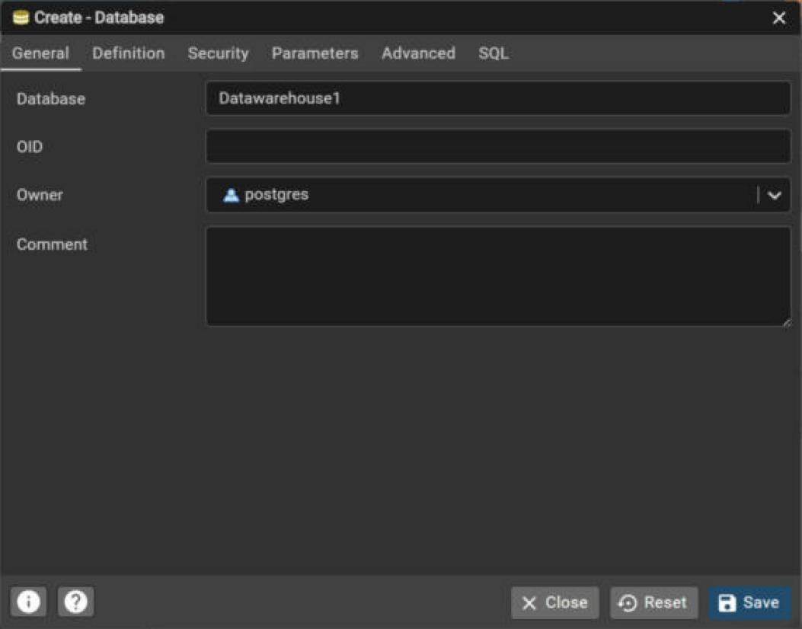](parte1_carga_inicial/figuras/fig01_crear_base_datos.jpg)

**Figura 1.** Creación de la base de datos Datawarehouse1 en pgAdmin. Archivo: [fig01_crear_base_datos.jpg](parte1_carga_inicial/figuras/fig01_crear_base_datos.jpg)

[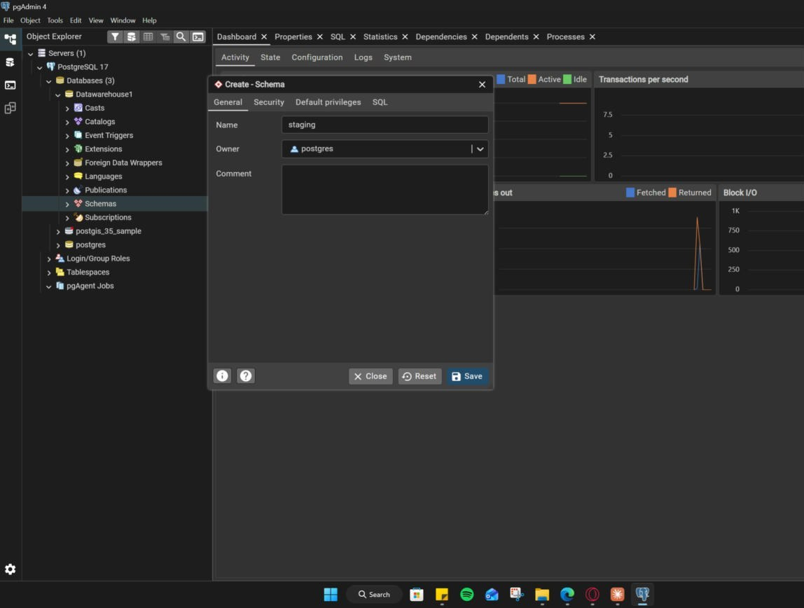](parte1_carga_inicial/figuras/fig02_crear_esquema_staging.jpg)

**Figura 2.** Creación del esquema staging dentro de Datawarehouse1. Archivo: [fig02_crear_esquema_staging.jpg](parte1_carga_inicial/figuras/fig02_crear_esquema_staging.jpg)

El script [dim_production.sql](parte1_carga_inicial/datos/entrada/dim_production.sql) crea la tabla `staging.dim_production` con cuatro columnas y la llena con diez productos. La Figura 3 lo muestra abierto en el Query Tool y la Figura 4 su ejecución, que insertó las 10 filas.

[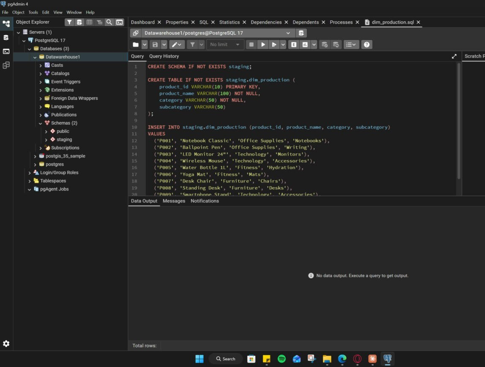](parte1_carga_inicial/figuras/fig03_script_dim_production_cargado.jpg)

**Figura 3.** Script dim_production.sql abierto en el Query Tool de pgAdmin. Archivo: [fig03_script_dim_production_cargado.jpg](parte1_carga_inicial/figuras/fig03_script_dim_production_cargado.jpg)

[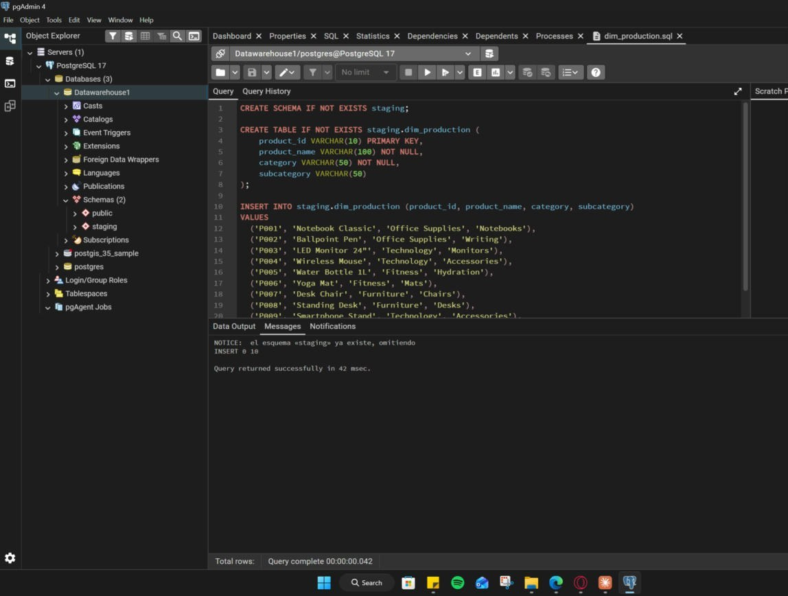](parte1_carga_inicial/figuras/fig04_script_dim_production_ejecutado.jpg)

**Figura 4.** Ejecución del script con 10 filas insertadas. Archivo: [fig04_script_dim_production_ejecutado.jpg](parte1_carga_inicial/figuras/fig04_script_dim_production_ejecutado.jpg)

La consulta de la Figura 5 confirma el contenido de la tabla de origen. El producto P003 aparece con el nombre `LED Monitor 24"`, que es el valor que la transformación debe corregir.

[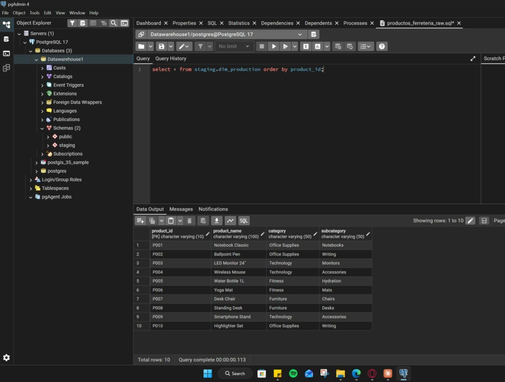](parte1_carga_inicial/figuras/fig05_consulta_dim_production.jpg)

**Figura 5.** Contenido de staging.dim_production antes de la carga. Archivo: [fig05_consulta_dim_production.jpg](parte1_carga_inicial/figuras/fig05_consulta_dim_production.jpg)

### 2.2. Conexión de Pentaho con PostgreSQL

En Spoon se definió una conexión llamada `PostgreSQL Conexion` con los parámetros de la Tabla 3. Todos los pasos de base de datos de las dos transformaciones reutilizan esa misma conexión.

**Tabla 3.** Parámetros de la conexión `PostgreSQL Conexion`

| Parámetro | Valor |
|---|---|
| Tipo de conexión | PostgreSQL |
| Método de acceso | Native JDBC |
| Servidor | localhost |
| Puerto | 5432 |
| Base de datos | Datawarehouse1 |
| Usuario | postgres |
| Contraseña | Variable `${PG_PASSWORD}`, definida en Edit > Set Environment Variables |

La prueba de que la conexión funciona es la vista previa de la Figura 8, que devuelve las diez filas desde la base de datos. El controlador JDBC de PostgreSQL ya viene en la carpeta `lib` de Pentaho.

### 2.3. Transformación de carga inicial

La transformación [01_Carga_Inicial_dim_production.ktr](parte1_carga_inicial/transformaciones/01_Carga_Inicial_dim_production.ktr) sigue la guía [1]. Lee la dimensión, reemplaza el texto `24` por `25` en el nombre del producto y carga el resultado en una tabla nueva. Además se agregó un paso `Salida CSV`, que deja una copia del resultado en [dim_production_new.csv](parte1_carga_inicial/datos/salida/dim_production_new.csv) para poder revisarlo y validarlo sin conectarse a la base. La Figura 6 muestra el flujo y la Tabla 4 resume cada paso.

[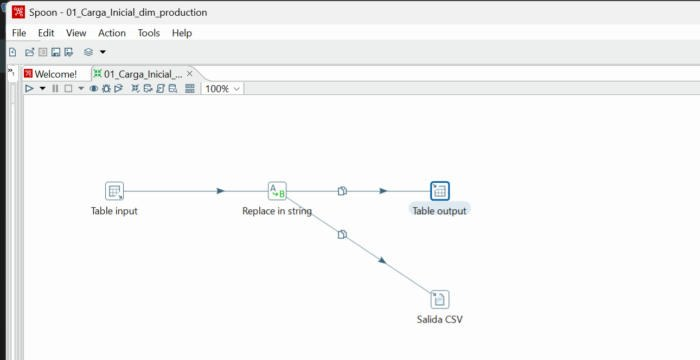](parte1_carga_inicial/figuras/fig06_transformacion_carga_inicial.jpg)

**Figura 6.** Transformación de carga inicial en el lienzo de Spoon. Archivo: [fig06_transformacion_carga_inicial.jpg](parte1_carga_inicial/figuras/fig06_transformacion_carga_inicial.jpg)

**Tabla 4.** Pasos de la transformación 01

| Paso | Tipo | Configuración |
|---|---|---|
| Table input | Table input | Conexión `PostgreSQL Conexion` y consulta `SELECT product_id, product_name, category, subcategory FROM staging.dim_production ORDER BY product_id` |
| Replace in string | Replace in string | Campo `product_name`, buscar `24` y reemplazar por `25` |
| Table output | Table output | Esquema `staging`, tabla `dim_production_new`, truncar tabla y especificar campos de la base de datos |
| Salida CSV | Text file output | Archivo `dim_production_new.csv` con separador punto y coma |

Las Figuras 7, 8, 9 y 10 muestran la configuración de los tres primeros pasos y la vista previa de datos.

[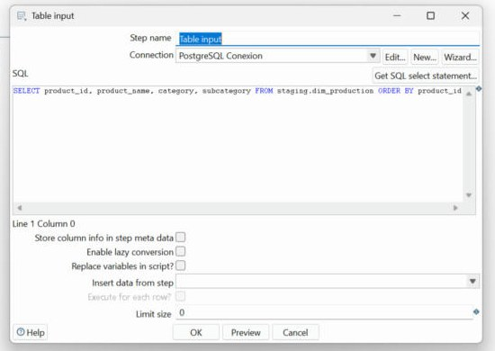](parte1_carga_inicial/figuras/fig07_table_input.jpg)

**Figura 7.** Configuración del paso Table input. Archivo: [fig07_table_input.jpg](parte1_carga_inicial/figuras/fig07_table_input.jpg)

[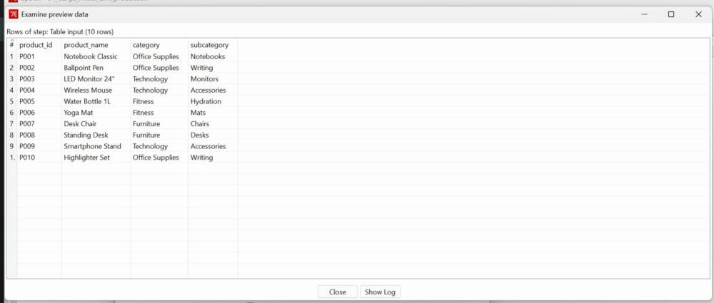](parte1_carga_inicial/figuras/fig08_vista_previa_table_input.jpg)

**Figura 8.** Vista previa de Table input con las 10 filas leídas desde PostgreSQL. Archivo: [fig08_vista_previa_table_input.jpg](parte1_carga_inicial/figuras/fig08_vista_previa_table_input.jpg)

[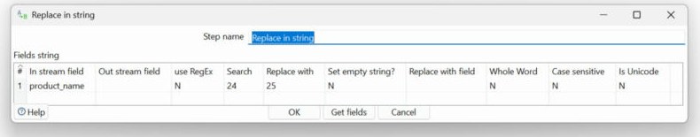](parte1_carga_inicial/figuras/fig09_replace_in_string.jpg)

**Figura 9.** Configuración del paso Replace in string, que cambia 24 por 25 en product_name. Archivo: [fig09_replace_in_string.jpg](parte1_carga_inicial/figuras/fig09_replace_in_string.jpg)

[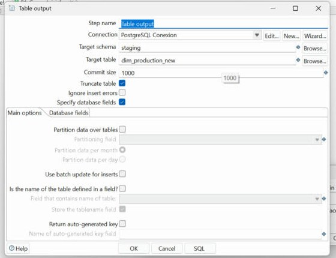](parte1_carga_inicial/figuras/fig10_table_output.jpg)

**Figura 10.** Configuración del paso Table output hacia staging.dim_production_new. Archivo: [fig10_table_output.jpg](parte1_carga_inicial/figuras/fig10_table_output.jpg)

### 2.4. Creación de la tabla de destino y ejecución

La tabla de destino no existe de antemano. Se creó desde el propio paso `Table output` con el botón `SQL`, que genera el `CREATE TABLE` a partir de los campos que llegan al paso, como muestra la Figura 11. Al presionar `Execute` Spoon crea la tabla en PostgreSQL y lo confirma, como muestra la Figura 12.

[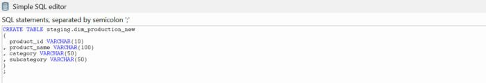](parte1_carga_inicial/figuras/fig11_ddl_generado_dim_production_new.jpg)

**Figura 11.** Sentencia CREATE TABLE que Spoon generó para staging.dim_production_new. Archivo: [fig11_ddl_generado_dim_production_new.jpg](parte1_carga_inicial/figuras/fig11_ddl_generado_dim_production_new.jpg)

[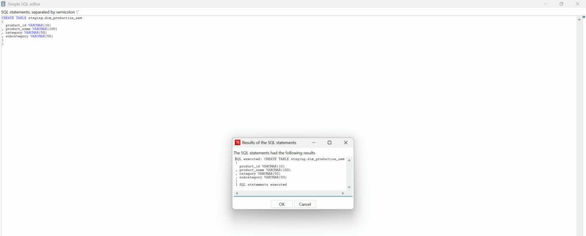](parte1_carga_inicial/figuras/fig12_ddl_ejecutado.jpg)

**Figura 12.** Resultado de ejecutar la sentencia desde Spoon. Archivo: [fig12_ddl_ejecutado.jpg](parte1_carga_inicial/figuras/fig12_ddl_ejecutado.jpg)

Con la tabla creada se ejecutó la transformación. La Figura 13 muestra el cuadro de opciones de ejecución, la Figura 14 el registro de la ejecución y la Figura 15 las métricas por paso, con la Tabla 5 como resumen.

[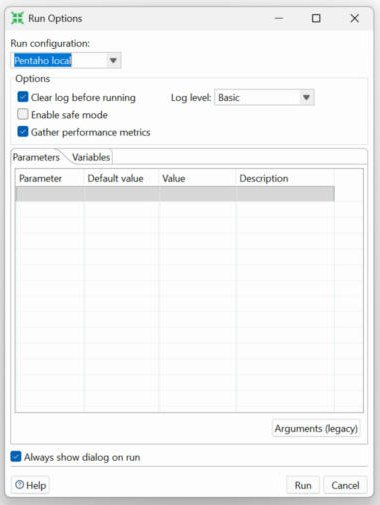](parte1_carga_inicial/figuras/fig13_opciones_de_ejecucion.jpg)

**Figura 13.** Opciones de ejecución de la transformación en Spoon. Archivo: [fig13_opciones_de_ejecucion.jpg](parte1_carga_inicial/figuras/fig13_opciones_de_ejecucion.jpg)

[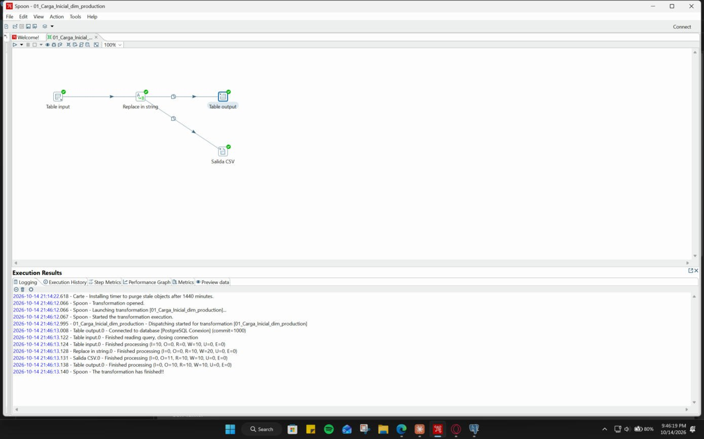](parte1_carga_inicial/figuras/fig14_ejecucion_logging.jpg)

**Figura 14.** Ejecución de la transformación 01 con todos los pasos finalizados. Archivo: [fig14_ejecucion_logging.jpg](parte1_carga_inicial/figuras/fig14_ejecucion_logging.jpg)

[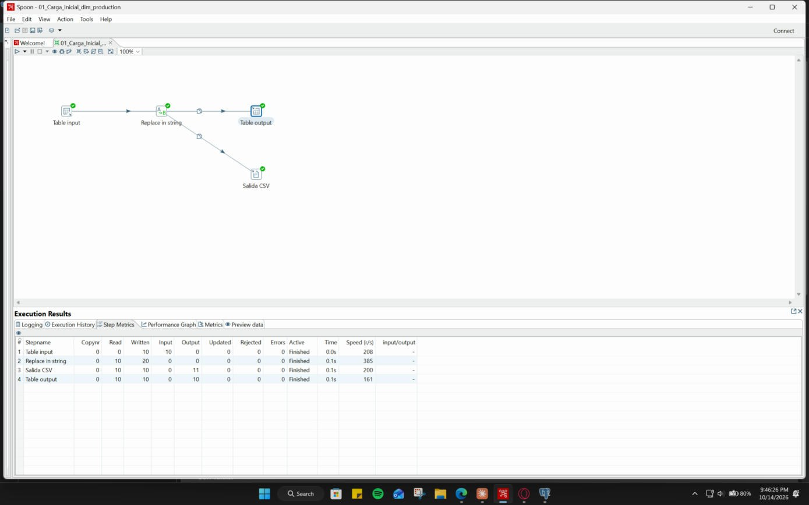](parte1_carga_inicial/figuras/fig15_metricas_por_paso.jpg)

**Figura 15.** Métricas por paso de la transformación 01. Archivo: [fig15_metricas_por_paso.jpg](parte1_carga_inicial/figuras/fig15_metricas_por_paso.jpg)

**Tabla 5.** Métricas de ejecución de la transformación 01

| Paso | Filas leídas | Filas escritas | Errores |
|---|---|---|---|
| Table input | 0 | 10 | 0 |
| Replace in string | 10 | 20 | 0 |
| Salida CSV | 10 | 10 | 0 |
| Table output | 10 | 10 | 0 |

El paso `Replace in string` figura con 20 filas escritas porque entrega su flujo a dos pasos distintos, `Table output` y `Salida CSV`, y cada fila se cuenta una vez por destino.

### 2.5. Verificación en pgAdmin

La Figura 16 muestra la consulta `select * from staging.dim_production_new` en pgAdmin. La tabla tiene las 10 filas y el producto P003 ahora se llama `LED Monitor 25"`. Las demás filas no cambiaron, porque ningún otro nombre contiene el texto `24`.

[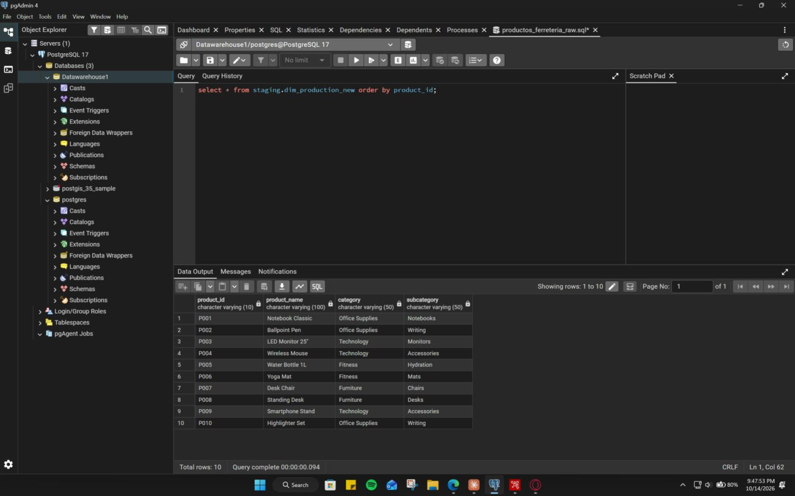](parte1_carga_inicial/figuras/fig16_verificacion_dim_production_new.jpg)

**Figura 16.** Contenido de staging.dim_production_new después de la carga. Archivo: [fig16_verificacion_dim_production_new.jpg](parte1_carga_inicial/figuras/fig16_verificacion_dim_production_new.jpg)

---

## 3. Parte 2: ETL para la ferretería El Tornillo Feliz

### 3.1. Planteamiento

La ferretería El Tornillo Feliz registra sus productos en una tabla donde cada sucursal escribe los datos a su manera [1]. El trabajo grupal pide unificar los nombres de categoría, quitar el signo de dólar del precio y estandarizar la unidad de medida, y cargar el resultado en una tabla limpia. El proceso toma la tabla `staging.productos_ferreteria_raw` y escribe en `staging.productos_ferreteria_clean`.

### 3.2. Datos de origen y problemas encontrados

El script [productos_ferreteria_raw.sql](parte2_ferreteria/datos/entrada/productos_ferreteria_raw.sql) crea la tabla cruda con todas sus columnas como texto y la llena con 100 productos. El mismo contenido está en [productos_ferreteria_raw.csv](parte2_ferreteria/datos/entrada/productos_ferreteria_raw.csv), que usa el script de validación. La Figura 17 muestra la ejecución del script, con 100 filas insertadas, y la Figura 18 la consulta de verificación.

[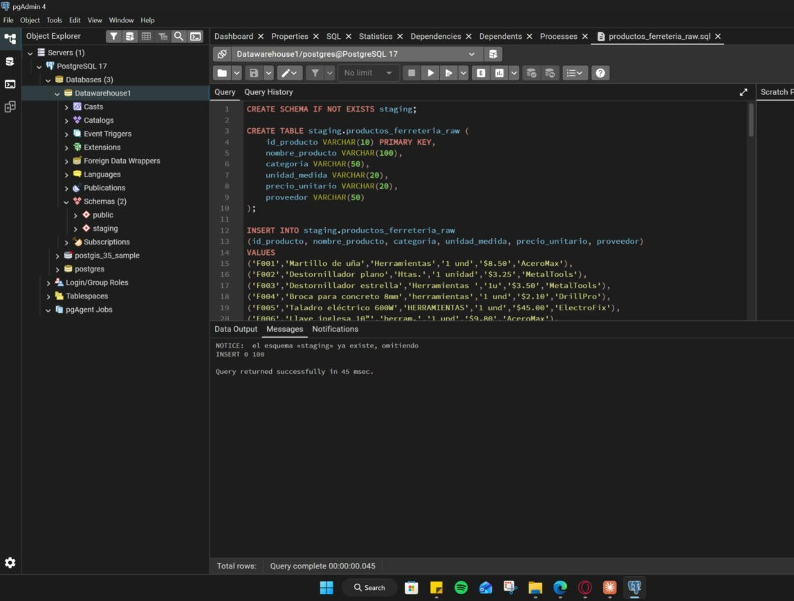](parte2_ferreteria/figuras/fig17_script_productos_raw_ejecutado.jpg)

**Figura 17.** Ejecución del script productos_ferreteria_raw.sql con 100 filas insertadas. Archivo: [fig17_script_productos_raw_ejecutado.jpg](parte2_ferreteria/figuras/fig17_script_productos_raw_ejecutado.jpg)

[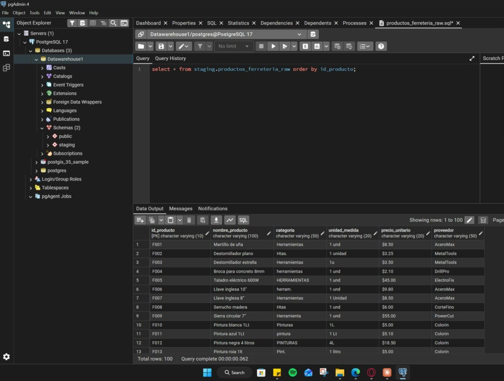](parte2_ferreteria/figuras/fig18_consulta_productos_raw.jpg)

**Figura 18.** Contenido de staging.productos_ferreteria_raw antes de la limpieza. Archivo: [fig18_consulta_productos_raw.jpg](parte2_ferreteria/figuras/fig18_consulta_productos_raw.jpg)

Al revisar los 100 registros se encontraron los problemas de la Tabla 6.

**Tabla 6.** Problemas encontrados en la tabla cruda

| Problema | Ejemplo | Alcance |
|---|---|---|
| Una misma categoría escrita de muchas formas | `Herramientas`, `herramientas`, `HERRAMIENTAS`, `Htas.`, `herram.` | 44 valores distintos para 8 categorías reales, y 68 de 100 filas con una forma no estándar |
| Espacios sobrantes | `Herramientas ` con un espacio al final, en el producto F003 | 1 fila, pero basta para que se cuente como una categoría distinta |
| Signo de moneda dentro del precio | `$8.50` | 100 de 100 filas, así que el precio no se puede usar como número |
| Unidad de medida con formas distintas | `1 und`, `1 unidad`, `1u` | 22 valores distintos para 10 unidades reales |
| Cantidad pegada a la unidad | `1 Lt`, `4L` | La cantidad y la unidad vienen en un solo campo |
| Unidad sin cantidad | `Caja`, `CJ` | 13 filas sin número |

### 3.3. Reglas de transformación

Las reglas siguen el orden en que se aplican. Primero se pasa a minúsculas y se recortan los espacios de la categoría y de la unidad, para que `Htas.` y `htas.` se traten igual. Después se traduce cada variante a un valor único con un paso `Value mapper` [2]. La Tabla 7 muestra las equivalencias de categoría y la Tabla 8 las de unidad.

**Tabla 7.** Equivalencias de categoría

| Categoría final | Variantes reconocidas en minúsculas |
|---|---|
| Herramientas | herramientas, herramienta, herram., htas, htas. |
| Pinturas | pinturas, pintura, pint, pint. |
| Ferretería | ferreteria, ferretería, ferre |
| Fontanería | fontaneria, fontanería |
| Electricidad | electricidad, electric., electr. |
| Seguridad | seguridad |
| Adhesivos | adhesivos, adhesivo |
| Selladores | selladores, sellador |

**Tabla 8.** Equivalencias de unidad de medida

| Unidad final | Variantes reconocidas en minúsculas |
|---|---|
| UND | und, unidad, u |
| L | l, lt, litro |
| ROLLO | rollo, rl |
| CAJA | caja, cj |
| M | m, mt, metro |
| TUBO | tubo |
| FRASCO | frasco |
| HOJA | hoja |
| PAR | par |
| SET | set |

El precio se limpia quitando el símbolo `$`. La unidad, que trae la cantidad pegada, se separa con dos expresiones regulares: una elimina todo lo que no es dígito para obtener la cantidad y la otra elimina dígitos y espacios para obtener el texto de la unidad. Si la unidad no trae número, como en `Caja`, la cantidad queda vacía y un `Value mapper` le asigna el valor 1.

### 3.4. Flujo ETL desarrollado

La transformación [02_ETL_Ferreteria.ktr](parte2_ferreteria/transformaciones/02_ETL_Ferreteria.ktr) tiene un flujo lineal con una derivación para los registros que no pasan la validación. La Figura 19 la muestra completa y la Tabla 9 describe cada paso.

[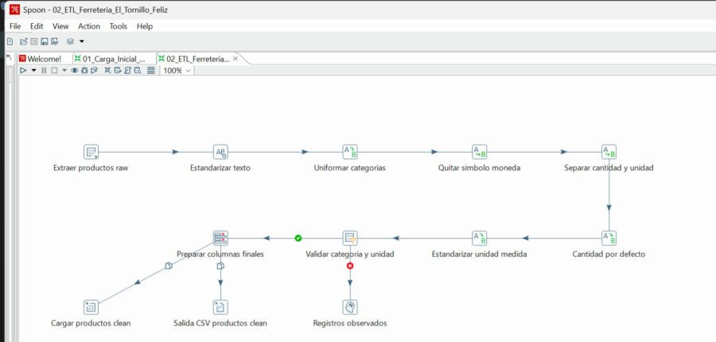](parte2_ferreteria/figuras/fig19_transformacion_ferreteria.jpg)

**Figura 19.** Transformación 02 de la ferretería en el lienzo de Spoon. Archivo: [fig19_transformacion_ferreteria.jpg](parte2_ferreteria/figuras/fig19_transformacion_ferreteria.jpg)

**Tabla 9.** Pasos de la transformación 02

| Orden | Paso | Tipo | Función |
|---|---|---|---|
| 1 | Extraer productos raw | Table input | Lee `staging.productos_ferreteria_raw` ordenada por identificador |
| 2 | Estandarizar texto | String operations | Recorta espacios y pasa a minúsculas la categoría y la unidad |
| 3 | Uniformar categorias | Value mapper | Traduce las variantes a 8 categorías, con `SIN CATEGORIA` como valor por defecto |
| 4 | Quitar simbolo moneda | Replace in string | Elimina el signo `$` del precio |
| 5 | Separar cantidad y unidad | Replace in string | Obtiene la cantidad y el texto de la unidad con expresiones regulares |
| 6 | Cantidad por defecto | Value mapper | Asigna 1 cuando la unidad no trae cantidad |
| 7 | Estandarizar unidad medida | Value mapper | Traduce las variantes a 10 unidades, con `SIN UNIDAD` como valor por defecto |
| 8 | Validar categoria y unidad | Filter rows | Deja pasar solo los registros con categoría y unidad reconocidas |
| 9 | Registros observados | Dummy | Recibe los registros que no pasan la validación |
| 10 | Preparar columnas finales | Select values | Ordena los campos y asigna el tipo de dato de cada uno |
| 11 | Cargar productos clean | Table output | Escribe en `staging.productos_ferreteria_clean` |
| 12 | Salida CSV productos clean | Text file output | Escribe [productos_ferreteria_clean.csv](parte2_ferreteria/datos/salida/productos_ferreteria_clean.csv) |

Las Figuras 20, 21, 22 y 23 muestran la configuración de los pasos que concentran las reglas de limpieza.

[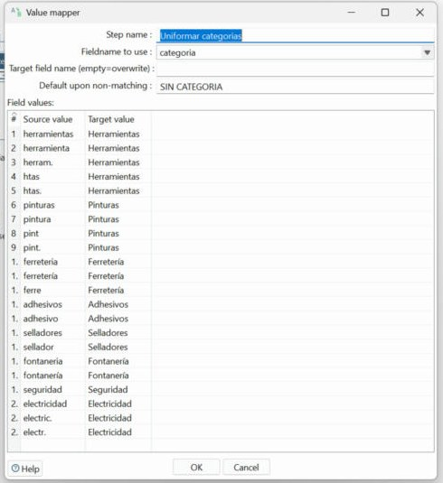](parte2_ferreteria/figuras/fig20_value_mapper_categorias.jpg)

**Figura 20.** Paso Uniformar categorias con las 22 equivalencias de categoría. Archivo: [fig20_value_mapper_categorias.jpg](parte2_ferreteria/figuras/fig20_value_mapper_categorias.jpg)

[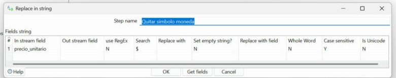](parte2_ferreteria/figuras/fig21_quitar_simbolo_moneda.jpg)

**Figura 21.** Paso Quitar simbolo moneda, que elimina el signo de dólar del precio. Archivo: [fig21_quitar_simbolo_moneda.jpg](parte2_ferreteria/figuras/fig21_quitar_simbolo_moneda.jpg)

[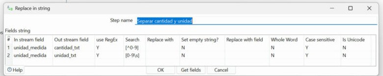](parte2_ferreteria/figuras/fig22_separar_cantidad_y_unidad.jpg)

**Figura 22.** Paso Separar cantidad y unidad con dos expresiones regulares. Archivo: [fig22_separar_cantidad_y_unidad.jpg](parte2_ferreteria/figuras/fig22_separar_cantidad_y_unidad.jpg)

[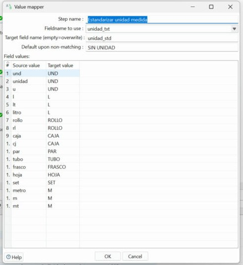](parte2_ferreteria/figuras/fig23_value_mapper_unidades.jpg)

**Figura 23.** Paso Estandarizar unidad medida con las 18 equivalencias de unidad. Archivo: [fig23_value_mapper_unidades.jpg](parte2_ferreteria/figuras/fig23_value_mapper_unidades.jpg)

El paso `Validar categoria y unidad` funciona como una cuarentena. Si en el futuro llega una categoría o unidad nueva que el catálogo no conoce, el `Value mapper` la marca con `SIN CATEGORIA` o `SIN UNIDAD` y el filtro la desvía a `Registros observados` en lugar de cargarla en la tabla limpia. En esta ejecución ningún registro fue desviado.

### 3.5. Ejecución en Spoon

La tabla `staging.productos_ferreteria_clean` se creó igual que en la Parte 1, con el botón `SQL` del paso `Table output`. La Figura 24 muestra la sentencia que generó Spoon, con los tipos `VARCHAR`, `INTEGER` y `NUMERIC`, y la Figura 25 la confirmación de su ejecución.

[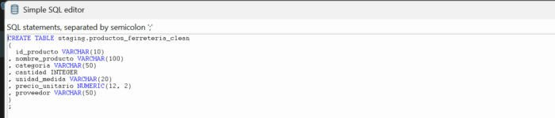](parte2_ferreteria/figuras/fig24_ddl_generado_productos_clean.jpg)

**Figura 24.** Sentencia CREATE TABLE que Spoon generó para staging.productos_ferreteria_clean. Archivo: [fig24_ddl_generado_productos_clean.jpg](parte2_ferreteria/figuras/fig24_ddl_generado_productos_clean.jpg)

[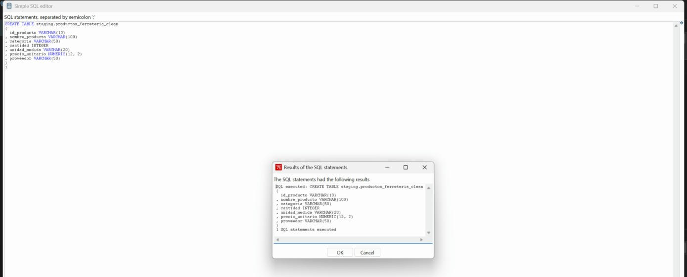](parte2_ferreteria/figuras/fig25_ddl_ejecutado.jpg)

**Figura 25.** Resultado de ejecutar la sentencia desde Spoon. Archivo: [fig25_ddl_ejecutado.jpg](parte2_ferreteria/figuras/fig25_ddl_ejecutado.jpg)

La Figura 26 muestra las opciones de ejecución, la Figura 27 el registro con todos los pasos marcados como finalizados y la Figura 28 las métricas por paso. La Tabla 10 las resume.

**Figura 26.** Opciones de ejecución de la transformación 02. Archivo: [fig26_opciones_de_ejecucion.jpg](parte2_ferreteria/figuras/fig26_opciones_de_ejecucion.jpg)

[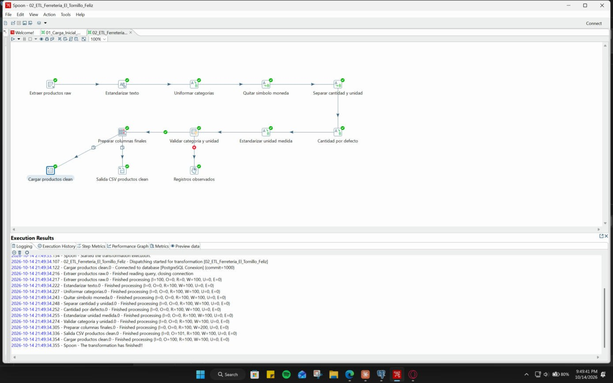](parte2_ferreteria/figuras/fig27_ejecucion_logging.jpg)

**Figura 27.** Ejecución de la transformación 02 con todos los pasos finalizados. Archivo: [fig27_ejecucion_logging.jpg](parte2_ferreteria/figuras/fig27_ejecucion_logging.jpg)

[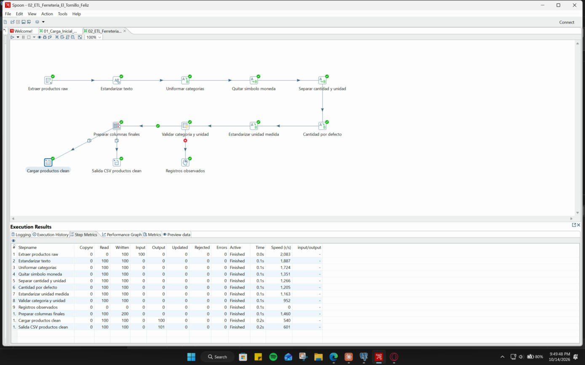](parte2_ferreteria/figuras/fig28_metricas_por_paso.jpg)

**Figura 28.** Métricas por paso de la transformación 02. Archivo: [fig28_metricas_por_paso.jpg](parte2_ferreteria/figuras/fig28_metricas_por_paso.jpg)

**Tabla 10.** Métricas de ejecución de la transformación 02

| Paso | Filas leídas | Filas escritas | Errores |
|---|---|---|---|
| Extraer productos raw | 0 | 100 | 0 |
| Estandarizar texto | 100 | 100 | 0 |
| Uniformar categorias | 100 | 100 | 0 |
| Quitar simbolo moneda | 100 | 100 | 0 |
| Separar cantidad y unidad | 100 | 100 | 0 |
| Cantidad por defecto | 100 | 100 | 0 |
| Estandarizar unidad medida | 100 | 100 | 0 |
| Validar categoria y unidad | 100 | 100 | 0 |
| Registros observados | 0 | 0 | 0 |
| Preparar columnas finales | 100 | 200 | 0 |
| Cargar productos clean | 100 | 100 | 0 |
| Salida CSV productos clean | 100 | 100 | 0 |

### 3.6. Resultado en la base de datos

La Figura 29 muestra la tabla limpia en pgAdmin. El precio ya es un número, la cantidad es un entero y las categorías y unidades usan un solo formato. Por ejemplo, el producto F012, que en el origen decía `4L`, quedó con cantidad 4 y unidad `L`.

[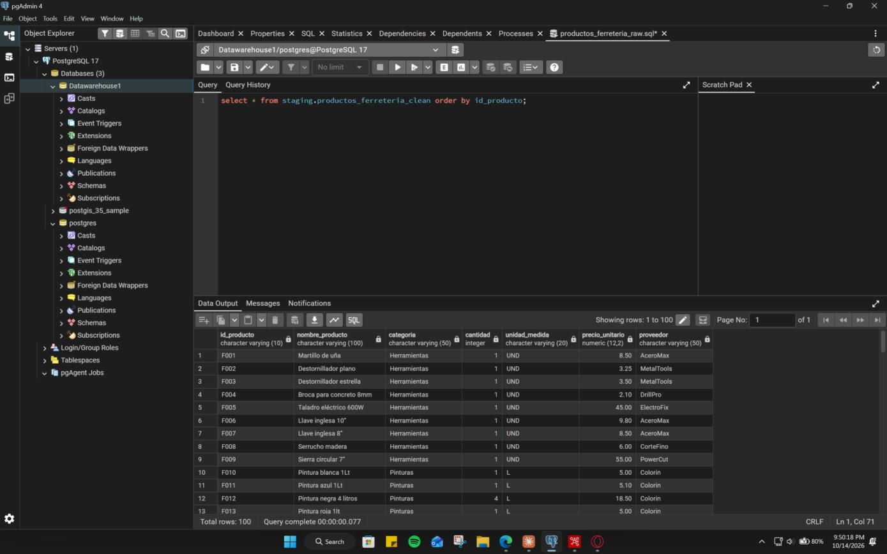](parte2_ferreteria/figuras/fig29_consulta_productos_clean.jpg)

**Figura 29.** Contenido de staging.productos_ferreteria_clean después de la carga. Archivo: [fig29_consulta_productos_clean.jpg](parte2_ferreteria/figuras/fig29_consulta_productos_clean.jpg)

La Figura 30 compara las dos tablas con una sola consulta, y la Tabla 11 recoge el efecto de la limpieza.

[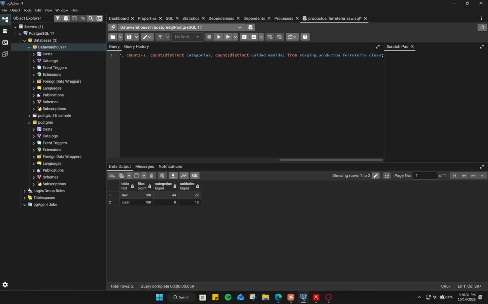](parte2_ferreteria/figuras/fig30_comparacion_raw_vs_clean.jpg)

**Figura 30.** Comparación de filas, categorías y unidades entre la tabla cruda y la limpia. Archivo: [fig30_comparacion_raw_vs_clean.jpg](parte2_ferreteria/figuras/fig30_comparacion_raw_vs_clean.jpg)

**Tabla 11.** Efecto de la limpieza

| Indicador | Antes | Después |
|---|---|---|
| Filas | 100 | 100 |
| Categorías distintas | 44 | 8 |
| Unidades distintas | 22 | 10 |
| Filas con símbolo de moneda en el precio | 100 | 0 |
| Tipo del precio | Texto | `NUMERIC(12, 2)` |

La Tabla 12 muestra cómo quedaron repartidos los productos por categoría.

**Tabla 12.** Productos por categoría en la tabla limpia

| Categoría | Productos |
|---|---|
| Ferretería | 22 |
| Herramientas | 21 |
| Pinturas | 20 |
| Fontanería | 12 |
| Electricidad | 9 |
| Seguridad | 7 |
| Adhesivos | 5 |
| Selladores | 4 |

### 3.7. Validación de los resultados

Los scripts [validar_resultados.py](parte1_carga_inicial/validacion/validar_resultados.py) de la Parte 1 y [validar_resultados.py](parte2_ferreteria/validacion/validar_resultados.py) de la Parte 2 recalculan el resultado en Python a partir de los datos de origen, sin usar nada de lo que produjo Pentaho, y lo comparan campo por campo con los CSV que escribió Spoon. Se ejecutaron sobre los archivos generados en esta práctica y todos los controles de la Tabla 13 resultaron correctos.

**Tabla 13.** Validación de los resultados

| Control | Resultado |
|---|---|
| Parte 1: filas cargadas frente a filas de origen | 10 de 10 |
| Parte 1: productos con `24` reemplazado por `25` | 1, el producto P003 |
| Parte 1: coincidencia campo por campo con el cálculo independiente | Correcta |
| Parte 2: filas cargadas frente a filas de origen | 100 de 100 |
| Parte 2: categorías distintas antes y después | 44 y 8 |
| Parte 2: unidades distintas antes y después | 22 y 10 |
| Parte 2: coincidencia campo por campo con el cálculo independiente | Correcta, incluidos cantidad, unidad y precio |
| Parte 2: símbolos de moneda en la salida | 0 |

### 3.8. Relación con la arquitectura de un Data Warehouse

La Figura 31 ubica el proceso dentro de la arquitectura de un Data Warehouse, en la que los datos pasan de las fuentes a una Staging Area, luego por la transformación y finalmente al almacén y a los Data Marts [3].

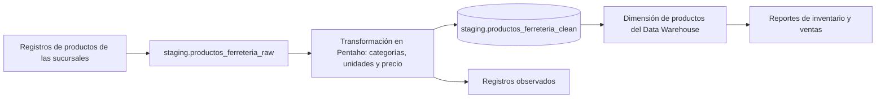

**Figura 31.** Ubicación del proceso en la arquitectura de un Data Warehouse

La tabla cruda cumple la función de Staging Area, porque guarda los datos tal como llegaron, todo como texto, sin perder información antes de procesarla [4]. La tabla limpia es el resultado conformado: cada categoría y cada unidad tiene un único valor, así que cualquier consulta puede agrupar por ellas sin tratar variantes. Con esta tabla se puede construir una dimensión de productos, con categoría, unidad y proveedor, que se relacionaría con una tabla de hechos de ventas o de inventario en un modelo dimensional [3].

---

## 4. Conclusiones

La carga inicial de la Parte 1 mostró el recorrido completo de un proceso ETL hacia un área de staging: conexión a la base, lectura, transformación y escritura en una tabla creada desde la propia herramienta. El reemplazo de texto corrigió el único producto afectado y dejó intactos los otros nueve.

En la Parte 2, un catálogo de equivalencias aplicado con `Value mapper` redujo 44 formas de escribir la categoría a 8 y 22 formas de escribir la unidad a 10, sin perder ninguno de los 100 registros. Separar la cantidad de la unidad y convertir el precio a número dejó la tabla lista para consultas y cálculos.

Incluir un filtro de validación con una salida de registros observados hace que el proceso siga siendo seguro cuando lleguen datos nuevos: lo que el catálogo no reconoce no entra a la tabla limpia.

Los scripts de validación, que repiten el cálculo de forma independiente, dan seguridad de que lo cargado en PostgreSQL y en los archivos de salida es correcto.

---

## 5. Referencias

[1] Escuela Politécnica Nacional, Facultad de Ingeniería de Sistemas, "Práctica 2. ETL Initial Load," guía de práctica de la asignatura Business Intelligence, Quito, Ecuador, 2026.

[2] Hitachi Vantara, "Try Pentaho Data Integration and Analytics," *Pentaho Documentation*. [En línea]. Disponible en: https://docs.pentaho.com/pdia-try-pdia/. [Accedido: 14-oct-2026].

[3] R. Kimball y M. Ross, *The Data Warehouse Toolkit: The Definitive Guide to Dimensional Modeling*, 3.ª ed. Indianapolis, IN, EE. UU.: Wiley, 2013.

[4] R. Kimball y J. Caserta, *The Data Warehouse ETL Toolkit: Practical Techniques for Extracting, Cleaning, Conforming, and Delivering Data*. Indianapolis, IN, EE. UU.: Wiley, 2004.

[5] PostgreSQL Global Development Group, "5.10. Schemas," *PostgreSQL 17 Documentation*. [En línea]. Disponible en: https://www.postgresql.org/docs/17/ddl-schemas.html. [Accedido: 14-oct-2026].

[6] pgAdmin Development Team, "Query Tool," *pgAdmin 4 Documentation*. [En línea]. Disponible en: https://www.pgadmin.org/docs/pgadmin4/latest/query_tool.html. [Accedido: 14-oct-2026].

[7] Hitachi Vantara, "PDI transformation steps," *Pentaho Data Integration 10.2 Documentation*. [En línea]. Disponible en: https://docs.pentaho.com/pdia-data-integration/10.2-data-integration/pdi-transformation-steps-reference-overview. [Accedido: 14-oct-2026].

---

## 6. Declaración de uso de inteligencia artificial

En la elaboración de este trabajo se utilizó el asistente de inteligencia artificial Claude como apoyo para la redaccion del informe markdown. El resto como capturas y ejecucion paso a paso fue autoría de los estudiantes responsables de este informe.

**Porcentaje de uso de inteligencia artificial: 30% %**
