# Práctica 4: Implementación física de una dimensión para un modelo estrella en PostgreSQL

**Universidad:** Escuela Politécnica Nacional

**Facultad:** Facultad de Ingeniería de Sistemas

**Asignatura:** Business Intelligence

**Paralelo:** GR2SW

**Integrantes:**

- Elian Daniel Caizapanta Caiza
- Brandon Javier Pallo Chango
- Alexis Eduardo Sotomayor Llerena
- Francisco Javier Torres Negrete

**Fecha de entrega:** 27 de octubre de 2026

**Herramientas:** PostgreSQL 17, pgAdmin 4 y Microsoft Excel con Power Pivot

---

## Índice

1. [Organización del trabajo](#1-organización-del-trabajo)
2. [Análisis y diseño dimensional](#2-análisis-y-diseño-dimensional)
   1. [Qué contiene cada archivo](#21-qué-contiene-cada-archivo)
   2. [Respuestas de diseño para products.csv](#22-respuestas-de-diseño-para-productscsv)
3. [Parte 1: dimensión de productos con products.csv](#3-parte-1-dimensión-de-productos-con-productscsv)
   1. [Entorno y creación de las tablas](#31-entorno-y-creación-de-las-tablas)
   2. [Importación de products.csv](#32-importación-de-productscsv)
   3. [Validación del conjunto importado](#33-validación-del-conjunto-importado)
   4. [Calidad de los datos y limpieza](#34-calidad-de-los-datos-y-limpieza)
   5. [Identificadores duplicados y nulos](#35-identificadores-duplicados-y-nulos)
   6. [Carga de la dimensión](#36-carga-de-la-dimensión)
   7. [Consultas de análisis](#37-consultas-de-análisis)
   8. [Por qué category y subcategory permanecen en la dimensión](#38-por-qué-category-y-subcategory-permanecen-en-la-dimensión)
4. [Parte 2: modelo estrella de ventas](#4-parte-2-modelo-estrella-de-ventas)
   1. [Análisis de la tabla desnormalizada](#41-análisis-de-la-tabla-desnormalizada)
   2. [Decisiones de diseño](#42-decisiones-de-diseño)
   3. [Diagrama en Power Pivot](#43-diagrama-en-power-pivot)
   4. [Diagrama entidad relación en pgAdmin](#44-diagrama-entidad-relación-en-pgadmin)
   5. [Script DDL](#45-script-ddl)
   6. [Importación al área de staging](#46-importación-al-área-de-staging)
   7. [Script DML de limpieza y carga](#47-script-dml-de-limpieza-y-carga)
   8. [Consultas de negocio](#48-consultas-de-negocio)
5. [Conclusiones](#5-conclusiones)
6. [Referencias](#6-referencias)
7. [Declaración de uso de inteligencia artificial](#7-declaración-de-uso-de-inteligencia-artificial)

---

## 1. Organización del trabajo

La práctica pide implementar físicamente una dimensión de productos en PostgreSQL a partir de `products.csv` y, en grupo, modelar como estrella la tabla desnormalizada de ventas, con su diagrama en Power Pivot, sus scripts DDL y DML y las respuestas a cinco consultas de negocio [1]. El trabajo se dividió en dos partes, como muestra la Tabla 1.

**Tabla 1.** División del trabajo

| Parte | Qué cubre | Fuente | Destino |
|---|---|---|---|
| Parte 1 | Práctica guiada: staging, limpieza y carga de la dimensión de productos | `products.csv` con 699 filas | `stg_products` y `dim_product` en el esquema `public` |
| Parte 2 | Trabajo en grupo: modelo estrella de ventas | `Tabla_Desnormalizada_Ventas.csv` con 100 filas | `stg_ventas`, tres dimensiones y `fact_sales` en el esquema `dw_ventas` |

La Tabla 2 enumera el contenido del repositorio, con enlaces directos a cada archivo. Ningún archivo contiene contraseñas: la conexión de pgAdmin se guarda en el propio programa y no forma parte de los entregables.

**Tabla 2.** Estructura de la carpeta de la práctica

| Carpeta | Archivos |
|---|---|
| [datos/entrada](datos/entrada/) | [products.csv](datos/entrada/products.csv), [Tabla_Desnormalizada_Ventas.csv](datos/entrada/Tabla_Desnormalizada_Ventas.csv) |
| [sql](sql/) | [01_ddl_parte1_dim_product.sql](sql/01_ddl_parte1_dim_product.sql), [02_dml_parte1_limpieza_carga.sql](sql/02_dml_parte1_limpieza_carga.sql), [03_consultas_parte1_dim_product.sql](sql/03_consultas_parte1_dim_product.sql), [04_ddl_parte2_estrella_ventas.sql](sql/04_ddl_parte2_estrella_ventas.sql), [05_dml_parte2_limpieza_carga.sql](sql/05_dml_parte2_limpieza_carga.sql), [06_consultas_parte2_ventas.sql](sql/06_consultas_parte2_ventas.sql) |
| [diagrama](diagrama/) | [Modelo_Estrella_Ventas.xlsx](diagrama/Modelo_Estrella_Ventas.xlsx), libro de Excel con el Modelo de datos de Power Pivot |
| [datos/salida](datos/salida/) | [dim_product.csv](datos/salida/dim_product.csv) y los resultados de las consultas: [consulta 1](datos/salida/consulta1_ventas_por_categoria_y_mes.csv), [consulta 1 por mes del año](datos/salida/consulta1b_ventas_por_categoria_y_mes_del_anio.csv), [consulta 2](datos/salida/consulta2_ingreso_por_cliente_y_genero.csv), [consulta 3](datos/salida/consulta3_cantidad_por_producto.csv), [consulta 4](datos/salida/consulta4_cantidad_enviada_por_mes_de_envio.csv), [consulta 4 por mes del año](datos/salida/consulta4b_cantidad_enviada_por_mes_del_anio.csv), [consulta 5](datos/salida/consulta5_ventas_por_tamano_y_estado_civil.csv) |
| [figuras](figuras/) | Figuras 1 a 51 del informe |
| [validacion](validacion/) | [validar_resultados.py](validacion/validar_resultados.py) |

---

## 2. Análisis y diseño dimensional

### 2.1. Qué contiene cada archivo

Antes de escribir SQL conviene decidir qué representa cada archivo dentro de un modelo dimensional [2].

`products.csv` tiene 699 filas con cuatro columnas: identificador, nombre con marca, categoría y subcategoría. Describe productos, pero no registra ningún evento ni medida: no hay cantidades, importes ni fechas. Por eso sirve para construir una dimensión y no una tabla de hechos, como advierte la nota conceptual de la guía [1].

`Tabla_Desnormalizada_Ventas.csv` tiene 100 filas y 26 columnas separadas por punto y coma. Cada fila es una línea de un pedido y repite en la misma fila los datos del producto, del cliente, las dos fechas del pedido y las medidas. Es el caso típico de una tabla desnormalizada que se debe descomponer en un esquema estrella.

Los dos archivos son catálogos distintos. Los identificadores del archivo de ventas, que van de 105 a 144 con códigos de producto como P104, no corresponden a los de `products.csv`, que tienen la forma P0000 y describen productos de una tienda de abarrotes. Los nombres del archivo de ventas son del tipo Product 5 y sus categorías son Accessories y Electronics. Por eso la Parte 2 define su propia dimensión de producto y no intenta unir ambos archivos: cualquier unión por el número del identificador relacionaría productos que no tienen nada en común.

### 2.2. Respuestas de diseño para products.csv

La Tabla 3 reproduce las preguntas de diseño de la guía y la respuesta que se obtiene del archivo [1].

**Tabla 3.** Preguntas de diseño dimensional para `products.csv`

| Pregunta | Respuesta |
|---|---|
| ¿Qué entidad describe? | Producto |
| ¿Contiene un evento de negocio? | No. No existen ventas, pedidos, reservas ni otro evento transaccional |
| ¿Contiene medidas? | No. No hay cantidad, monto, costo ni descuento |
| Rol en un modelo estrella | Dimensión de producto, `dim_product` |

La estructura objetivo de la dimensión se resume en la Tabla 4. La clave primaria es una clave sustituta generada por la base de datos, de modo que el almacén no dependa del identificador del sistema fuente [2].

**Tabla 4.** Estructura de `stg_products` y de `dim_product`

| Columna | Tipo | En `stg_products` | En `dim_product` |
|---|---|---|---|
| `product_key` | `BIGSERIAL` | No existe | Clave primaria sustituta |
| `product_id` | `VARCHAR(5)` | Admite nulos | Clave natural, única y obligatoria |
| `product_name` | `VARCHAR(150)` | Admite nulos | Obligatoria |
| `category` | `VARCHAR(80)` | Admite nulos | Obligatoria |
| `subcategory` | `VARCHAR(80)` | Admite nulos | Obligatoria |

---

## 3. Parte 1: dimensión de productos con products.csv

### 3.1. Entorno y creación de las tablas

Se trabajó en la base de datos `Datawarehouse1` de PostgreSQL 17, dentro del esquema `public`, con el Query Tool de pgAdmin, como muestra la Figura 1.

[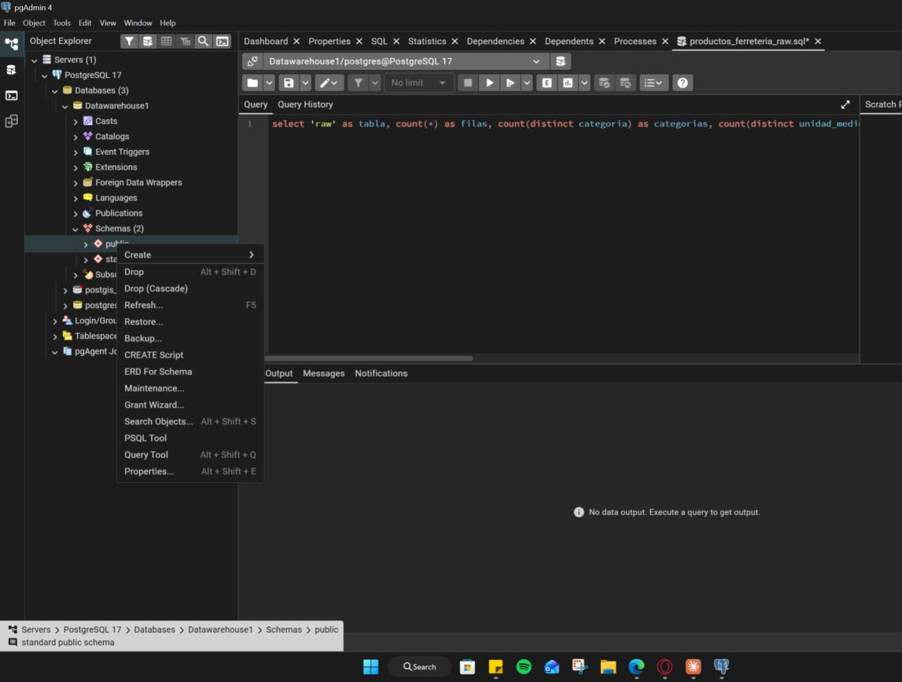](figuras/fig01_menu_query_tool_parte1.jpg)

**Figura 1.** Acceso al Query Tool desde el esquema public de la base Datawarehouse1. Archivo: [fig01_menu_query_tool_parte1.jpg](figuras/fig01_menu_query_tool_parte1.jpg)

El script [01_ddl_parte1_dim_product.sql](sql/01_ddl_parte1_dim_product.sql) crea las dos tablas de la Tabla 4. La tabla de staging no tiene restricciones y usa texto para todas las columnas, de modo que la importación nunca falle por un valor inesperado y los problemas se puedan detectar y corregir con SQL. La Figura 2 muestra el script abierto y la Figura 3 el resultado de su ejecución, que lista las columnas de ambas tablas con su tipo y si admiten nulos.

[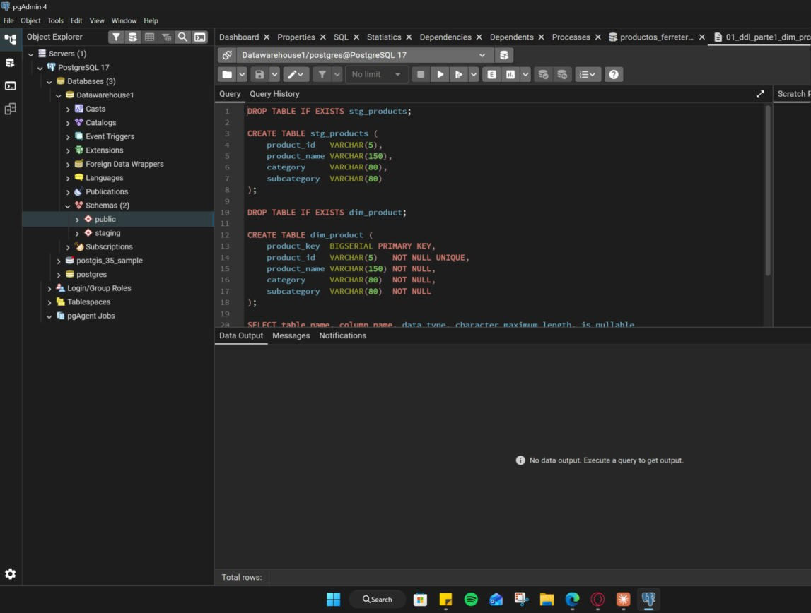](figuras/fig02_ddl_parte1_script.jpg)

**Figura 2.** Script 01_ddl_parte1_dim_product.sql abierto en el Query Tool. Archivo: [fig02_ddl_parte1_script.jpg](figuras/fig02_ddl_parte1_script.jpg)

[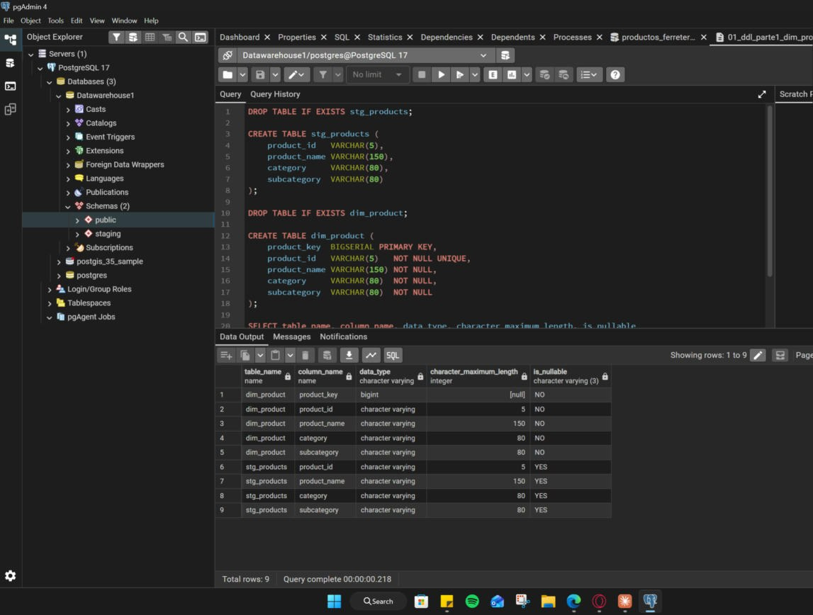](figuras/fig03_ddl_parte1_ejecutado.jpg)

**Figura 3.** Verificación de las columnas de stg_products y dim_product después de crearlas. Archivo: [fig03_ddl_parte1_ejecutado.jpg](figuras/fig03_ddl_parte1_ejecutado.jpg)

### 3.2. Importación de products.csv

La importación se hizo con la herramienta Import/Export Data de pgAdmin, desde el menú contextual de `stg_products`, como muestra la Figura 4. La Tabla 5 documenta la configuración usada, que es lo que pide la actividad grupal.

[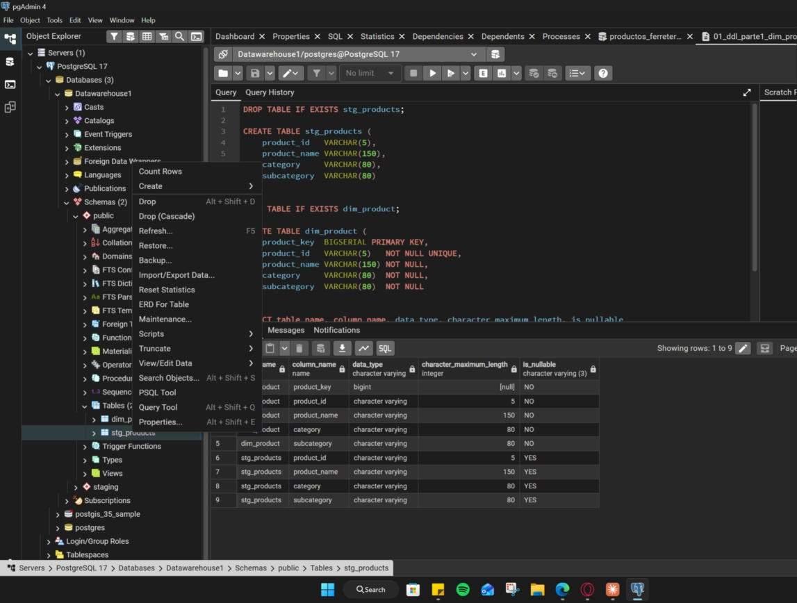](figuras/fig04_menu_import_export_products.jpg)

**Figura 4.** Menú Import/Export Data sobre la tabla stg_products. Archivo: [fig04_menu_import_export_products.jpg](figuras/fig04_menu_import_export_products.jpg)

**Tabla 5.** Configuración de carga de `products.csv` en `stg_products`

| Pestaña | Parámetro | Valor |
|---|---|---|
| General | Import/Export | Import |
| General | Filename | [products.csv](datos/entrada/products.csv) |
| General | Format | csv |
| General | Encoding | UTF8 |
| General | On Error | stop |
| Options | Header | Activado, porque la primera fila trae los nombres de columna |
| Options | Delimiter | Coma |
| Options | Quote | Comillas dobles |
| Options | Escape | Comillas dobles |
| Columns | Columns to import | `product_id`, `product_name`, `category`, `subcategory`, en el orden del archivo |

Las Figuras 5, 6 y 7 muestran las tres pestañas del cuadro de diálogo. Con Header activado, pgAdmin descarta la primera fila y asigna las columnas por posición, así que los nombres del encabezado del archivo, que son `product (brand)` y `sub_category`, no tienen que coincidir con los de la tabla. El valor On Error se dejó en stop para que cualquier fila mal formada detenga la carga en lugar de perderse sin aviso.

[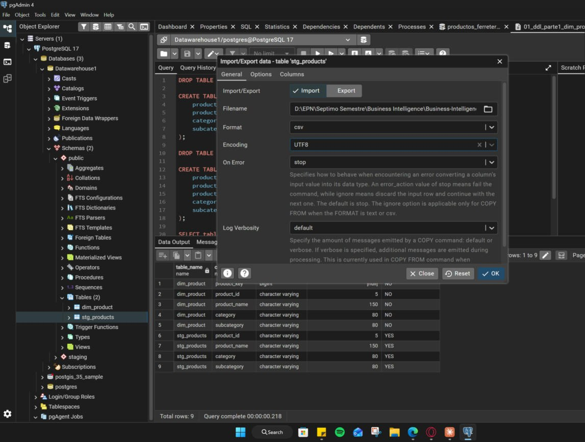](figuras/fig05_import_products_general.jpg)

**Figura 5.** Pestaña General de la importación: formato csv y codificación UTF8. Archivo: [fig05_import_products_general.jpg](figuras/fig05_import_products_general.jpg)

[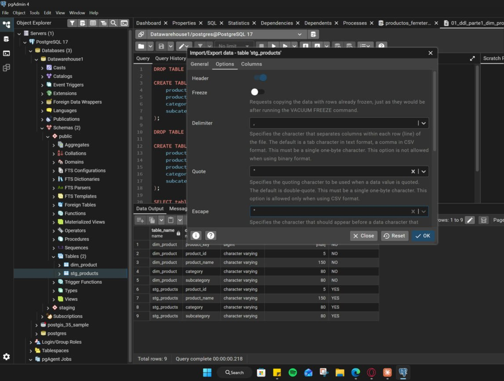](figuras/fig06_import_products_opciones.jpg)

**Figura 6.** Pestaña Options con Header activado, delimitador coma, comillas dobles y escape de comillas dobles. Archivo: [fig06_import_products_opciones.jpg](figuras/fig06_import_products_opciones.jpg)

[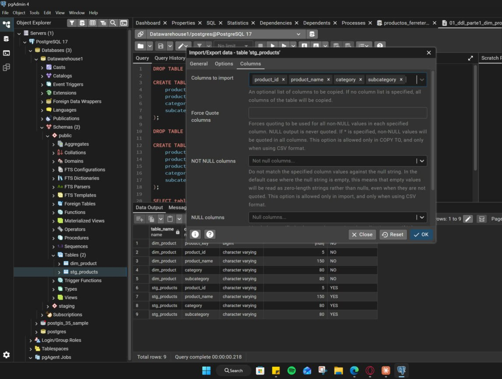](figuras/fig07_import_products_columnas.jpg)

**Figura 7.** Pestaña Columns con las cuatro columnas de destino. Archivo: [fig07_import_products_columnas.jpg](figuras/fig07_import_products_columnas.jpg)

La Figura 8 muestra la notificación de proceso completado.

[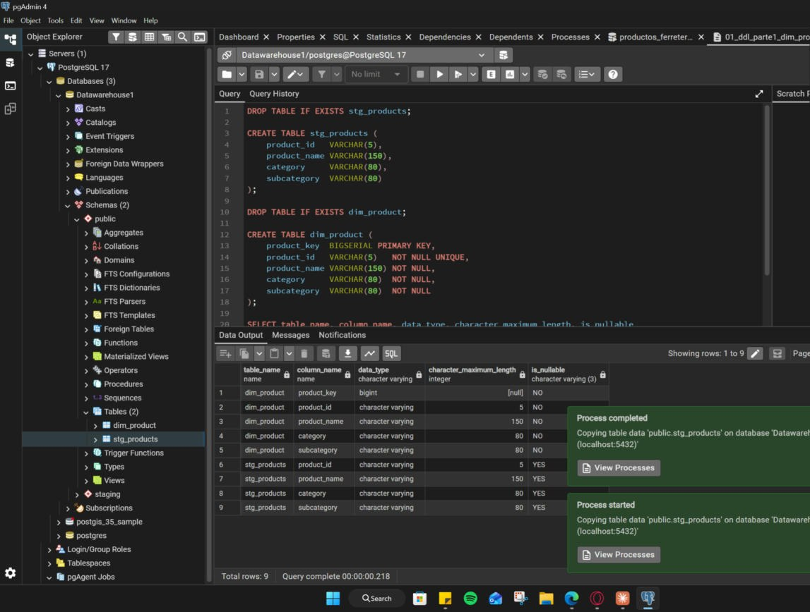](figuras/fig08_import_products_completado.jpg)

**Figura 8.** Notificación de proceso completado de la importación. Archivo: [fig08_import_products_completado.jpg](figuras/fig08_import_products_completado.jpg)

### 3.3. Validación del conjunto importado

El script [02_dml_parte1_limpieza_carga.sql](sql/02_dml_parte1_limpieza_carga.sql) empieza con una consulta que reúne las tres validaciones de la guía: número de registros, identificadores únicos, y categorías y subcategorías distintas [1]. La Figura 9 muestra el resultado y la Tabla 6 lo compara con lo esperado.

[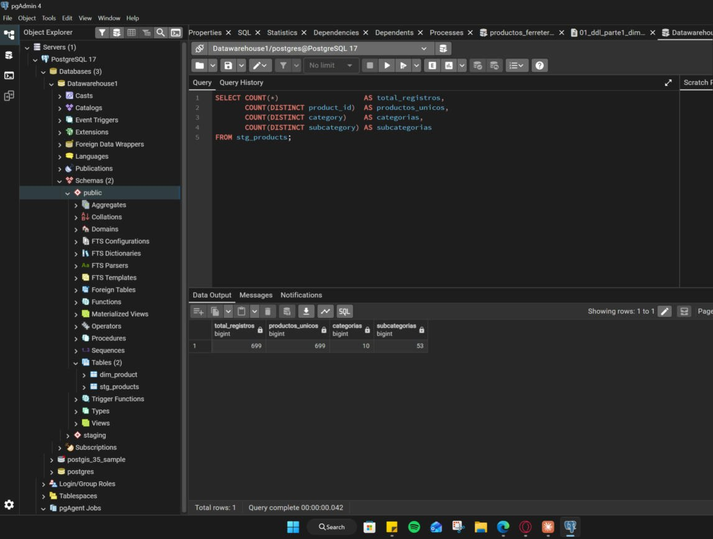](figuras/fig09_validacion_conteos_stg_products.jpg)

**Figura 9.** Conteos de validación de stg_products: 699 registros, 699 identificadores únicos, 10 categorías y 53 subcategorías. Archivo: [fig09_validacion_conteos_stg_products.jpg](figuras/fig09_validacion_conteos_stg_products.jpg)

**Tabla 6.** Validación de `stg_products` frente a lo esperado

| Control | Esperado | Obtenido |
|---|---|---|
| Registros | 699 | 699 |
| Identificadores de producto únicos | 699 | 699 |
| Categorías | 10 | 10 |
| Subcategorías | 53 | 53 |

### 3.4. Calidad de los datos y limpieza

La guía indica que los nombres traen tabulaciones y espacios repetidos y propone `regexp_replace(btrim(product_name), '\s+', ' ', 'g')`. Al medir el problema antes de limpiar se encontró que la fórmula de la guía no cubre todos los casos. La consulta diagnóstica cuenta los nombres con cuatro tipos de anomalía, la Figura 10 muestra los valores antes de la limpieza y la Tabla 7 los compara con los valores posteriores.

[](figuras/fig10_diagnostico_antes_de_limpiar.jpg)

**Figura 10.** Diagnóstico de caracteres problemáticos en product_name antes de la limpieza. Archivo: [fig10_diagnostico_antes_de_limpiar.jpg](figuras/fig10_diagnostico_antes_de_limpiar.jpg)

**Tabla 7.** Anomalías de `product_name` en `stg_products`

| Anomalía | Antes de limpiar | Después de limpiar |
|---|---|---|
| Nombres con tabulación | 5 | 0 |
| Nombres con espacio no separable, `chr(160)` | 6 | 0 |
| Nombres con espacios repetidos | 12 | 0 |
| Nombres con espacios al inicio o al final | 4 | 0 |

Hay dos casos que la fórmula de la guía no resuelve:

- **El orden de `btrim` y `regexp_replace`.** `btrim` solo quita espacios, no tabulaciones. En el nombre `\tserum\t (Livon)`, que empieza con una tabulación, la fórmula de la guía deja un espacio al inicio después de reemplazar la tabulación. Aplicar `btrim` después de `regexp_replace` elimina el problema.
- **El espacio no separable.** Seis nombres, como `Dish Shine\xa0Bar (Exo)`, contienen el carácter 160, que parece un espacio pero es otro código. Según el sistema operativo del servidor, `\s` puede no reconocerlo. Se convierte primero en un espacio normal con `translate`.

Por eso la limpieza aplicada sobre staging, y no sobre el archivo fuente, es la siguiente:

```sql
UPDATE stg_products
SET product_name = btrim(regexp_replace(translate(product_name, chr(160), ' '), '\s+', ' ', 'g')),
    category     = btrim(category),
    subcategory  = btrim(subcategory);
```

La Figura 11 muestra la actualización de las 699 filas y la Figura 12 repite el diagnóstico, con los cuatro contadores en cero. La función `regexp_replace` y la clase `\s` se describen en la documentación de PostgreSQL [4].

[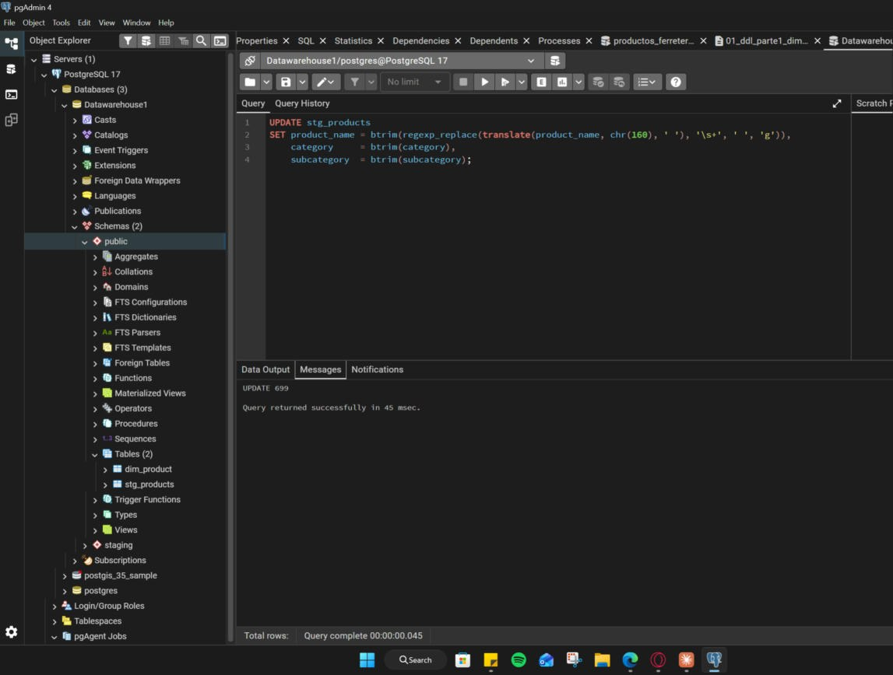](figuras/fig11_update_limpieza_stg_products.jpg)

**Figura 11.** Actualización de limpieza sobre staging con 699 filas modificadas. Archivo: [fig11_update_limpieza_stg_products.jpg](figuras/fig11_update_limpieza_stg_products.jpg)

[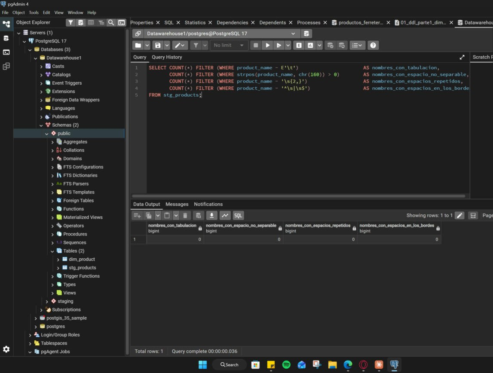](figuras/fig12_diagnostico_despues_de_limpiar.jpg)

**Figura 12.** Diagnóstico después de la limpieza, con los cuatro contadores en cero. Archivo: [fig12_diagnostico_despues_de_limpiar.jpg](figuras/fig12_diagnostico_despues_de_limpiar.jpg)

Un cuarto hallazgo no se corrige porque no es un problema de espacios: el producto P0748 tiene como nombre solo ` ()`, es decir, un nombre vacío con el paréntesis de la marca. Se conserva tal como llega y queda señalado, porque inventar un nombre sería peor que mostrar el dato faltante.

### 3.5. Identificadores duplicados y nulos

La guía pide comprobar que no existan identificadores nulos ni duplicados antes de cargar la dimensión [1]. Una sola consulta devuelve ambos contadores y la Figura 13 muestra que los dos son cero.

[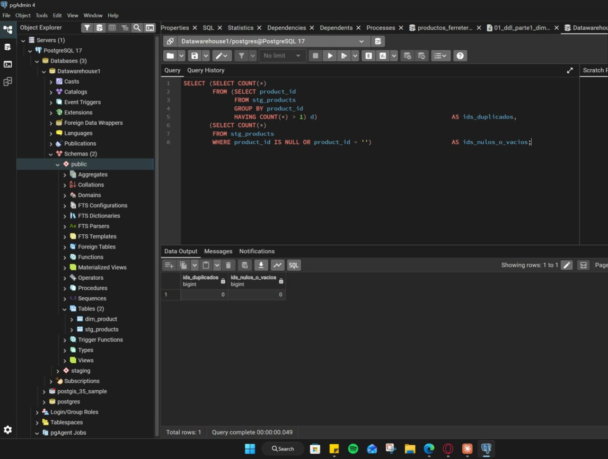](figuras/fig13_duplicados_y_nulos_stg_products.jpg)

**Figura 13.** Verificación de identificadores duplicados y nulos en stg_products. Archivo: [fig13_duplicados_y_nulos_stg_products.jpg](figuras/fig13_duplicados_y_nulos_stg_products.jpg)

### 3.6. Carga de la dimensión

La dimensión se crea en el script [01_ddl_parte1_dim_product.sql](sql/01_ddl_parte1_dim_product.sql) con `product_key BIGSERIAL PRIMARY KEY`, que asigna la clave sustituta de forma automática a cada fila nueva [5], y con `product_id` como clave natural única. La carga usa `SELECT DISTINCT` desde staging y ordena por `product_id`, de modo que las claves sustitutas quedan asignadas de 1 a 699 en ese orden.

```sql
INSERT INTO dim_product
    (product_id, product_name, category, subcategory)
SELECT DISTINCT
    product_id, product_name, category, subcategory
FROM stg_products
ORDER BY product_id;
```

La Figura 14 muestra la inserción de 699 filas y la Figura 15 el conteo de la dimensión. La Figura 16 muestra las primeras 20 filas, donde se ve que `product_key` es independiente de `product_id`. El archivo [dim_product.csv](datos/salida/dim_product.csv) contiene la dimensión cargada.

[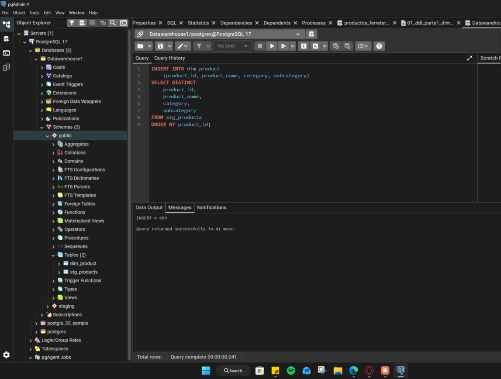](figuras/fig14_insert_dim_product.jpg)

**Figura 14.** Carga de dim_product desde staging con 699 filas insertadas. Archivo: [fig14_insert_dim_product.jpg](figuras/fig14_insert_dim_product.jpg)

[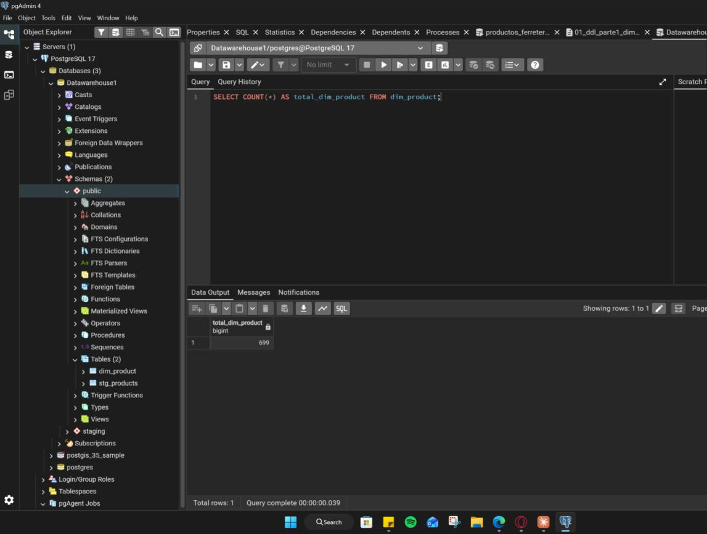](figuras/fig15_conteo_dim_product.jpg)

**Figura 15.** Conteo de filas de dim_product. Archivo: [fig15_conteo_dim_product.jpg](figuras/fig15_conteo_dim_product.jpg)

[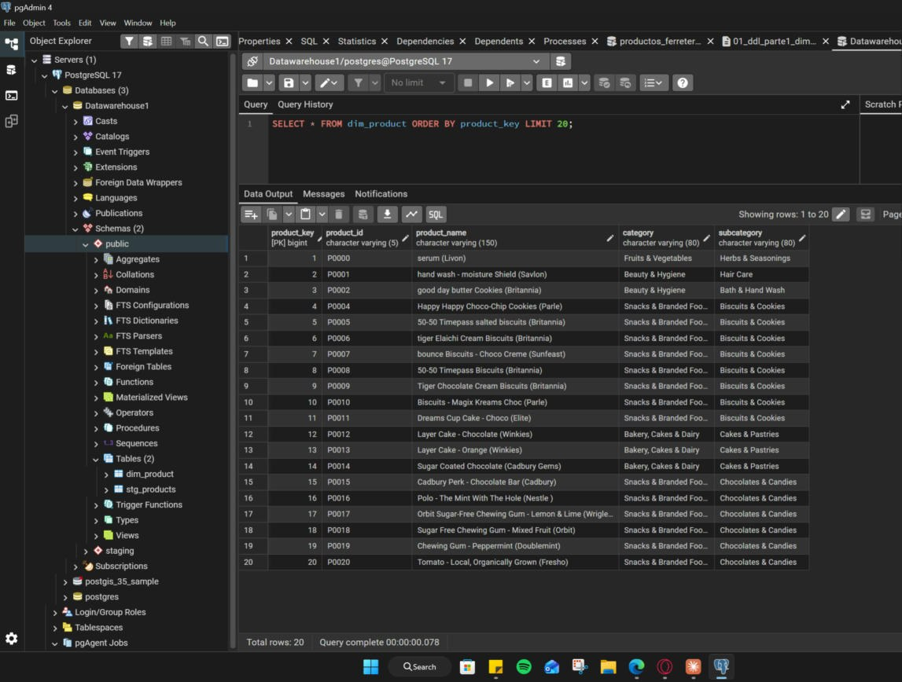](figuras/fig16_muestra_dim_product.jpg)

**Figura 16.** Primeras 20 filas de dim_product con su clave sustituta. Archivo: [fig16_muestra_dim_product.jpg](figuras/fig16_muestra_dim_product.jpg)

### 3.7. Consultas de análisis

Las consultas de la guía, que están en el script [03_consultas_parte1_dim_product.sql](sql/03_consultas_parte1_dim_product.sql), comprueban que los atributos descriptivos de la dimensión sirven directamente para agrupar y filtrar.

La consulta 9.1 cuenta los productos por categoría. La Figura 17 muestra el resultado y la Tabla 8 lo resume.

[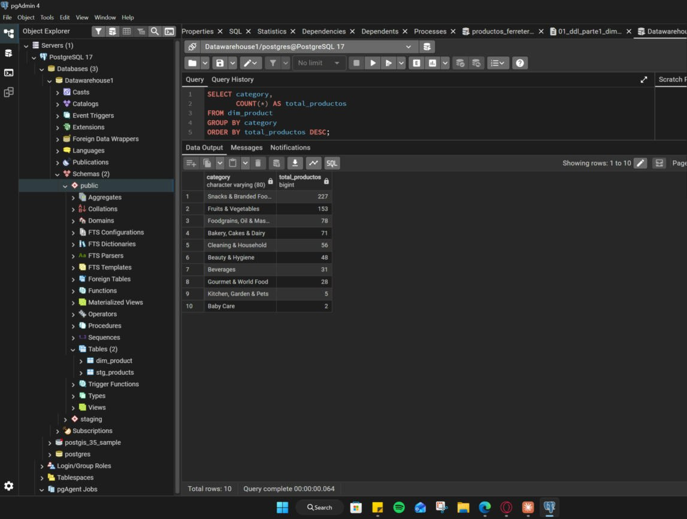](figuras/fig17_consulta_9_1_por_categoria.jpg)

**Figura 17.** Consulta 9.1: productos por categoría. Archivo: [fig17_consulta_9_1_por_categoria.jpg](figuras/fig17_consulta_9_1_por_categoria.jpg)

**Tabla 8.** Productos por categoría, consulta 9.1

| Categoría | Productos |
|---|---|
| Snacks & Branded Foods | 227 |
| Fruits & Vegetables | 153 |
| Foodgrains, Oil & Masala | 78 |
| Bakery, Cakes & Dairy | 71 |
| Cleaning & Household | 56 |
| Beauty & Hygiene | 48 |
| Beverages | 31 |
| Gourmet & World Food | 28 |
| Kitchen, Garden & Pets | 5 |
| Baby Care | 2 |
| **Total** | **699** |

La consulta 9.2 hace lo mismo por subcategoría y devuelve 53 filas. La Figura 18 muestra el resultado y la Tabla 9 recoge las cinco subcategorías con más productos.

[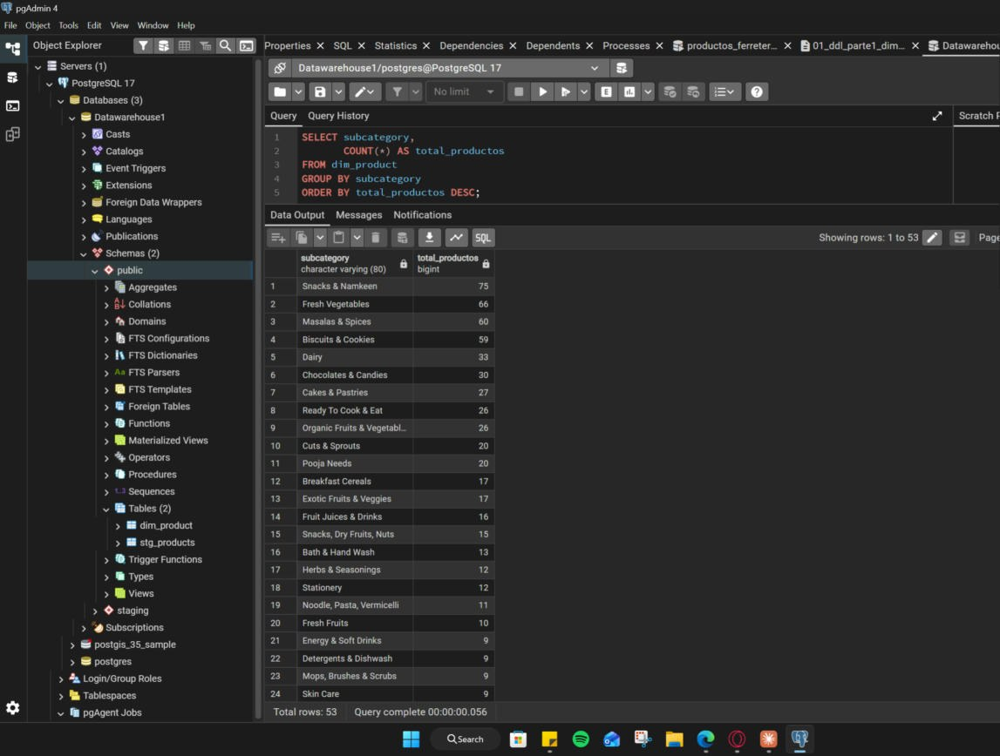](figuras/fig18_consulta_9_2_por_subcategoria.jpg)

**Figura 18.** Consulta 9.2: productos por subcategoría. Archivo: [fig18_consulta_9_2_por_subcategoria.jpg](figuras/fig18_consulta_9_2_por_subcategoria.jpg)

**Tabla 9.** Subcategorías con más productos, consulta 9.2

| Subcategoría | Productos |
|---|---|
| Snacks & Namkeen | 75 |
| Fresh Vegetables | 66 |
| Masalas & Spices | 60 |
| Biscuits & Cookies | 59 |
| Dairy | 33 |

La consulta 9.3 lista los 48 productos de la categoría Beauty & Hygiene, ordenados por nombre, como muestra la Figura 19. La consulta 9.4 lista los 59 productos de la subcategoría Biscuits & Cookies, como muestra la Figura 20. Ambas consultas filtran con un atributo de la dimensión, sin unir ninguna otra tabla.

[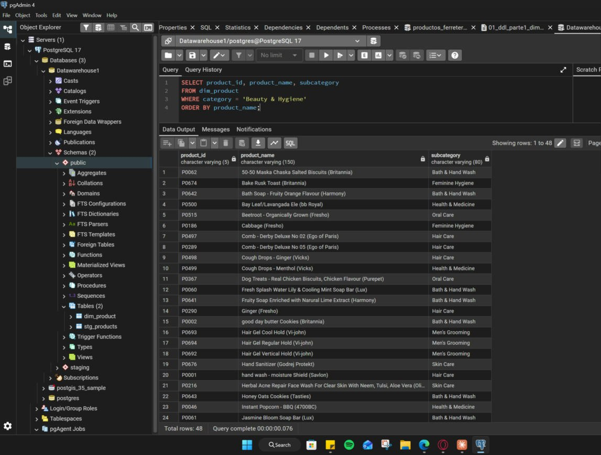](figuras/fig19_consulta_9_3_beauty_hygiene.jpg)

**Figura 19.** Consulta 9.3: productos de la categoría Beauty & Hygiene. Archivo: [fig19_consulta_9_3_beauty_hygiene.jpg](figuras/fig19_consulta_9_3_beauty_hygiene.jpg)

[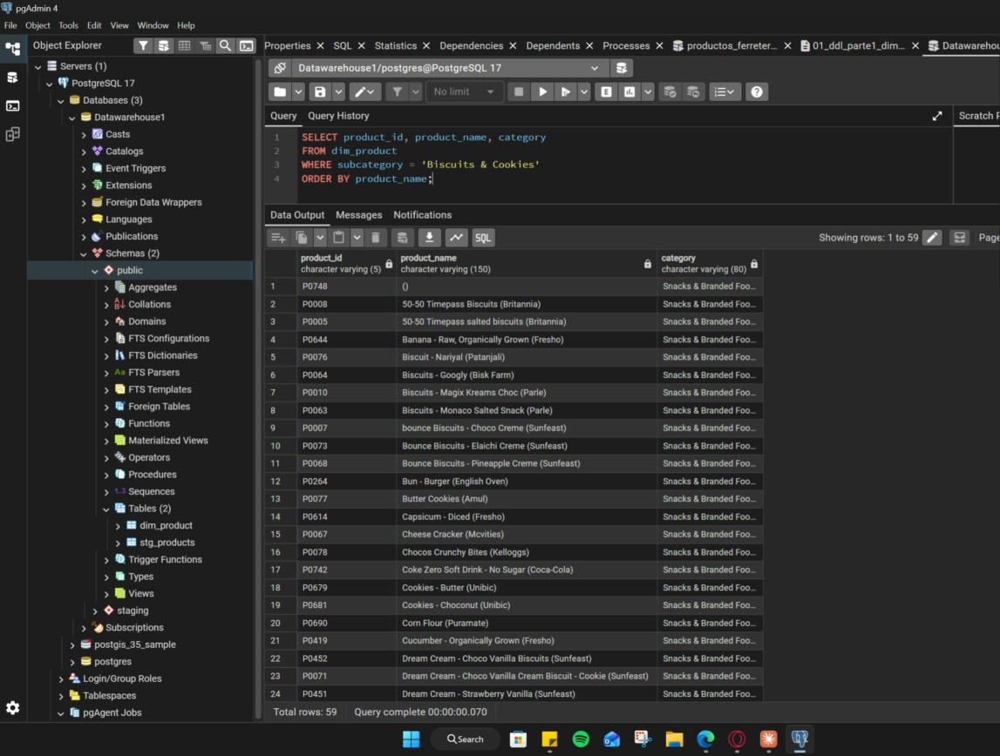](figuras/fig20_consulta_9_4_biscuits_cookies.jpg)

**Figura 20.** Consulta 9.4: productos de la subcategoría Biscuits & Cookies. Archivo: [fig20_consulta_9_4_biscuits_cookies.jpg](figuras/fig20_consulta_9_4_biscuits_cookies.jpg)

La consulta 9.5 cuenta cuántas subcategorías distintas tiene cada categoría. La Figura 21 muestra el resultado y la Tabla 10 lo resume.

[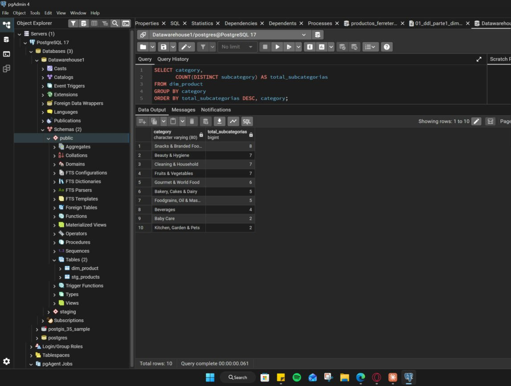](figuras/fig21_consulta_9_5_subcategorias_por_categoria.jpg)

**Figura 21.** Consulta 9.5: número de subcategorías por categoría. Archivo: [fig21_consulta_9_5_subcategorias_por_categoria.jpg](figuras/fig21_consulta_9_5_subcategorias_por_categoria.jpg)

**Tabla 10.** Subcategorías por categoría, consulta 9.5

| Categoría | Subcategorías |
|---|---|
| Snacks & Branded Foods | 8 |
| Beauty & Hygiene | 7 |
| Cleaning & Household | 7 |
| Fruits & Vegetables | 7 |
| Gourmet & World Food | 6 |
| Bakery, Cakes & Dairy | 5 |
| Foodgrains, Oil & Masala | 5 |
| Beverages | 4 |
| Baby Care | 2 |
| Kitchen, Garden & Pets | 2 |
| **Total** | **53** |

### 3.8. Por qué category y subcategory permanecen en la dimensión

En un esquema estrella las dimensiones se diseñan para facilitar el análisis, no para minimizar la repetición de datos [2]. Conservar la categoría y la subcategoría dentro de `dim_product` permite que una consulta agrupe o filtre con una sola unión entre la tabla de hechos y la dimensión, como hacen las consultas 9.1 a 9.5, que no necesitan ninguna unión adicional. Que el texto Beauty & Hygiene se repita en 48 filas no es un problema, porque la dimensión es pequeña frente a la tabla de hechos y porque esa repetición es el costo de tener las consultas más simples.

Separar la categoría y la subcategoría en tablas independientes sería una decisión de normalización. Acercaría el diseño a un esquema copo de nieve, con más tablas y más uniones en cada consulta, que es justo lo que esta práctica busca evitar al reforzar el esquema estrella simple [1], [2].

---

## 4. Parte 2: modelo estrella de ventas

### 4.1. Análisis de la tabla desnormalizada

La Tabla 11 asigna cada una de las 26 columnas de `Tabla_Desnormalizada_Ventas.csv` al elemento del modelo donde debe vivir.

**Tabla 11.** Destino de cada columna de la tabla desnormalizada

| Columnas del archivo | Elemento del modelo | Columna destino |
|---|---|---|
| `ProductKey` | `dim_product` | `product_id`, clave natural |
| `Product Code`, `Product Name`, `List Price`, `Color`, `Size`, `Category`, `Subcategory` | `dim_product` | `product_code`, `product_name`, `list_price`, `color`, `size`, `category`, `subcategory` |
| `CustomerKey` | `dim_customer` | `customer_id`, clave natural |
| `Birth Date`, `Marital Status`, `Gender`, `Income`, `Children`, `Home Owner`, `Cars` | `dim_customer` | `birth_date`, `marital_status`, `gender`, `income`, `children`, `home_owner`, `cars` |
| `OrderDateKey`, `Order Date` | `dim_date` | `date_key` y `full_date`, usada como fecha de pedido |
| `ShipDateKey`, `Ship Date` | `dim_date` | `date_key` y `full_date`, usada como fecha de envío |
| `OrderNumber`, `OrderLineNumber` | `fact_sales` | `order_number` y `order_line_number`, que forman la clave primaria |
| `Quantity`, `UnitPrice`, `ProductCost`, `SalesAmount` | `fact_sales` | `quantity`, `unit_price`, `product_cost`, `sales_amount`, que son las medidas |

El perfil de los datos, que se calculó en la Figura 34 con staging, es el siguiente: 100 filas, 100 órdenes con una sola línea cada una, 9 productos, 10 clientes, 61 fechas de pedido distintas entre enero de 2022 y diciembre de 2025, y 86 fechas de envío distintas. El envío ocurre entre 1 y 3 días después del pedido.

### 4.2. Decisiones de diseño

La Tabla 12 resume las decisiones del modelo y la razón de cada una.

**Tabla 12.** Decisiones de diseño del modelo estrella

| Decisión | Resolución | Razón |
|---|---|---|
| Granularidad de la tabla de hechos | Una fila por línea de pedido | Es el nivel más detallado que trae el archivo y permite responder todas las preguntas de negocio agregando |
| Dimensiones | `dim_product`, `dim_customer` y `dim_date` | Cada una agrupa atributos descriptivos que el archivo repetía en cada fila |
| Medidas | `quantity`, `unit_price`, `product_cost` y `sales_amount` | Son los valores numéricos del evento. Todas son aditivas excepto el precio unitario, que se usa para verificar el importe |
| Número de orden | Columnas `order_number` y `order_line_number` dentro de la tabla de hechos | Es una dimensión degenerada: identifica el pedido, pero no tiene atributos propios que justifiquen una tabla [2] |
| Fechas | Una sola `dim_date` con dos relaciones desde `fact_sales`, `order_date_key` y `ship_date_key` | Es una dimensión con rol: el mismo calendario sirve para fecha de pedido y de envío, sin duplicar la tabla [2] |
| Clave de la dimensión de fecha | Entero con formato `AAAAMMDD` | Es la convención habitual y coincide con las columnas `OrderDateKey` y `ShipDateKey` del archivo [2] |
| Claves de producto y cliente | Claves sustitutas `BIGSERIAL` y clave natural única | Igual que en la Parte 1, el almacén no depende de los identificadores del sistema fuente |
| Calendario | 1461 filas, una por día de 2022 a 2025 | Se generan los años completos y no solo los días con ventas, de modo que la dimensión sirve también para días sin pedidos |
| Esquema | `dw_ventas`, separado de `public` | Los dos modelos tienen una tabla `dim_product` con estructuras distintas, y los esquemas permiten que convivan sin chocar [9] |
| Catálogos | `dim_product` de ventas independiente del de `products.csv` | Los dos archivos describen catálogos distintos, como se explicó en la sección 2.1 |

### 4.3. Diagrama en Power Pivot

El diagrama se construyó en Excel con Power Pivot. Las cuatro tablas del modelo se exportaron de la base de datos a las hojas de [Modelo_Estrella_Ventas.xlsx](diagrama/Modelo_Estrella_Ventas.xlsx), se agregaron al Modelo de datos y se relacionaron en la Vista de diagrama, arrastrando cada clave foránea de `fact_sales` sobre la clave de su dimensión [8]. La Figura 22 muestra el resultado.

[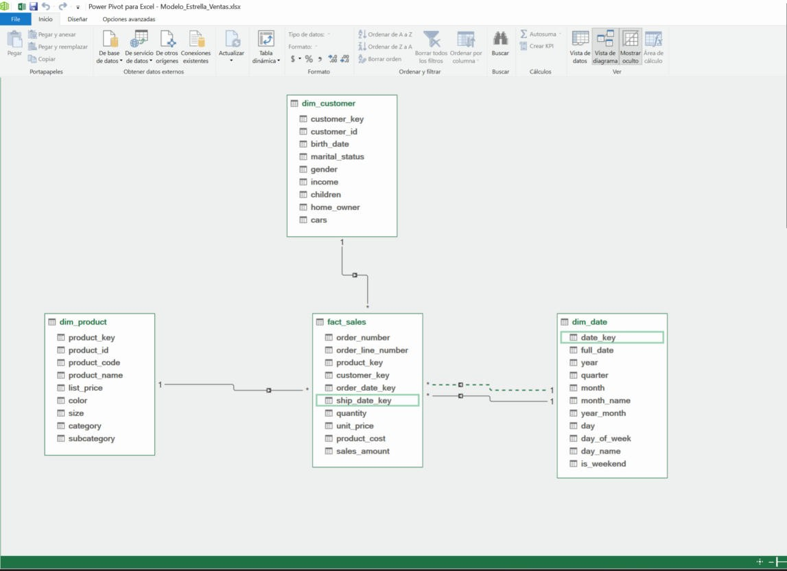](figuras/fig22_diagrama_power_pivot_estrella_ventas.jpg)

**Figura 22.** Diagrama del modelo estrella de ventas en la Vista de diagrama de Power Pivot. Archivo: [fig22_diagrama_power_pivot_estrella_ventas.jpg](figuras/fig22_diagrama_power_pivot_estrella_ventas.jpg)

Las relaciones son de uno a muchos, con la dimensión en el lado uno y `fact_sales` en el lado muchos:

- `dim_product.product_key` con `fact_sales.product_key`.
- `dim_customer.customer_key` con `fact_sales.customer_key`.
- `dim_date.date_key` con `fact_sales.order_date_key`, que es la relación activa.
- `dim_date.date_key` con `fact_sales.ship_date_key`, que aparece con línea punteada porque es inactiva.

Power Pivot solo permite una relación activa entre dos tablas. La relación con la fecha de envío se deja inactiva y se puede activar en una medida con la función `USERELATIONSHIP` [8]. En PostgreSQL no existe esa limitación: las dos claves foráneas tienen la misma validez y las consultas escogen la que necesitan, como en la consulta 4.

### 4.4. Diagrama entidad relación en pgAdmin

La herramienta ERD de pgAdmin genera el diagrama directamente desde las restricciones de la base de datos [7]. La Figura 23 es el resultado para `fact_sales` y sus dimensiones: confirma que las relaciones definidas en el DDL existen en el servidor, incluidas las dos claves foráneas hacia `dim_date`.

[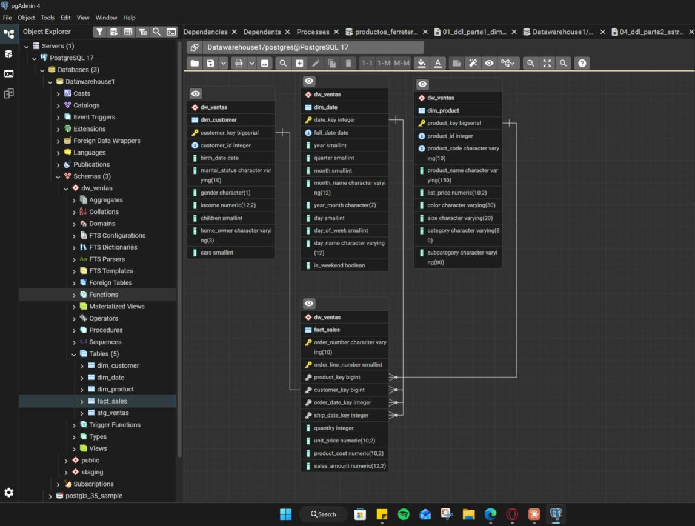](figuras/fig23_erd_pgadmin_estrella_ventas.jpg)

**Figura 23.** Diagrama entidad relación del esquema dw_ventas generado con la herramienta ERD de pgAdmin. Archivo: [fig23_erd_pgadmin_estrella_ventas.jpg](figuras/fig23_erd_pgadmin_estrella_ventas.jpg)

### 4.5. Script DDL

El script [04_ddl_parte2_estrella_ventas.sql](sql/04_ddl_parte2_estrella_ventas.sql) crea el esquema `dw_ventas`, la tabla de staging, las tres dimensiones, la tabla de hechos y los índices. Las Figuras 24 a 27 muestran el contenido del script en el Query Tool y la Figura 28 su ejecución, que termina con una consulta de las columnas de cada tabla.

[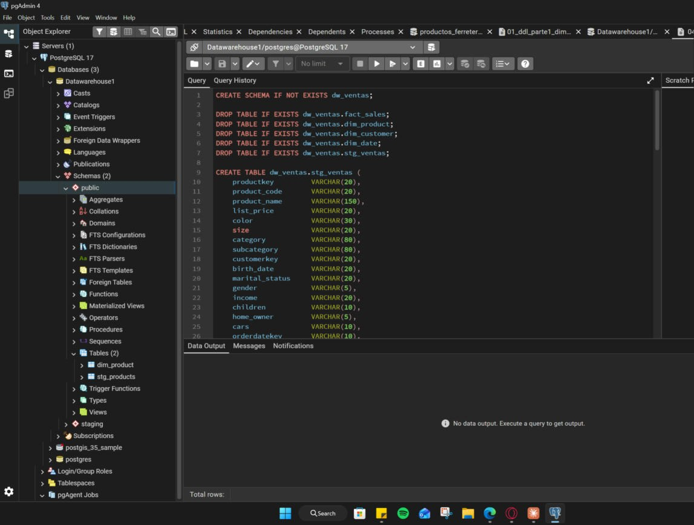](figuras/fig24_ddl_parte2_esquema_y_staging.jpg)

**Figura 24.** Script 04_ddl_parte2_estrella_ventas.sql: esquema y tabla de staging. Archivo: [fig24_ddl_parte2_esquema_y_staging.jpg](figuras/fig24_ddl_parte2_esquema_y_staging.jpg)

[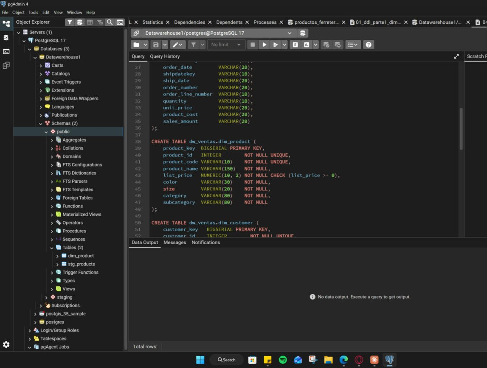](figuras/fig25_ddl_parte2_dim_product.jpg)

**Figura 25.** Script del DDL: dimensión de producto. Archivo: [fig25_ddl_parte2_dim_product.jpg](figuras/fig25_ddl_parte2_dim_product.jpg)

[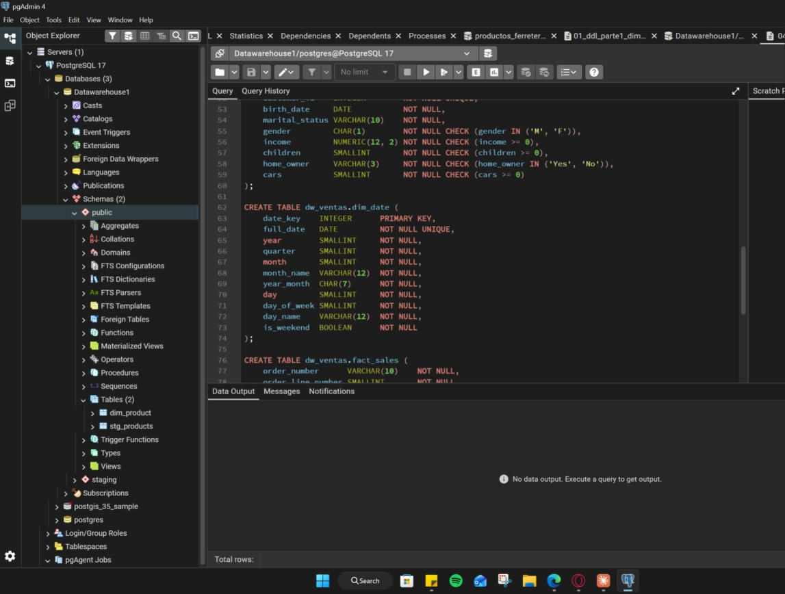](figuras/fig26_ddl_parte2_dim_customer_y_dim_date.jpg)

**Figura 26.** Script del DDL: dimensiones de cliente y de fecha. Archivo: [fig26_ddl_parte2_dim_customer_y_dim_date.jpg](figuras/fig26_ddl_parte2_dim_customer_y_dim_date.jpg)

[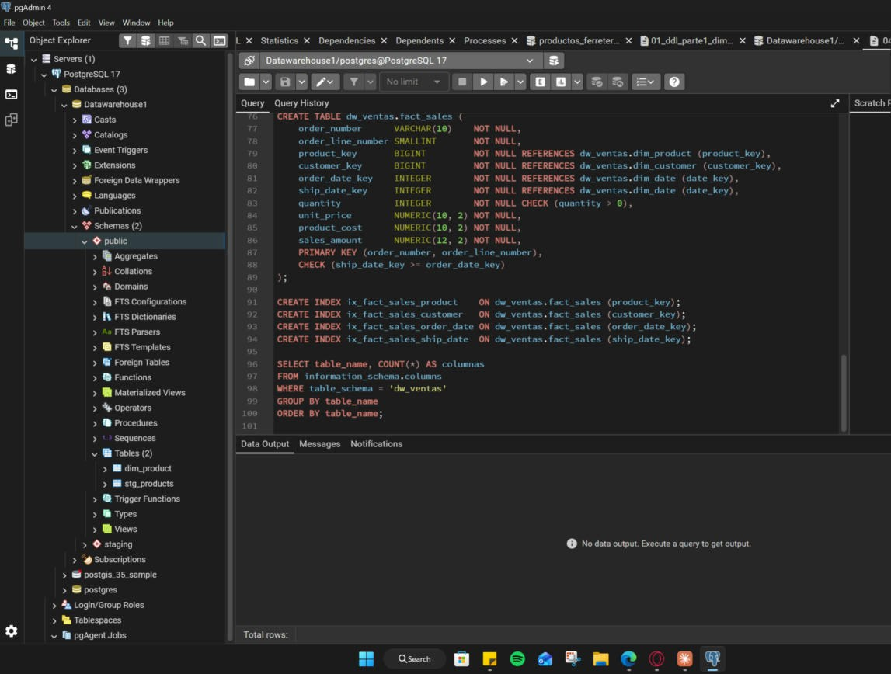](figuras/fig27_ddl_parte2_fact_sales_e_indices.jpg)

**Figura 27.** Script del DDL: tabla de hechos e índices sobre las claves foráneas. Archivo: [fig27_ddl_parte2_fact_sales_e_indices.jpg](figuras/fig27_ddl_parte2_fact_sales_e_indices.jpg)

[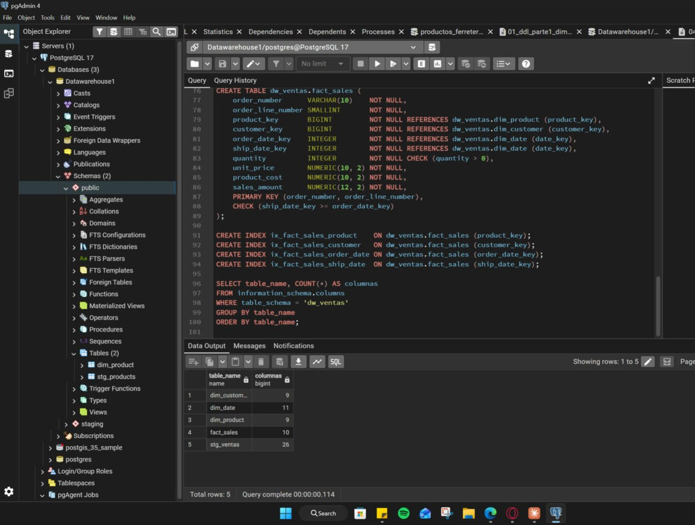](figuras/fig28_ddl_parte2_ejecutado_columnas_por_tabla.jpg)

**Figura 28.** Ejecución del DDL y número de columnas por tabla. Archivo: [fig28_ddl_parte2_ejecutado_columnas_por_tabla.jpg](figuras/fig28_ddl_parte2_ejecutado_columnas_por_tabla.jpg)

La Tabla 13 resume las restricciones que el DDL impone para proteger la calidad de los datos.

**Tabla 13.** Restricciones del modelo físico

| Tabla | Restricciones |
|---|---|
| `dim_product` | Clave primaria `product_key`, `product_id` y `product_code` únicos, `list_price` mayor o igual a cero y todas las columnas obligatorias |
| `dim_customer` | Clave primaria `customer_key`, `customer_id` único, `gender` limitado a M o F, `home_owner` limitado a Yes o No, e ingresos, hijos y autos mayores o iguales a cero |
| `dim_date` | Clave primaria `date_key`, `full_date` única y todas las columnas obligatorias |
| `fact_sales` | Clave primaria compuesta por `order_number` y `order_line_number`, cuatro claves foráneas, `quantity` mayor a cero y fecha de envío no anterior a la fecha de pedido |

Los cuatro índices sobre las claves foráneas de `fact_sales` aceleran las uniones con las dimensiones. La Figura 29 muestra las cinco tablas del esquema en el explorador de objetos.

[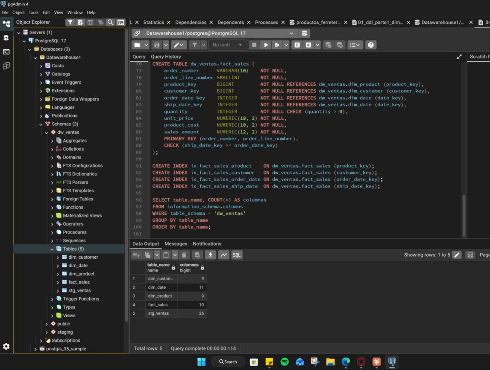](figuras/fig29_explorador_tablas_dw_ventas.jpg)

**Figura 29.** Tablas del esquema dw_ventas en el explorador de objetos. Archivo: [fig29_explorador_tablas_dw_ventas.jpg](figuras/fig29_explorador_tablas_dw_ventas.jpg)

### 4.6. Importación al área de staging

La tabla desnormalizada se importó a `dw_ventas.stg_ventas` con el mismo procedimiento de la Parte 1. La diferencia es el delimitador: este archivo separa las columnas con punto y coma. La Tabla 14 documenta la configuración y las Figuras 30 a 33 muestran el cuadro de diálogo y el resultado.

**Tabla 14.** Configuración de carga de `Tabla_Desnormalizada_Ventas.csv` en `dw_ventas.stg_ventas`

| Pestaña | Parámetro | Valor |
|---|---|---|
| General | Import/Export | Import |
| General | Filename | [Tabla_Desnormalizada_Ventas.csv](datos/entrada/Tabla_Desnormalizada_Ventas.csv) |
| General | Format | csv |
| General | Encoding | UTF8 |
| Options | Header | Activado |
| Options | Delimiter | Punto y coma |
| Columns | Columns to import | Las 26 columnas, en el orden del archivo |

[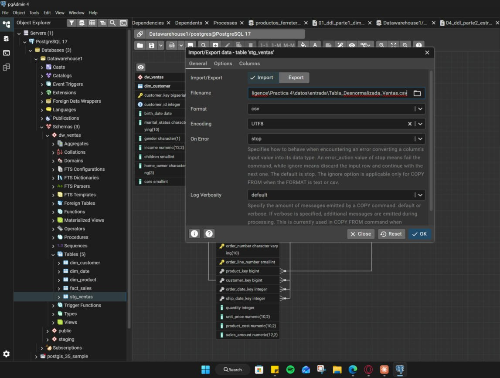](figuras/fig30_import_ventas_general.jpg)

**Figura 30.** Pestaña General de la importación de Tabla_Desnormalizada_Ventas.csv. Archivo: [fig30_import_ventas_general.jpg](figuras/fig30_import_ventas_general.jpg)

[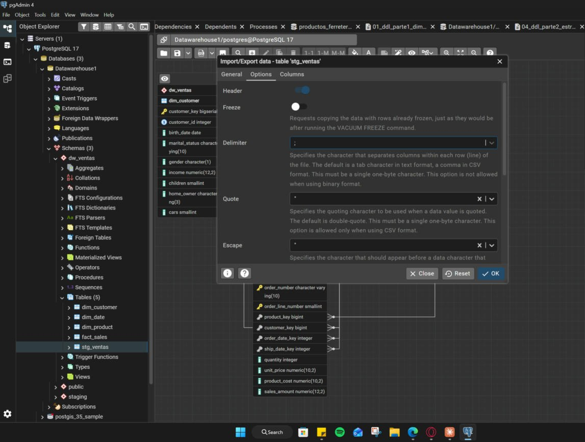](figuras/fig31_import_ventas_opciones.jpg)

**Figura 31.** Pestaña Options con Header activado y punto y coma como delimitador. Archivo: [fig31_import_ventas_opciones.jpg](figuras/fig31_import_ventas_opciones.jpg)

[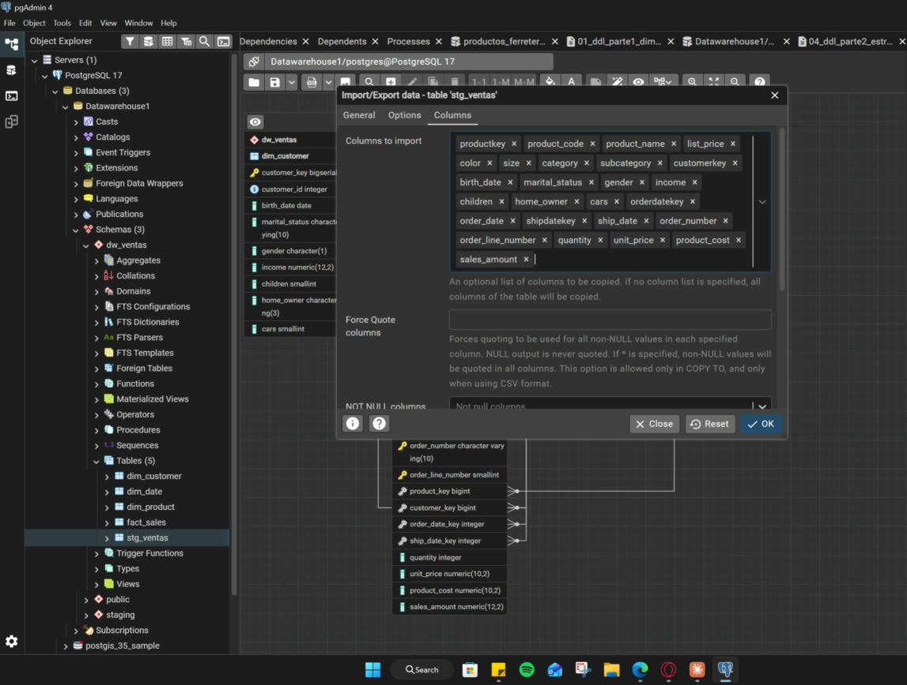](figuras/fig32_import_ventas_columnas.jpg)

**Figura 32.** Pestaña Columns con las 26 columnas de stg_ventas. Archivo: [fig32_import_ventas_columnas.jpg](figuras/fig32_import_ventas_columnas.jpg)

[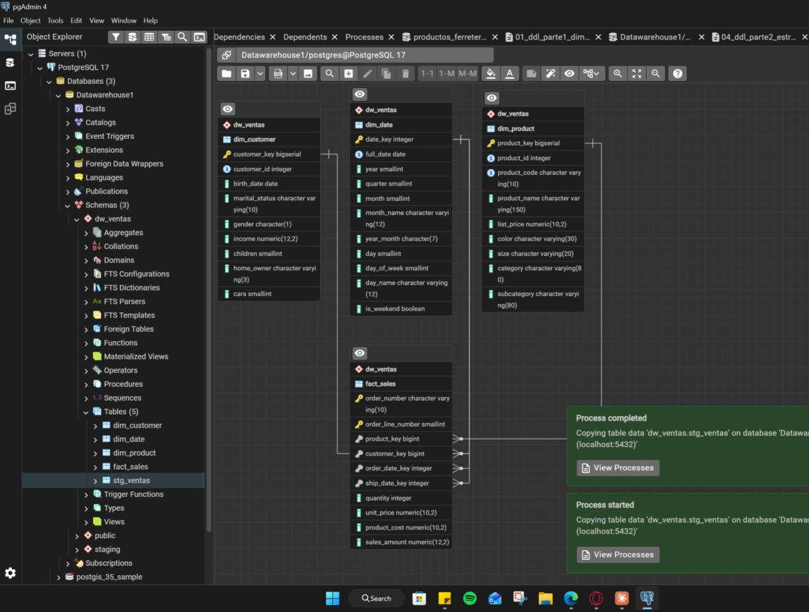](figuras/fig33_import_ventas_completado.jpg)

**Figura 33.** Notificación de proceso completado de la importación de stg_ventas. Archivo: [fig33_import_ventas_completado.jpg](figuras/fig33_import_ventas_completado.jpg)

### 4.7. Script DML de limpieza y carga

El script [05_dml_parte2_limpieza_carga.sql](sql/05_dml_parte2_limpieza_carga.sql) ejecuta el proceso en el orden de la Tabla 15. Cada paso se ejecutó por separado en pgAdmin y su resultado se capturó.

**Tabla 15.** Pasos del script DML

| Paso | Qué hace | Figura |
|---|---|---|
| 1 | Perfila `stg_ventas`: filas, órdenes, productos, clientes y fechas distintas | 34 |
| 2 | Limpia los espacios de todas las columnas, normaliza el nombre del producto y pasa el género a mayúsculas | 35 |
| 3 | Ejecuta los controles de calidad | 36 |
| 4 | Busca duplicados por número de orden y línea | 37 |
| 5 | Carga `dim_product` con `SELECT DISTINCT` | 38 |
| 6 | Carga `dim_customer` con `SELECT DISTINCT` | 39 |
| 7 | Genera `dim_date` con `generate_series` | 40 |
| 8 | Carga `fact_sales` buscando las claves sustitutas con una unión por clave natural | 41 |
| 9 | Cuenta las filas de cada tabla | 42 |
| 10 | Concilia filas, ventas y unidades entre `stg_ventas` y `fact_sales` | 43 |

La Figura 34 muestra el perfil de los datos importados.

[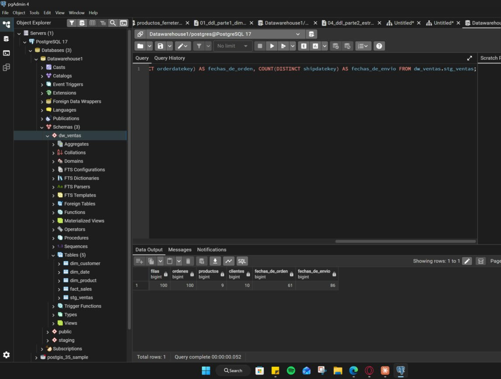](figuras/fig34_perfil_stg_ventas.jpg)

**Figura 34.** Perfil de stg_ventas: filas, órdenes, productos, clientes y fechas distintas. Archivo: [fig34_perfil_stg_ventas.jpg](figuras/fig34_perfil_stg_ventas.jpg)

La limpieza de la Figura 35 modifica las 100 filas porque recorta todas las columnas de texto. Todas las columnas de staging son texto, así que las conversiones a número y fecha se hacen recién al cargar el modelo.

[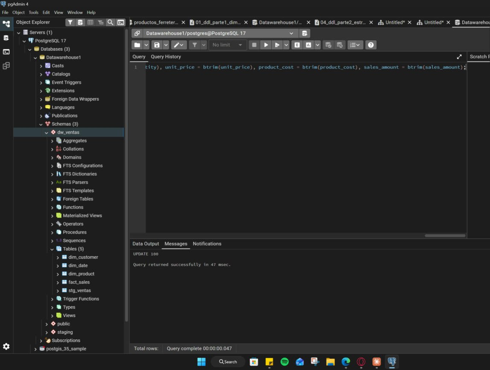](figuras/fig35_update_limpieza_stg_ventas.jpg)

**Figura 35.** Actualización de limpieza sobre stg_ventas con 100 filas modificadas. Archivo: [fig35_update_limpieza_stg_ventas.jpg](figuras/fig35_update_limpieza_stg_ventas.jpg)

La Figura 36 muestra los controles de calidad y la Tabla 16 los describe. Todos los datos pasan los controles, por lo que ninguna fila se descartó ni se corrigió.

[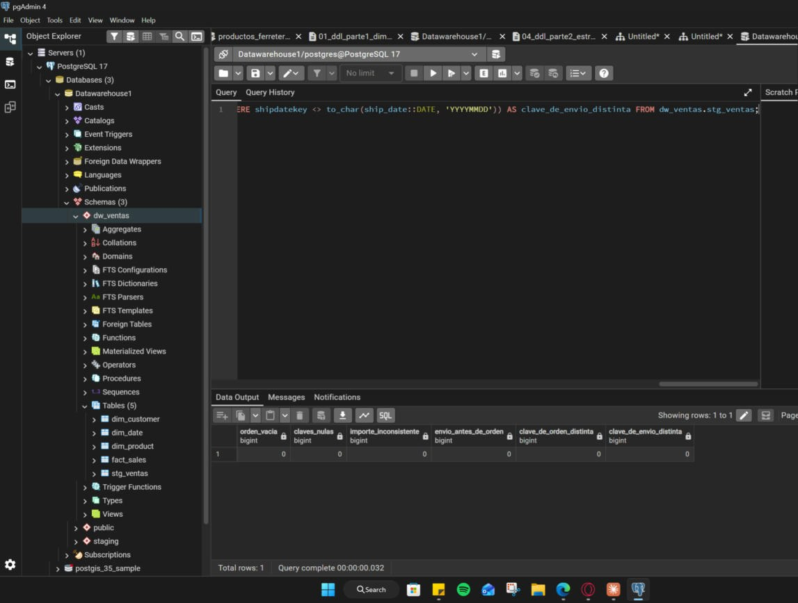](figuras/fig36_controles_de_calidad_stg_ventas.jpg)

**Figura 36.** Controles de calidad de stg_ventas con todos los contadores en cero. Archivo: [fig36_controles_de_calidad_stg_ventas.jpg](figuras/fig36_controles_de_calidad_stg_ventas.jpg)

**Tabla 16.** Controles de calidad de `stg_ventas`

| Control | Resultado |
|---|---|
| Número de orden vacío | 0 |
| Clave de producto o de cliente nula | 0 |
| Importe distinto de cantidad por precio unitario | 0 |
| Fecha de envío anterior a la fecha de pedido | 0 |
| Clave de fecha de pedido distinta de la fecha | 0 |
| Clave de fecha de envío distinta de la fecha | 0 |
| Combinaciones de orden y línea duplicadas | 0 |

La búsqueda de combinaciones repetidas de orden y línea no devuelve ninguna fila, como muestra la Figura 37.

[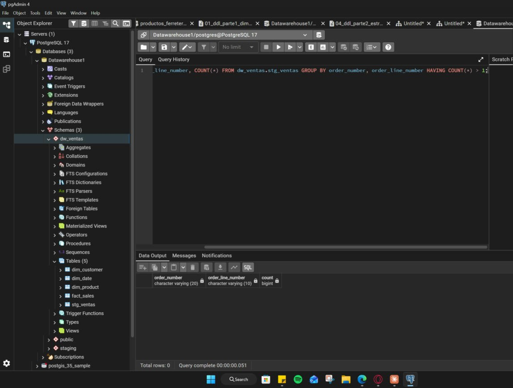](figuras/fig37_duplicados_orden_linea.jpg)

**Figura 37.** Verificación de duplicados por número de orden y línea, sin filas. Archivo: [fig37_duplicados_orden_linea.jpg](figuras/fig37_duplicados_orden_linea.jpg)

Después de los controles se cargan las dimensiones y la tabla de hechos, como muestran las Figuras 38 a 41. La Tabla 17 recoge las filas de cada tabla.

[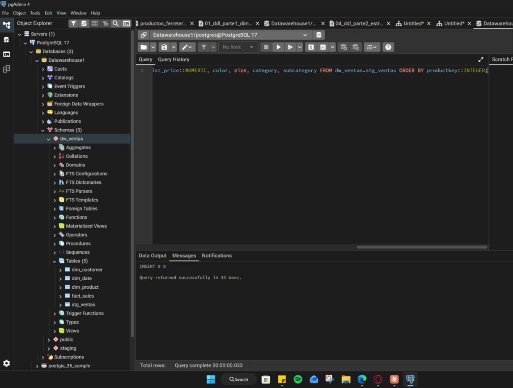](figuras/fig38_insert_dim_product_ventas.jpg)

**Figura 38.** Carga de dim_product del modelo de ventas con 9 filas. Archivo: [fig38_insert_dim_product_ventas.jpg](figuras/fig38_insert_dim_product_ventas.jpg)

[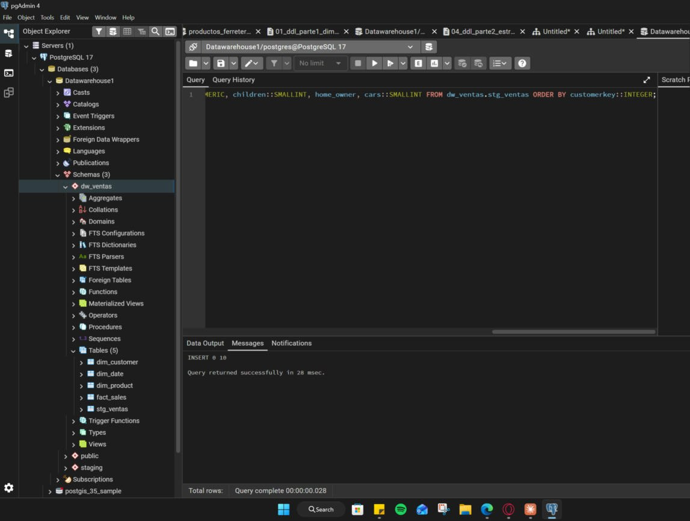](figuras/fig39_insert_dim_customer.jpg)

**Figura 39.** Carga de dim_customer con 10 filas. Archivo: [fig39_insert_dim_customer.jpg](figuras/fig39_insert_dim_customer.jpg)

[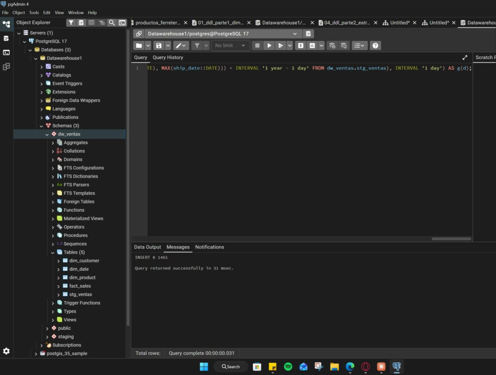](figuras/fig40_insert_dim_date.jpg)

**Figura 40.** Carga de dim_date con 1461 filas, una por cada día de 2022 a 2025. Archivo: [fig40_insert_dim_date.jpg](figuras/fig40_insert_dim_date.jpg)

[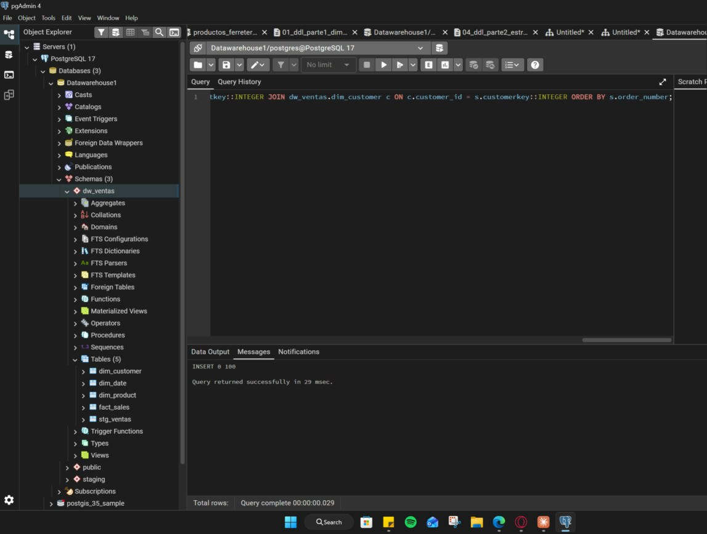](figuras/fig41_insert_fact_sales.jpg)

**Figura 41.** Carga de fact_sales con 100 filas. Archivo: [fig41_insert_fact_sales.jpg](figuras/fig41_insert_fact_sales.jpg)

**Tabla 17.** Filas cargadas en el modelo

| Tabla | Filas | Origen |
|---|---|---|
| `dim_product` | 9 | Productos distintos de `stg_ventas` |
| `dim_customer` | 10 | Clientes distintos de `stg_ventas` |
| `dim_date` | 1461 | Un día por cada día de 2022 a 2025 |
| `fact_sales` | 100 | Una fila por línea de pedido |

La Figura 42 muestra el conteo de filas de cada tabla del modelo.

[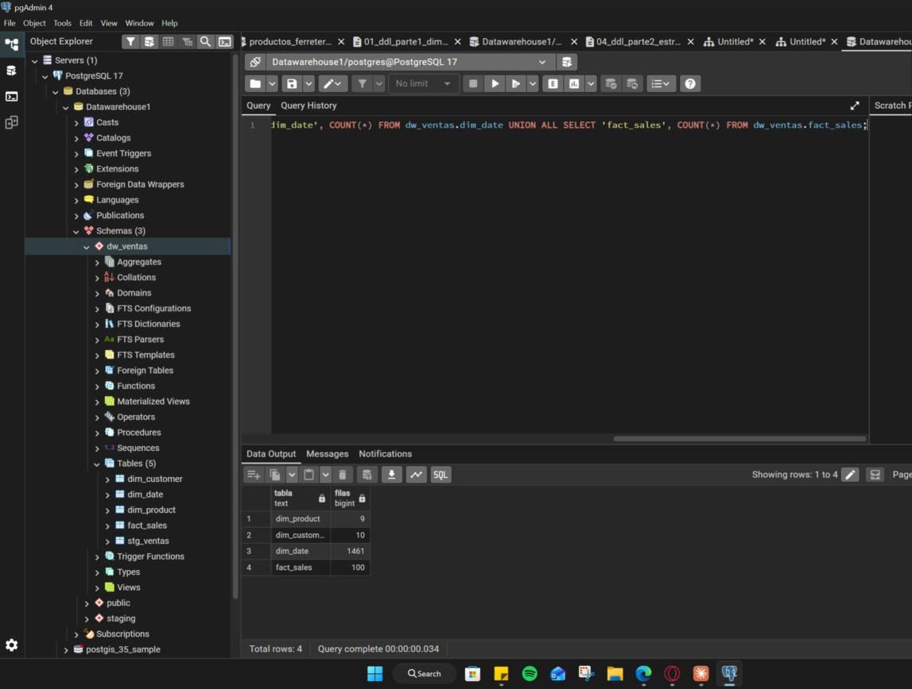](figuras/fig42_conteo_filas_por_tabla.jpg)

**Figura 42.** Número de filas de cada tabla del modelo. Archivo: [fig42_conteo_filas_por_tabla.jpg](figuras/fig42_conteo_filas_por_tabla.jpg)

La Figura 43 concilia el origen con el destino: la tabla de hechos tiene las mismas 100 filas, 69547 en ventas y 296 unidades que staging, así que la carga no perdió ni duplicó ningún dato. La Figura 44 muestra las primeras filas de la tabla de hechos, con claves sustitutas en lugar de los identificadores del archivo.

[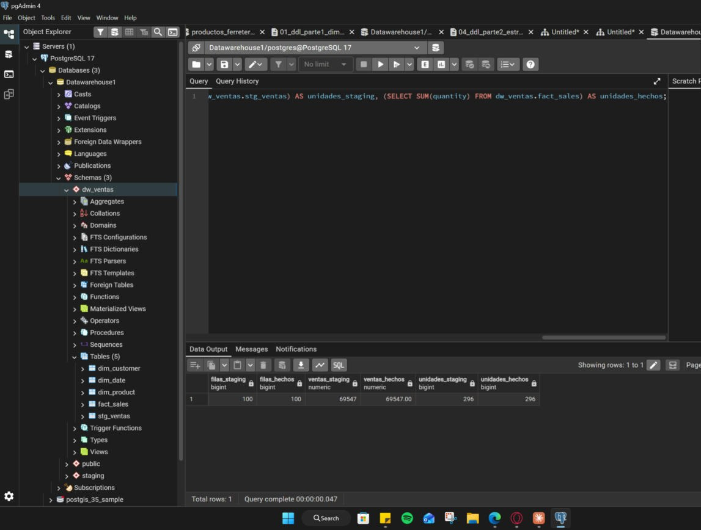](figuras/fig43_conciliacion_staging_hechos.jpg)

**Figura 43.** Conciliación de filas, ventas y unidades entre stg_ventas y fact_sales. Archivo: [fig43_conciliacion_staging_hechos.jpg](figuras/fig43_conciliacion_staging_hechos.jpg)

[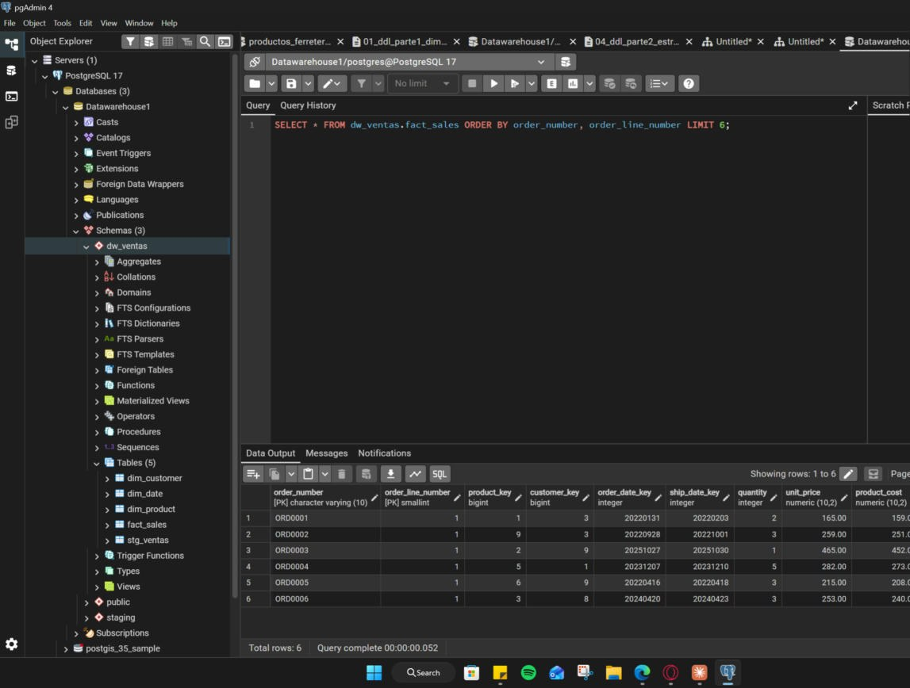](figuras/fig44_muestra_fact_sales.jpg)

**Figura 44.** Primeras filas de fact_sales. Archivo: [fig44_muestra_fact_sales.jpg](figuras/fig44_muestra_fact_sales.jpg)

### 4.8. Consultas de negocio

Las cinco consultas pedidas por la guía están en [06_consultas_parte2_ventas.sql](sql/06_consultas_parte2_ventas.sql). Cada una une la tabla de hechos con las dimensiones que necesita. Los resultados están además en [datos/salida](datos/salida/).

**Consulta 1: ventas por categoría de producto y mes.** Una venta se cuenta como un número de orden distinto, y se muestra además el ingreso. La Figura 45 muestra el resultado por año y mes, con 59 filas, y la Figura 46 lo agrupa por mes del año. La Tabla 18 resume ese agrupamiento.

[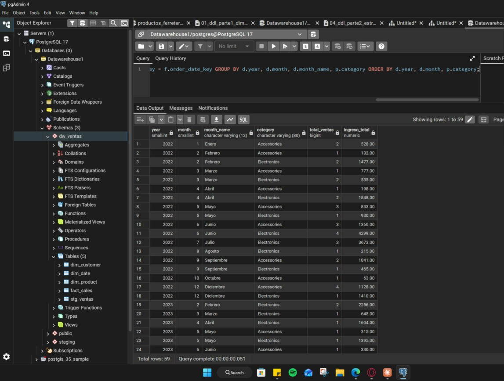](figuras/fig45_consulta1_ventas_por_categoria_y_mes.jpg)

**Figura 45.** Consulta 1: ventas por categoría de producto, año y mes. Archivo: [fig45_consulta1_ventas_por_categoria_y_mes.jpg](figuras/fig45_consulta1_ventas_por_categoria_y_mes.jpg)

[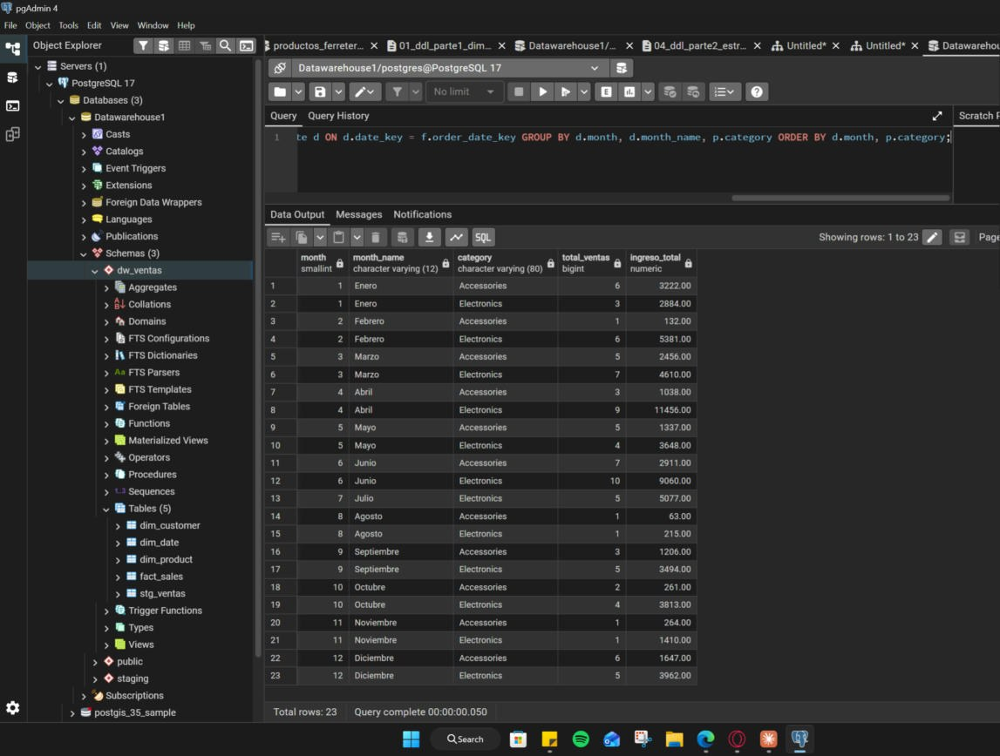](figuras/fig46_consulta1b_ventas_por_categoria_y_mes_del_anio.jpg)

**Figura 46.** Consulta 1 agrupada por mes del año. Archivo: [fig46_consulta1b_ventas_por_categoria_y_mes_del_anio.jpg](figuras/fig46_consulta1b_ventas_por_categoria_y_mes_del_anio.jpg)

**Tabla 18.** Ventas e ingreso por categoría y mes del año, consulta 1

| Mes | Ventas Accessories | Ingreso Accessories | Ventas Electronics | Ingreso Electronics |
|---|---|---|---|---|
| Enero | 6 | 3222 | 3 | 2884 |
| Febrero | 1 | 132 | 6 | 5381 |
| Marzo | 5 | 2456 | 7 | 4610 |
| Abril | 3 | 1038 | 9 | 11456 |
| Mayo | 5 | 1337 | 4 | 3648 |
| Junio | 7 | 2911 | 10 | 9060 |
| Julio | 0 | 0 | 5 | 5077 |
| Agosto | 1 | 63 | 1 | 215 |
| Septiembre | 3 | 1206 | 5 | 3494 |
| Octubre | 2 | 261 | 4 | 3813 |
| Noviembre | 1 | 264 | 1 | 1410 |
| Diciembre | 6 | 1647 | 5 | 3962 |
| **Total** | **40** | **14537** | **60** | **55010** |

Electronics concentra 60 de las 100 ventas y el 79 % del ingreso, con un mes fuerte en abril por 11456. En julio no hubo ventas de Accessories.

**Consulta 2: ingreso total por cliente y género.** La Figura 47 muestra el resultado y la Tabla 19 lo recoge.

[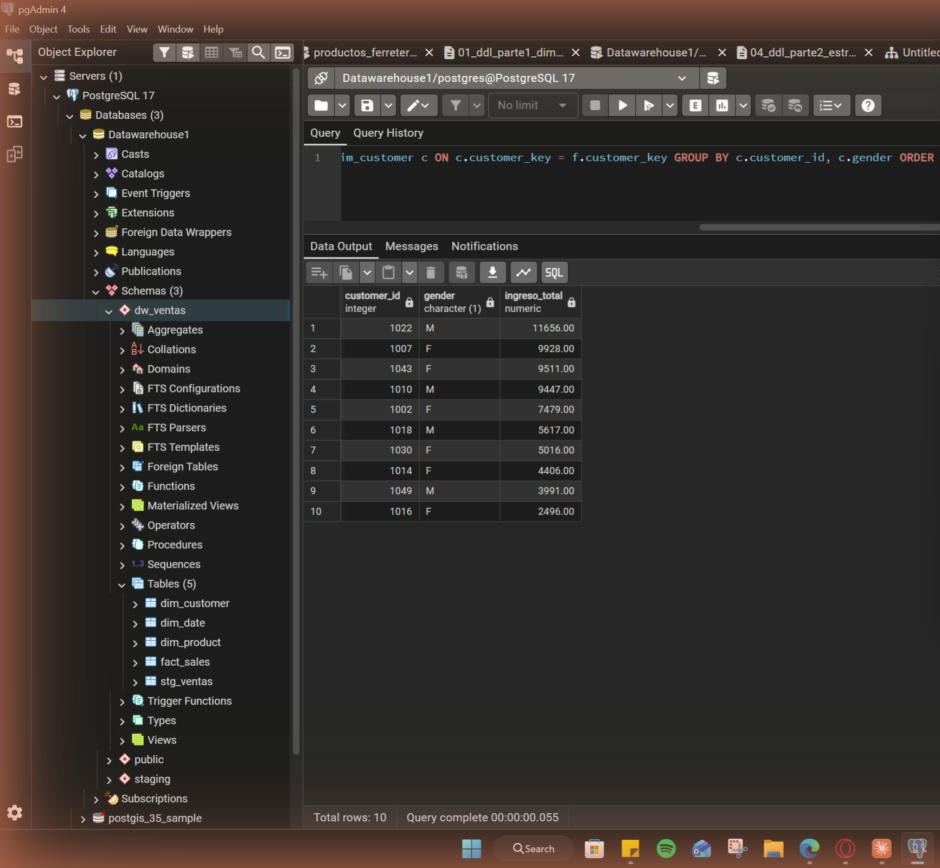](figuras/fig47_consulta2_ingreso_por_cliente_y_genero.jpg)

**Figura 47.** Consulta 2: ingreso total por cliente y género. Archivo: [fig47_consulta2_ingreso_por_cliente_y_genero.jpg](figuras/fig47_consulta2_ingreso_por_cliente_y_genero.jpg)

**Tabla 19.** Ingreso total por cliente y género, consulta 2

| Cliente | Género | Ingreso total |
|---|---|---|
| 1022 | M | 11656 |
| 1007 | F | 9928 |
| 1043 | F | 9511 |
| 1010 | M | 9447 |
| 1002 | F | 7479 |
| 1018 | M | 5617 |
| 1030 | F | 5016 |
| 1014 | F | 4406 |
| 1049 | M | 3991 |
| 1016 | F | 2496 |
| **Total** | | **69547** |

El cliente 1022 es el de mayor ingreso, con 11656. Por género, las seis clientas generan 38836 y los cuatro clientes 30711, así que el género femenino aporta el 56 % del ingreso con 6 de los 10 clientes.

**Consulta 3: cantidad total vendida por producto.** La Figura 48 muestra el resultado y la Tabla 20 lo recoge.

[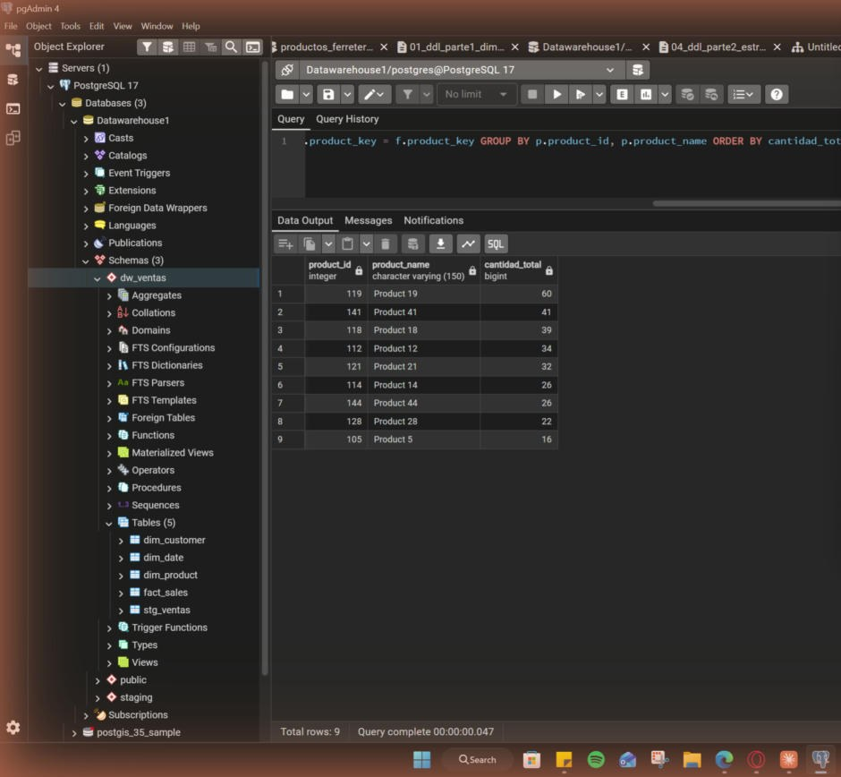](figuras/fig48_consulta3_cantidad_por_producto.jpg)

**Figura 48.** Consulta 3: cantidad total vendida por producto. Archivo: [fig48_consulta3_cantidad_por_producto.jpg](figuras/fig48_consulta3_cantidad_por_producto.jpg)

**Tabla 20.** Cantidad vendida por producto, consulta 3

| Producto | Nombre | Cantidad |
|---|---|---|
| 119 | Product 19 | 60 |
| 141 | Product 41 | 41 |
| 118 | Product 18 | 39 |
| 112 | Product 12 | 34 |
| 121 | Product 21 | 32 |
| 114 | Product 14 | 26 |
| 144 | Product 44 | 26 |
| 128 | Product 28 | 22 |
| 105 | Product 5 | 16 |
| **Total** | | **296** |

El Product 19 es el más vendido, con 60 unidades, y supera por 19 al segundo.

**Consulta 4: cantidad enviada por mes de envío.** La consulta une `fact_sales` con `dim_date` por `ship_date_key`, la relación que Power Pivot deja inactiva. La Figura 49 muestra el resultado por año y mes, con 41 filas, y la Figura 50 lo agrupa por mes del año. La Tabla 21 resume ese agrupamiento.

[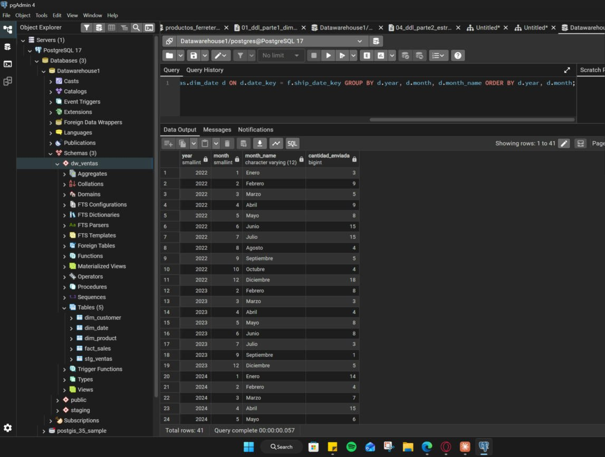](figuras/fig49_consulta4_cantidad_enviada_por_mes_de_envio.jpg)

**Figura 49.** Consulta 4: cantidad enviada por año y mes de envío. Archivo: [fig49_consulta4_cantidad_enviada_por_mes_de_envio.jpg](figuras/fig49_consulta4_cantidad_enviada_por_mes_de_envio.jpg)

[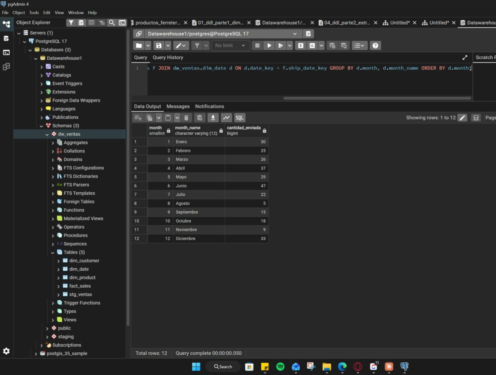](figuras/fig50_consulta4b_cantidad_enviada_por_mes_del_anio.jpg)

**Figura 50.** Consulta 4 agrupada por mes del año. Archivo: [fig50_consulta4b_cantidad_enviada_por_mes_del_anio.jpg](figuras/fig50_consulta4b_cantidad_enviada_por_mes_del_anio.jpg)

**Tabla 21.** Cantidad enviada por mes del año, consulta 4

| Mes | Cantidad enviada |
|---|---|
| Enero | 30 |
| Febrero | 25 |
| Marzo | 26 |
| Abril | 37 |
| Mayo | 29 |
| Junio | 47 |
| Julio | 22 |
| Agosto | 5 |
| Septiembre | 15 |
| Octubre | 18 |
| Noviembre | 9 |
| Diciembre | 33 |
| **Total** | **296** |

Junio es el mes con más unidades enviadas, con 47, y agosto el de menos, con 5. El total coincide con las 296 unidades vendidas, lo que confirma que cada pedido tiene una fecha de envío.

**Consulta 5: ventas por tamaño de producto y estado civil del cliente.** La Figura 51 muestra el resultado y la Tabla 22 lo recoge.

[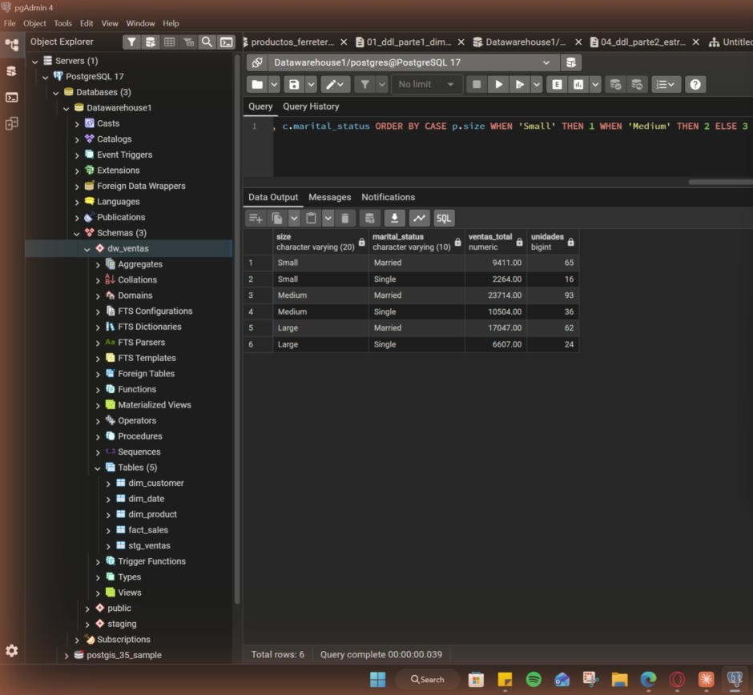](figuras/fig51_consulta5_ventas_por_tamano_y_estado_civil.jpg)

**Figura 51.** Consulta 5: ventas por tamaño de producto y estado civil del cliente. Archivo: [fig51_consulta5_ventas_por_tamano_y_estado_civil.jpg](figuras/fig51_consulta5_ventas_por_tamano_y_estado_civil.jpg)

**Tabla 22.** Ventas por tamaño de producto y estado civil, consulta 5

| Tamaño | Estado civil | Ventas | Unidades |
|---|---|---|---|
| Small | Married | 9411 | 65 |
| Small | Single | 2264 | 16 |
| Medium | Married | 23714 | 93 |
| Medium | Single | 10504 | 36 |
| Large | Married | 17047 | 62 |
| Large | Single | 6607 | 24 |
| **Total** | | **69547** | **296** |

Los productos de tamaño Medium son los que más ingreso generan, con 34218 entre ambos estados civiles. Los clientes casados representan el 73 % de los pedidos y el 72 % del ingreso, así que su peso en el resultado se debe sobre todo a que son mayoría en el archivo.

---

## 5. Conclusiones

La Parte 1 muestra el recorrido completo de una dimensión: staging sin restricciones, validación frente a cifras conocidas, limpieza y carga con una clave sustituta. Medir los datos antes de limpiarlos fue lo que permitió descubrir que la fórmula de la guía deja un nombre con espacio al inicio y no reconoce seis nombres con espacio no separable. Con el orden corregido de `btrim` y la conversión previa del carácter 160, los 699 productos quedan sin anomalías.

La categoría y la subcategoría se conservan en `dim_product` porque en un esquema estrella lo que importa es que las consultas sean simples. Las consultas 9.1 a 9.5 agrupan y filtran con un solo atributo de la dimensión, sin uniones adicionales.

En la Parte 2, la tabla desnormalizada de ventas se descompuso en tres dimensiones y una tabla de hechos con granularidad de línea de pedido. La fecha se modeló como una dimensión con rol, que sirve para el pedido y para el envío. Power Pivot obliga a dejar inactiva una de las dos relaciones, mientras que PostgreSQL permite usar ambas, y la consulta 4 depende justamente de la de envío.

Los controles de calidad, la conciliación entre staging y la tabla de hechos y el script de validación en Python coinciden: se cargaron las 100 filas, 69547 en ventas y 296 unidades, y las siete consultas dan los mismos resultados en SQL que al recalcularlas de forma independiente.

También se identificó un límite del conjunto de datos: el archivo de ventas y `products.csv` son catálogos diferentes, de modo que la dimensión de productos de ventas no se pudo construir a partir de la de la Parte 1. Con datos de ventas reales de esa tienda, la dimensión de la Parte 1 se relacionaría con la tabla de hechos tal como describe la guía [1].

---

## 6. Referencias

[1] Escuela Politécnica Nacional, Facultad de Ingeniería de Sistemas, "Práctica 4. Implementación física de una dimensión para un modelo estrella en PostgreSQL," guía de práctica de la asignatura Business Intelligence, Quito, Ecuador, 2026.

[2] R. Kimball y M. Ross, *The Data Warehouse Toolkit: The Definitive Guide to Dimensional Modeling*, 3.ª ed. Indianapolis, IN, EE. UU.: Wiley, 2013.

[3] pgAdmin Development Team, "ERD Tool," *pgAdmin 4 Documentation*. [En línea]. Disponible en: https://www.pgadmin.org/docs/pgadmin4/latest/erd_tool.html. [Accedido: 20-oct-2026].

[4] Microsoft, "Create relationships in Diagram View in Power Pivot," *Microsoft Support*. [En línea]. Disponible en: https://support.microsoft.com/en-US/Excel/create-relationships-in-diagram-view-in-power-pivot. [Accedido: 20-oct-2026].

[5] PostgreSQL Global Development Group, "5.10. Schemas," *PostgreSQL 17 Documentation*. [En línea]. Disponible en: https://www.postgresql.org/docs/17/ddl-schemas.html. [Accedido: 20-oct-2026].

---

## 7. Declaración de uso de inteligencia artificial

En la elaboración de este trabajo se utilizó el asistente de inteligencia artificial Claude como apoyo en la redacción del informe de manera ordenada, el resto de la práctica fue realizada por los estudiantes del grupo: realizar los procedimientos, capturas, etc.

**Porcentaje de uso de inteligencia artificial: 30 %**
