# Práctica 5: Creación de un Data Warehouse con un proceso ETL completo

**Universidad:** Escuela Politécnica Nacional

**Facultad:** Facultad de Ingeniería de Sistemas

**Asignatura:** Business Intelligence

**Paralelo:** GR2SW

**Integrantes:**

- Elian Daniel Caizapanta Caiza
- Brandon Javier Pallo Chango
- Alexis Eduardo Sotomayor Llerena
- Francisco Javier Torres Negrete

**Fecha de entrega:** 23 de octubre de 2026

**Herramientas:** Pentaho Data Integration Community Edition 10.2.0.0-222 con Java 21, PostgreSQL 17 y pgAdmin 4

---

## Índice

1. [Organización del trabajo](#1-organización-del-trabajo)
2. [Análisis del problema](#2-análisis-del-problema)
   1. [Preguntas de negocio](#21-preguntas-de-negocio)
   2. [Datos de origen](#22-datos-de-origen)
   3. [Problemas encontrados en la guía y en los datos](#23-problemas-encontrados-en-la-guía-y-en-los-datos)
   4. [Modelo estrella resultante](#24-modelo-estrella-resultante)
3. [Creación del esquema y las tablas en PostgreSQL](#3-creación-del-esquema-y-las-tablas-en-postgresql)
4. [Carga en staging con Pentaho](#4-carga-en-staging-con-pentaho)
   1. [Conexión con PostgreSQL](#41-conexión-con-postgresql)
   2. [Transformación Load_Staging_raw](#42-transformación-load_staging_raw)
5. [Transformación de dimensiones](#5-transformación-de-dimensiones)
   1. [Dimensión de productos](#51-dimensión-de-productos)
   2. [Dimensión de clientes](#52-dimensión-de-clientes)
   3. [Dimensión de tiempo](#53-dimensión-de-tiempo)
6. [Transformación de la tabla de hechos](#6-transformación-de-la-tabla-de-hechos)
7. [Job ETL y ejecución completa](#7-job-etl-y-ejecución-completa)
8. [Comprobación en PostgreSQL](#8-comprobación-en-postgresql)
   1. [Conteos y calidad de la carga](#81-conteos-y-calidad-de-la-carga)
   2. [Consulta de comprobación de la guía](#82-consulta-de-comprobación-de-la-guía)
   3. [Ventas por mes y categoría](#83-ventas-por-mes-y-categoría)
   4. [Ventas por cliente y género](#84-ventas-por-cliente-y-género)
9. [Validación independiente](#9-validación-independiente)
10. [Conclusiones](#10-conclusiones)
11. [Referencias](#11-referencias)
12. [Declaración de uso de inteligencia artificial](#12-declaración-de-uso-de-inteligencia-artificial)

---

## 1. Organización del trabajo

La práctica pide implementar un proceso ETL completo con Pentaho Data Integration y construir con él un data warehouse en la base `Datawarehouse2` de PostgreSQL [1]. El flujo sigue el plan de trabajo de la guía: análisis del problema, creación de las tablas, carga en staging, carga de las dimensiones, carga de la tabla de hechos, y ejecución y pruebas con un job. La Tabla 1 enumera el contenido de la carpeta, con enlaces directos a cada archivo.

**Tabla 1.** Estructura de la carpeta de la práctica

| Carpeta | Archivos |
|---|---|
| [datos/entrada](datos/entrada/) | [ventas_1000.csv](datos/entrada/ventas_1000.csv), archivo de origen entregado con la guía |
| [sql](sql/) | [01_ddl_datawarehouse2.sql](sql/01_ddl_datawarehouse2.sql), [02_verificacion_resultados.sql](sql/02_verificacion_resultados.sql) |
| [transformaciones](transformaciones/) | [01_Load_Staging_raw.ktr](transformaciones/01_Load_Staging_raw.ktr), [02_Load_dim_product.ktr](transformaciones/02_Load_dim_product.ktr), [03_Load_dim_customer.ktr](transformaciones/03_Load_dim_customer.ktr), [04_Load_dim_date.ktr](transformaciones/04_Load_dim_date.ktr), [05_Load_fact_sales.ktr](transformaciones/05_Load_fact_sales.ktr), [etl_job_sales.kjb](transformaciones/etl_job_sales.kjb) |
| [datos/salida](datos/salida/) | Resultados de las consultas: [comprobación de la guía](datos/salida/comprobacion_ventas_por_categoria_y_mes.csv), [ventas por mes y categoría](datos/salida/consulta1_ventas_por_anio_mes_y_categoria.csv), [ventas por cliente y género](datos/salida/consulta2_ventas_por_cliente_y_genero.csv), [ventas por género](datos/salida/consulta2b_ventas_por_genero.csv), [conciliación por categoría](datos/salida/conciliacion_ventas_por_categoria.csv) |
| [figuras](figuras/) | Figuras 1 a 40 del informe |
| [validacion](validacion/) | [validar_resultados.py](validacion/validar_resultados.py) |

Las transformaciones leen el CSV con una ruta relativa construida con `${Internal.Entry.Current.Directory}`, y el job llama a cada transformación de la misma forma, así que funcionan en cualquier equipo después de clonar el repositorio. La contraseña de PostgreSQL no está en ningún archivo: la conexión usa la variable `${PG_PASSWORD}`, que cada integrante define en Spoon desde Edit, Set Environment Variables.

---

## 2. Análisis del problema

### 2.1. Preguntas de negocio

Una tienda desea analizar sus ventas según productos, clientes y fechas, y la guía plantea dos preguntas [1]:

1. ¿Cuántas ventas se realizaron por mes y categoría?
2. ¿Cuánto se vendió a cada cliente por género?

Para responderlas se necesita un modelo estrella con la venta como hecho, una dimensión de productos que contenga la categoría, una dimensión de clientes que contenga el género y una dimensión de tiempo que contenga el mes [2].

### 2.2. Datos de origen

El archivo `ventas_1000.csv` tiene 1000 filas y 13 columnas separadas por coma, con fechas en formato `AAAA-MM-DD` entre el 13 de mayo de 2024 y el 13 de mayo de 2025. Cada fila es una venta y repite los datos del producto y del cliente. La Tabla 2 resume el perfil de cada grupo de columnas.

**Tabla 2.** Perfil de `ventas_1000.csv`

| Columnas | Destino | Valores distintos |
|---|---|---|
| `product_id`, `product_name`, `category`, `subcategory` | `dim_product` | 100 productos, 4 categorías, 7 subcategorías |
| `customer_id`, `customer_name`, `gender`, `marital_status`, `income` | `dim_customer` | 100 clientes, 50 de género F y 50 de género M |
| `order_date` | `dim_date` | 339 fechas |
| `quantity`, `unit_price`, `sales_amount` | `fact_sales` | 1000 ventas, 2999 unidades y 1 469 266.11 de ventas totales |

No hay valores vacíos ni espacios sobrantes, y en las 1000 filas `sales_amount` es exactamente `quantity` por `unit_price`, así que las medidas no necesitan limpieza.

### 2.3. Problemas encontrados en la guía y en los datos

Antes de construir el ETL se perfiló el archivo y se encontraron dos problemas que cambian el resultado si se siguen los pasos de la guía tal como están. La Tabla 3 los resume.

**Tabla 3.** Problemas encontrados y solución aplicada

| Problema | Efecto si se sigue la guía | Solución aplicada |
|---|---|---|
| El paso Unique rows de Pentaho solo elimina duplicados consecutivos, por eso necesita los datos ordenados [3] | Las capturas de la guía muestran 989 productos y 990 clientes, pero en el archivo solo hay 100 de cada uno. La dimensión queda llena de duplicados | Se agregó un paso Sort rows antes de cada Unique rows |
| Un mismo `product_id` aparece con varias categorías y subcategorías. Hay 541 combinaciones distintas para 100 productos | Si se deja un solo registro por `product_id`, 562 de las 1000 ventas quedan asignadas a una categoría distinta de la registrada y la pregunta 1 se responde mal | `dim_product` guarda una fila por combinación de producto, categoría y subcategoría, y la tabla de hechos busca la clave con esos tres campos |

El primer problema se confirmó contando las filas que cambian de `product_id` respecto de la fila anterior: son exactamente 989, el mismo número que aparece en la captura de la guía, y para `customer_id` son 990. Es decir, el resultado de la guía no es una dimensión de 989 productos distintos, sino el efecto de comparar cada fila solo con la anterior.

El segundo problema es una característica de los datos de origen. El producto P186, por ejemplo, figura en ventas de Accessories, Clothing, Electronics y Home, como se verá en la Figura 33. Como la categoría registrada en cada venta es la que responde a la pregunta de negocio, el diseño la conserva en lugar de inventar una única categoría por producto. Con esta decisión las ventas por categoría del data warehouse coinciden centavo por centavo con las del archivo, como se comprueba en la sección 8.1.

Los clientes no tienen este problema: cada `customer_id` aparece siempre con el mismo nombre, género, estado civil e ingreso, así que la dimensión de clientes se deja comparando solo `customer_id`, como indica la guía.

### 2.4. Modelo estrella resultante

El modelo final usa exactamente las tablas de la guía, y la Tabla 4 describe el contenido y el grano de cada una.

**Tabla 4.** Tablas del data warehouse en `Datawarehouse2`

| Tabla | Tipo | Grano | Clave primaria | Filas |
|---|---|---|---|---|
| `raw_sales` | Staging | Una fila por venta, sin transformar | No tiene | 1000 |
| `dim_product` | Dimensión | Una fila por combinación de producto, categoría y subcategoría | `product_key SERIAL` | 541 |
| `dim_customer` | Dimensión | Una fila por cliente | `customer_key SERIAL` | 100 |
| `dim_date` | Dimensión | Una fila por fecha con ventas | `date_key DATE` | 339 |
| `fact_sales` | Hechos | Una fila por venta | `transaction_key SERIAL` | 1000 |

`fact_sales` se relaciona con las tres dimensiones mediante `product_key`, `customer_key` y `date_key`, y guarda como medidas `quantity`, `unit_price` y `sales_amount`.

---

## 3. Creación del esquema y las tablas en PostgreSQL

La base `Datawarehouse2` se creó desde pgAdmin, con el menú Create, Database sobre el servidor PostgreSQL 17, como muestran las Figuras 1 y 2.

[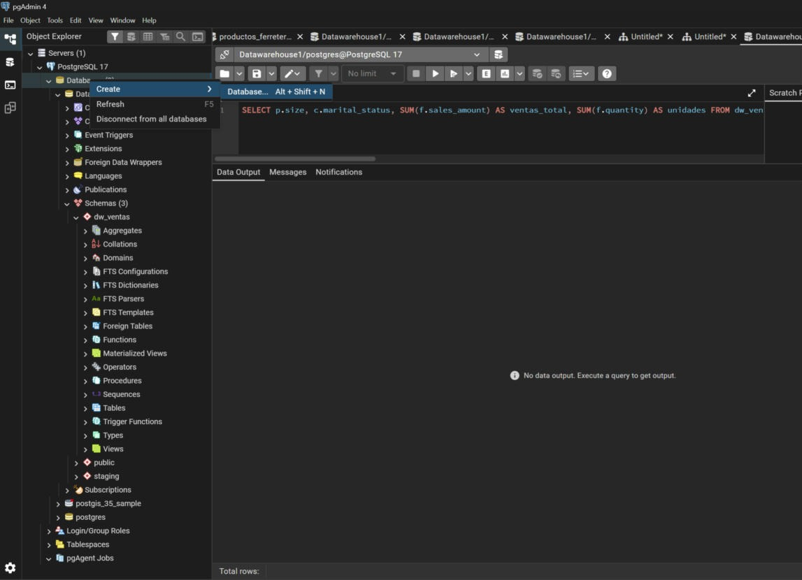](figuras/fig01_menu_crear_base_datos.jpg)

**Figura 1.** Menú Create, Database sobre el nodo Databases del servidor PostgreSQL 17. Archivo: [fig01_menu_crear_base_datos.jpg](figuras/fig01_menu_crear_base_datos.jpg)

[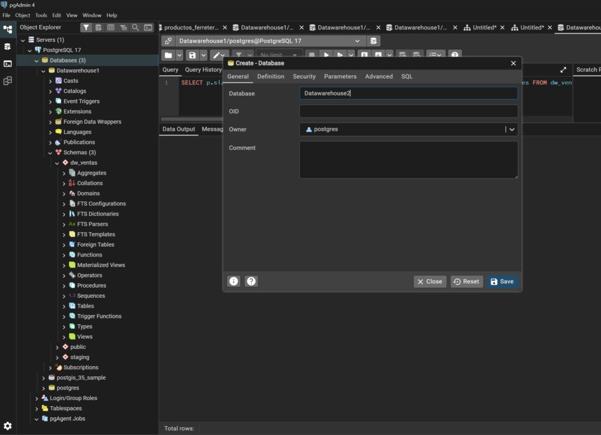](figuras/fig02_dialogo_crear_datawarehouse2.jpg)

**Figura 2.** Cuadro de diálogo Create Database con el nombre Datawarehouse2. Archivo: [fig02_dialogo_crear_datawarehouse2.jpg](figuras/fig02_dialogo_crear_datawarehouse2.jpg)

En el Query Tool de `Datawarehouse2` se ejecutó el script [01_ddl_datawarehouse2.sql](sql/01_ddl_datawarehouse2.sql), que contiene el DDL de la guía en el esquema `public` [1]. Se agregaron al inicio cinco sentencias `DROP TABLE IF EXISTS` para poder volver a ejecutar el script sin errores, y al final una consulta que cuenta las columnas de cada tabla. Las Figuras 3 a 5 muestran el script y la Figura 6 el resultado de la ejecución, con las cinco tablas en el explorador de objetos.

[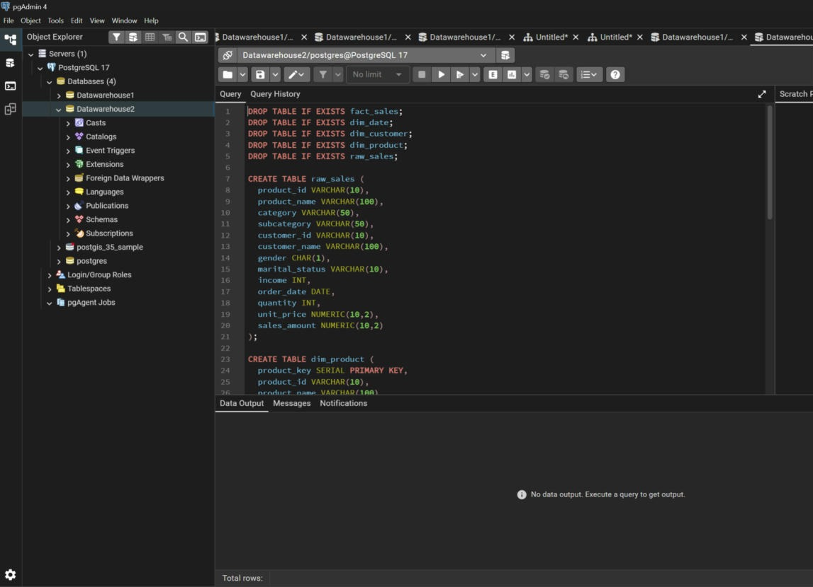](figuras/fig03_ddl_raw_sales.jpg)

**Figura 3.** Script de creación en el Query Tool: limpieza previa y tabla de staging raw_sales. Archivo: [fig03_ddl_raw_sales.jpg](figuras/fig03_ddl_raw_sales.jpg)

[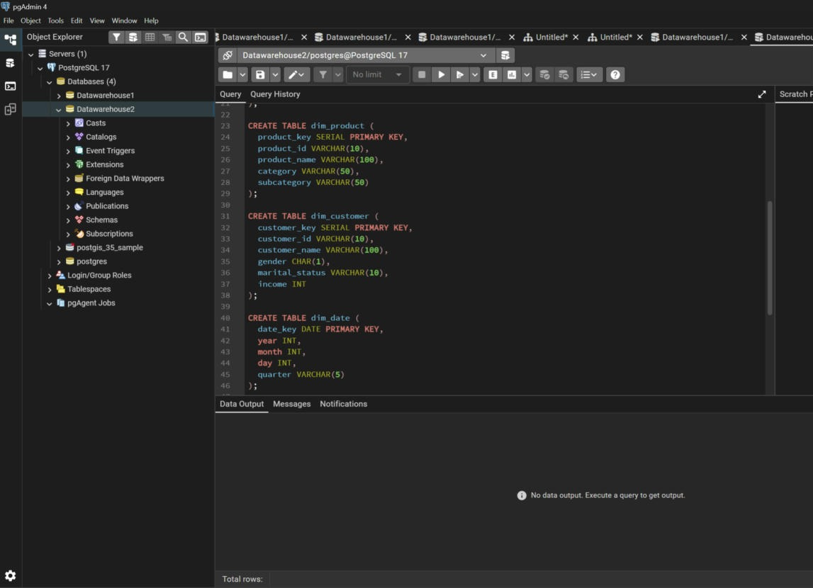](figuras/fig04_ddl_dimensiones.jpg)

**Figura 4.** Script de creación: tablas dim_product, dim_customer y dim_date. Archivo: [fig04_ddl_dimensiones.jpg](figuras/fig04_ddl_dimensiones.jpg)

[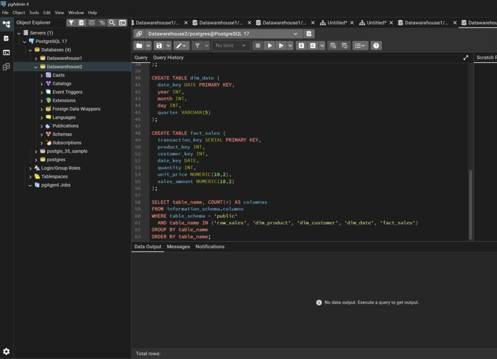](figuras/fig05_ddl_fact_sales.jpg)

**Figura 5.** Script de creación: tabla de hechos fact_sales y consulta de verificación de columnas. Archivo: [fig05_ddl_fact_sales.jpg](figuras/fig05_ddl_fact_sales.jpg)

[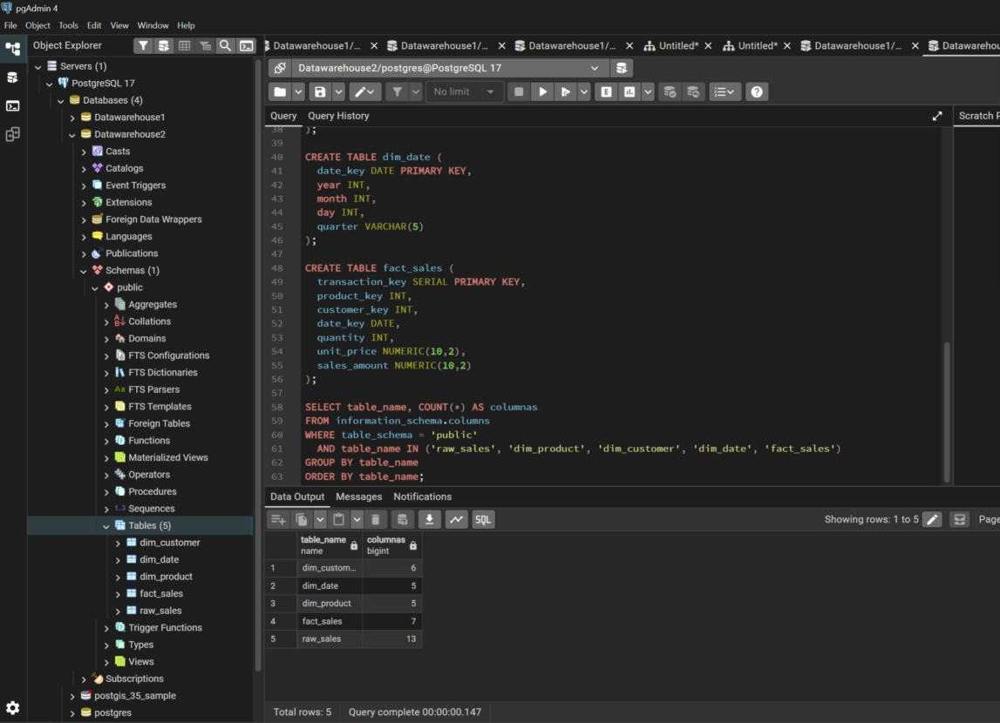](figuras/fig06_ddl_ejecutado.jpg)

**Figura 6.** Resultado del script con el número de columnas de cada tabla y las cinco tablas en el esquema public. Archivo: [fig06_ddl_ejecutado.jpg](figuras/fig06_ddl_ejecutado.jpg)

---

## 4. Carga en staging con Pentaho

### 4.1. Conexión con PostgreSQL

Todas las transformaciones usan la misma conexión, `PostgreSQL Datawarehouse2`, de tipo PostgreSQL con acceso Native JDBC hacia `localhost`, puerto 5432 y usuario `postgres`. La Figura 7 muestra la conexión. El campo de contraseña contiene la variable `${PG_PASSWORD}` y no la contraseña real.

[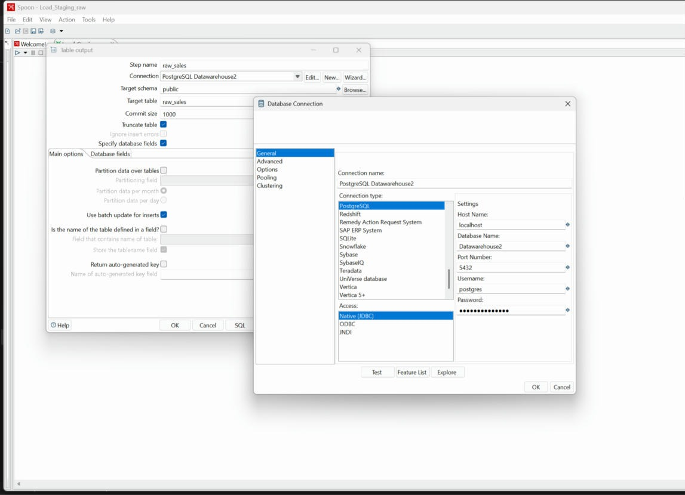](figuras/fig07_conexion_postgresql.jpg)

**Figura 7.** Conexión PostgreSQL Datawarehouse2 en Spoon; la contraseña se toma de la variable PG_PASSWORD. Archivo: [fig07_conexion_postgresql.jpg](figuras/fig07_conexion_postgresql.jpg)

### 4.2. Transformación Load_Staging_raw

La transformación [01_Load_Staging_raw.ktr](transformaciones/01_Load_Staging_raw.ktr) tiene los dos pasos de la guía: CSV file input y Table output hacia `raw_sales` [1]. La Tabla 5 resume su configuración y las Figuras 8 a 10 la muestran.

**Tabla 5.** Configuración de la carga a staging

| Paso | Configuración |
|---|---|
| CSV file input | Archivo `ventas_1000.csv` con ruta relativa, delimitador coma, encabezado activado y codificación UTF-8. `income` y `quantity` como Integer, `order_date` como Date con formato `yyyy-MM-dd`, y `unit_price` y `sales_amount` como BigNumber para no perder precisión en los decimales |
| Table output `raw_sales` | Tabla destino `public.raw_sales`, Truncate table activado para que cada ejecución reemplace los datos, y Specify database fields con los 13 campos mapeados uno a uno |

[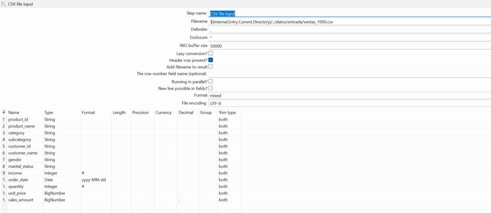](figuras/fig08_csv_file_input.jpg)

**Figura 8.** Paso CSV file input con la ruta relativa de ventas_1000.csv y el tipo de cada campo. Archivo: [fig08_csv_file_input.jpg](figuras/fig08_csv_file_input.jpg)

[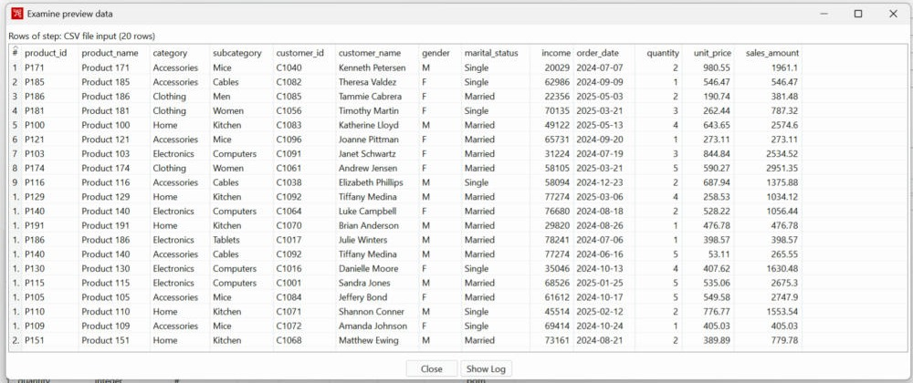](figuras/fig09_vista_previa_csv.jpg)

**Figura 9.** Vista previa de las primeras 20 filas leídas por el CSV file input. Archivo: [fig09_vista_previa_csv.jpg](figuras/fig09_vista_previa_csv.jpg)

[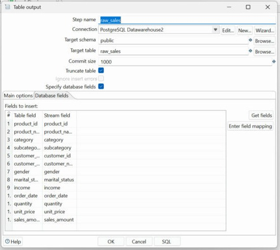](figuras/fig10_table_output_raw_sales.jpg)

**Figura 10.** Paso Table output raw_sales con Truncate table y el mapeo de los 13 campos. Archivo: [fig10_table_output_raw_sales.jpg](figuras/fig10_table_output_raw_sales.jpg)

La Figura 11 muestra la ejecución: el CSV file input lee 1001 líneas, que son el encabezado y las 1000 ventas, y el paso `raw_sales` escribe 1000 filas. Es el mismo resultado de la captura de la guía [1]. La Figura 12 muestra las métricas por paso, sin errores.

[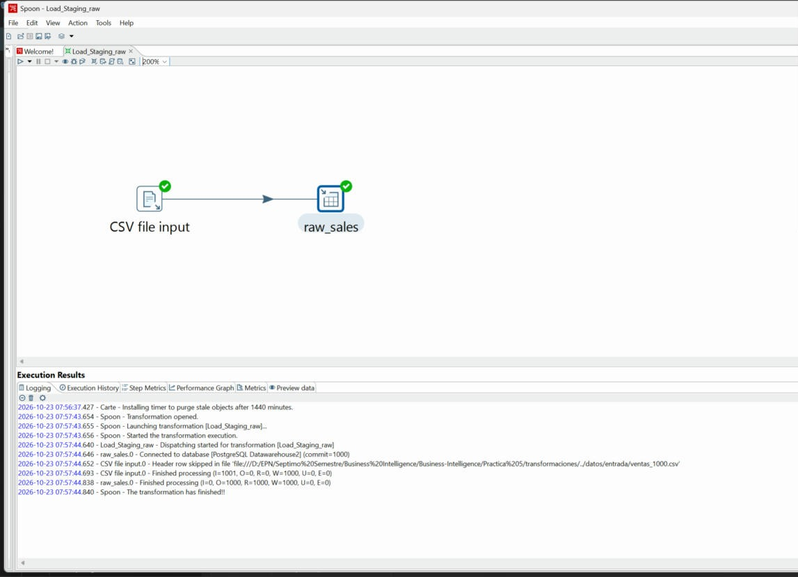](figuras/fig11_ejecucion_staging.jpg)

**Figura 11.** Ejecución de Load_Staging_raw: se leen 1001 líneas y se escriben 1000 filas en raw_sales. Archivo: [fig11_ejecucion_staging.jpg](figuras/fig11_ejecucion_staging.jpg)

[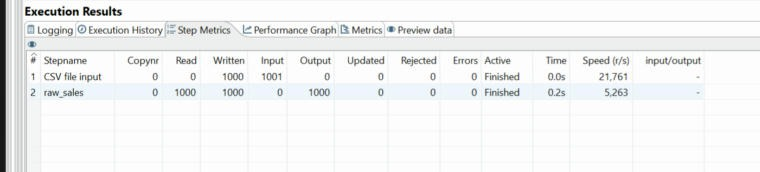](figuras/fig12_metricas_staging.jpg)

**Figura 12.** Step Metrics de Load_Staging_raw sin errores. Archivo: [fig12_metricas_staging.jpg](figuras/fig12_metricas_staging.jpg)

---

## 5. Transformación de dimensiones

### 5.1. Dimensión de productos

La transformación [02_Load_dim_product.ktr](transformaciones/02_Load_dim_product.ktr) sigue los pasos de la guía, Table input, Select values, Unique rows y Table output, y agrega un paso Sort rows antes de Unique rows por la razón explicada en la sección 2.3. La Tabla 6 compara el flujo de la guía con el implementado.

**Tabla 6.** Flujo de la dimensión de productos

| Paso | Guía | Implementado |
|---|---|---|
| Table input | `SELECT product_id, product_name, category, subcategory FROM raw_sales;` | Igual |
| Select values | Los cuatro campos | Igual |
| Sort rows | No existe | Ordena por `product_id`, `product_name`, `category` y `subcategory` |
| Unique rows | Compara `product_id` | Compara los cuatro campos |
| Table output | `dim_product` con los cuatro campos mapeados | Igual, con Truncate table activado |

Las Figuras 13 a 16 muestran la configuración de los pasos y la Figura 17 la ejecución: el paso Unique rows recibe 1000 filas y deja pasar 541, que se insertan en `dim_product`.

[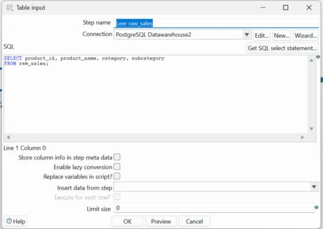](figuras/fig13_table_input_dim_product.jpg)

**Figura 13.** Paso Leer raw_sales con la consulta de la guía para productos. Archivo: [fig13_table_input_dim_product.jpg](figuras/fig13_table_input_dim_product.jpg)

[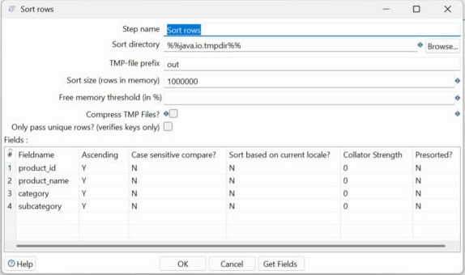](figuras/fig14_sort_rows_dim_product.jpg)

**Figura 14.** Paso Sort rows agregado antes de Unique rows, ordenado por los cuatro atributos del producto. Archivo: [fig14_sort_rows_dim_product.jpg](figuras/fig14_sort_rows_dim_product.jpg)

[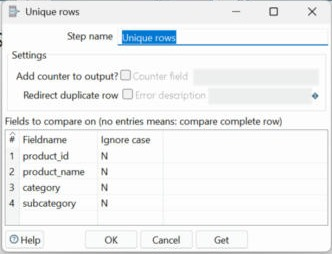](figuras/fig15_unique_rows_dim_product.jpg)

**Figura 15.** Paso Unique rows que compara product_id, product_name, category y subcategory. Archivo: [fig15_unique_rows_dim_product.jpg](figuras/fig15_unique_rows_dim_product.jpg)

[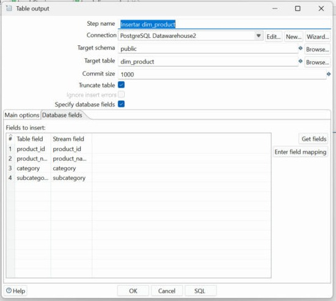](figuras/fig16_table_output_dim_product.jpg)

**Figura 16.** Paso Insertar dim_product con el mapeo de los cuatro campos de la guía. Archivo: [fig16_table_output_dim_product.jpg](figuras/fig16_table_output_dim_product.jpg)

[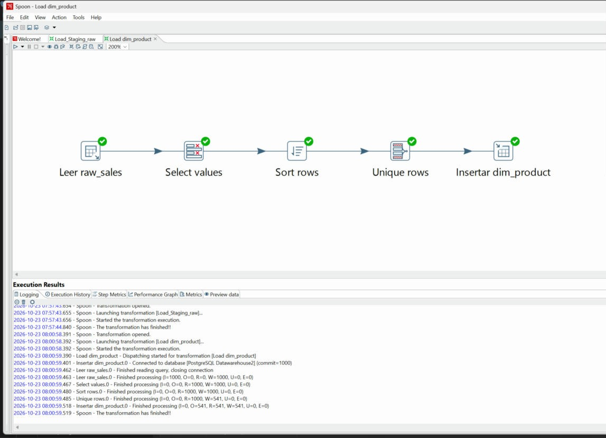](figuras/fig17_ejecucion_dim_product.jpg)

**Figura 17.** Ejecución de Load dim_product: 1000 filas leídas y 541 insertadas. Archivo: [fig17_ejecucion_dim_product.jpg](figuras/fig17_ejecucion_dim_product.jpg)

### 5.2. Dimensión de clientes

La transformación [03_Load_dim_customer.ktr](transformaciones/03_Load_dim_customer.ktr) tiene la misma estructura. Unique rows compara solo `customer_id`, como indica la guía, porque los atributos de cada cliente son siempre los mismos, y el paso Sort rows ordena por `customer_id`. Las Figuras 18 y 19 muestran la consulta y la comparación, y la Figura 20 la ejecución, con 100 clientes insertados.

[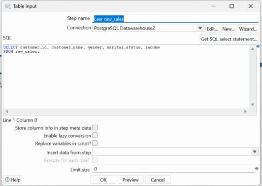](figuras/fig18_table_input_dim_customer.jpg)

**Figura 18.** Paso Leer raw_sales con la consulta de la guía para clientes. Archivo: [fig18_table_input_dim_customer.jpg](figuras/fig18_table_input_dim_customer.jpg)

[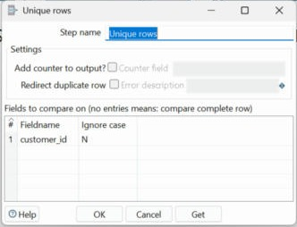](figuras/fig19_unique_rows_dim_customer.jpg)

**Figura 19.** Paso Unique rows que compara customer_id, como indica la guía. Archivo: [fig19_unique_rows_dim_customer.jpg](figuras/fig19_unique_rows_dim_customer.jpg)

[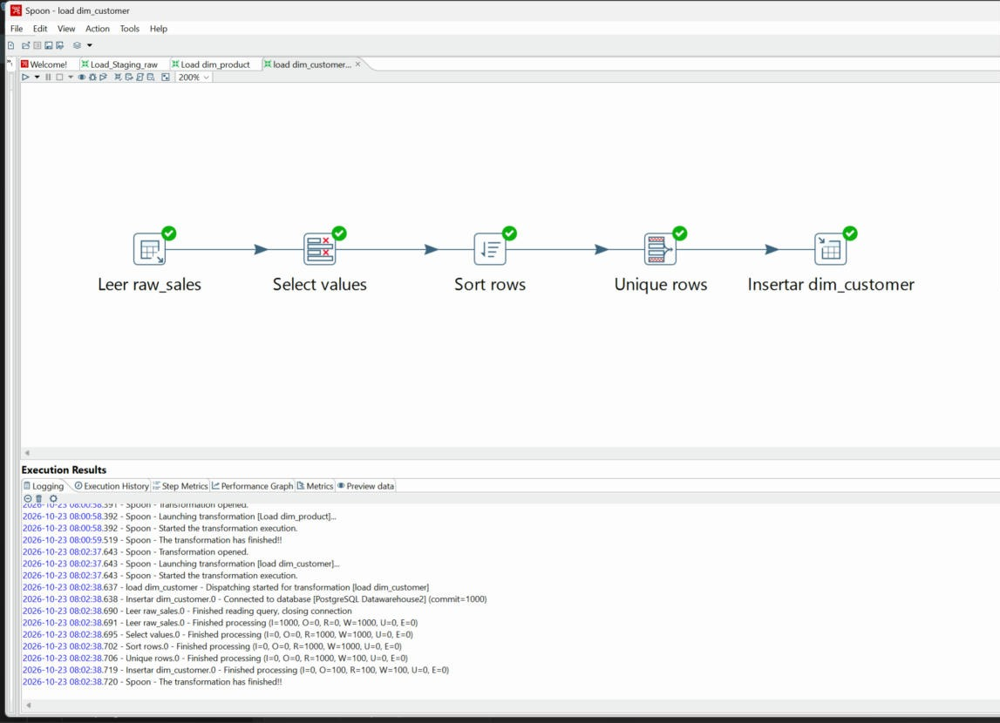](figuras/fig20_ejecucion_dim_customer.jpg)

**Figura 20.** Ejecución de load dim_customer: 1000 filas leídas y 100 insertadas. Archivo: [fig20_ejecucion_dim_customer.jpg](figuras/fig20_ejecucion_dim_customer.jpg)

### 5.3. Dimensión de tiempo

La transformación [04_Load_dim_date.ktr](transformaciones/04_Load_dim_date.ktr) lee las fechas distintas con `SELECT DISTINCT order_date FROM raw_sales;` y calcula los atributos con un paso Calculator, como muestra la Figura 21. Después, el paso Select values de la Figura 22 renombra `order_date` como `date_key` y deja solo los cinco campos de la tabla. La Tabla 7 resume los cálculos.

**Tabla 7.** Cálculos del paso Calculator

| Campo | Cálculo de Pentaho | Campo A | Tipo |
|---|---|---|---|
| `year` | Year of date A | `order_date` | Integer |
| `month` | Month of date A | `order_date` | Integer |
| `day` | Day of month of date A | `order_date` | Integer |
| `quarter` | Quarter of date A | `order_date` | Integer |

La columna `quarter` es `VARCHAR(5)` en el DDL de la guía y el Calculator produce un entero. PostgreSQL convierte el entero a texto al insertarlo, así que la carga funciona sin pasos adicionales y la columna queda con los valores 1 a 4.

[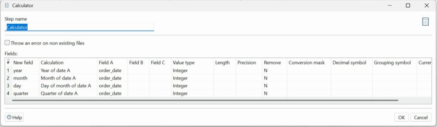](figuras/fig21_calculator_dim_date.jpg)

**Figura 21.** Paso Calculator con año, mes, día y trimestre calculados desde order_date. Archivo: [fig21_calculator_dim_date.jpg](figuras/fig21_calculator_dim_date.jpg)

[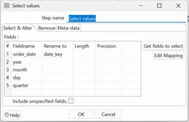](figuras/fig22_select_values_dim_date.jpg)

**Figura 22.** Paso Select values que renombra order_date como date_key. Archivo: [fig22_select_values_dim_date.jpg](figuras/fig22_select_values_dim_date.jpg)

La Figura 23 muestra la ejecución, con 339 fechas insertadas, el mismo número de la captura de la guía [1].

[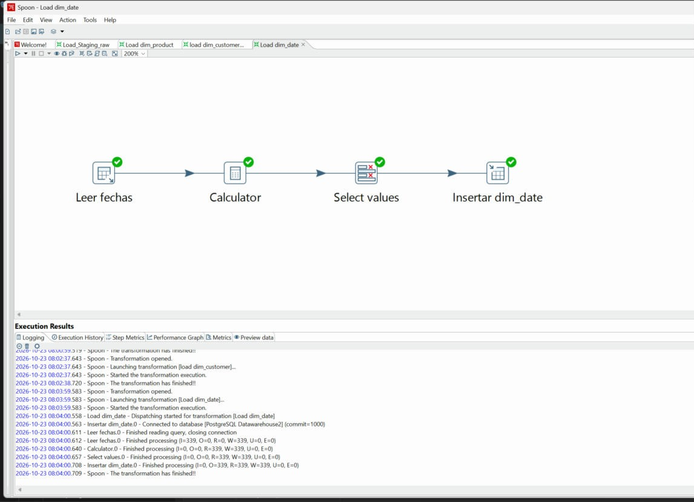](figuras/fig23_ejecucion_dim_date.jpg)

**Figura 23.** Ejecución de Load dim_date: 339 fechas distintas insertadas. Archivo: [fig23_ejecucion_dim_date.jpg](figuras/fig23_ejecucion_dim_date.jpg)

---

## 6. Transformación de la tabla de hechos

La transformación [05_Load_fact_sales.ktr](transformaciones/05_Load_fact_sales.ktr) lee las ventas de `raw_sales`, reemplaza los identificadores del sistema origen por las claves sustitutas de las dimensiones con tres pasos Stream lookup y carga las medidas en `fact_sales` [1], [2]. La Tabla 8 resume cada búsqueda.

**Tabla 8.** Búsquedas de claves en la tabla de hechos

| Paso | Flujo de referencia | Claves de búsqueda | Campo devuelto |
|---|---|---|---|
| Buscar product_key | `SELECT product_id, category, subcategory, product_key FROM dim_product;` | `product_id`, `category`, `subcategory` | `product_key` |
| Buscar customer_key | `SELECT customer_id, customer_key FROM dim_customer;` | `customer_id` | `customer_key` |
| Buscar date_key | `SELECT date_key FROM dim_date;` | `order_date` igual a `date_key` | `date_key` |

La única diferencia con la guía está en la búsqueda del producto. La guía busca solo por `product_id`, pero como la dimensión tiene varias filas por producto, el Table input principal de la Figura 24 también lee `category` y `subcategory`, y la búsqueda de la Figura 25 usa los tres campos. Así cada venta recibe la clave de la combinación exacta que registró. La búsqueda de la fecha de la Figura 26 sigue la guía sin cambios. Al final, un Select values deja solo `product_key`, `customer_key`, `date_key`, `quantity`, `unit_price` y `sales_amount`, y el Table output los inserta en `fact_sales`.

[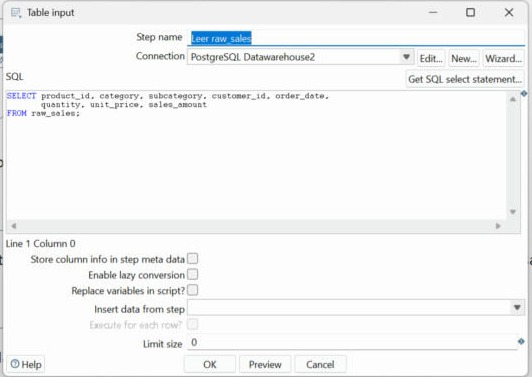](figuras/fig24_table_input_fact_sales.jpg)

**Figura 24.** Paso Leer raw_sales de la tabla de hechos, que incluye category y subcategory para la búsqueda del producto. Archivo: [fig24_table_input_fact_sales.jpg](figuras/fig24_table_input_fact_sales.jpg)

[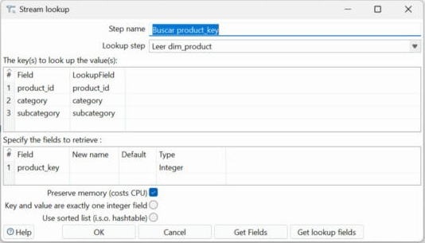](figuras/fig25_stream_lookup_product_key.jpg)

**Figura 25.** Paso Buscar product_key con las claves product_id, category y subcategory. Archivo: [fig25_stream_lookup_product_key.jpg](figuras/fig25_stream_lookup_product_key.jpg)

[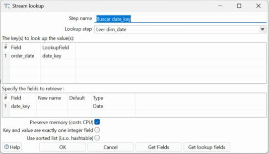](figuras/fig26_stream_lookup_date_key.jpg)

**Figura 26.** Paso Buscar date_key con la relación order_date igual a date_key. Archivo: [fig26_stream_lookup_date_key.jpg](figuras/fig26_stream_lookup_date_key.jpg)

La Figura 27 muestra la ejecución: las tres búsquedas procesan 1000 filas y se insertan 1000 hechos.

[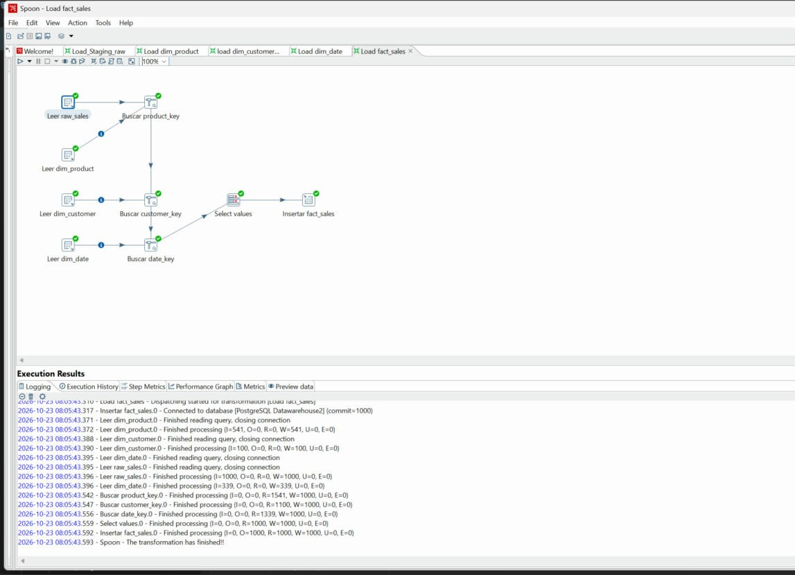](figuras/fig27_ejecucion_fact_sales.jpg)

**Figura 27.** Ejecución de Load fact_sales: 1000 filas insertadas en la tabla de hechos. Archivo: [fig27_ejecucion_fact_sales.jpg](figuras/fig27_ejecucion_fact_sales.jpg)

---

## 7. Job ETL y ejecución completa

El job [etl_job_sales.kjb](transformaciones/etl_job_sales.kjb) encadena las cinco transformaciones en el orden de la guía: Carga a staging, Carga dim_product, Carga dim_customer, Carga dim_date y Carga fact_sales. Cada salto se ejecuta solo si la transformación anterior termina con éxito, así que un error detiene el proceso antes de cargar datos incompletos. Antes de ejecutarlo se eligió Carga a staging como entrada de inicio en las opciones de ejecución, como pide la guía y muestra la Figura 28 [1].

[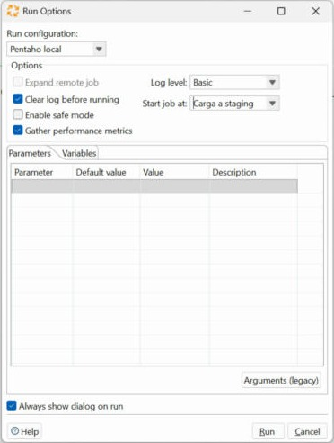](figuras/fig28_opciones_job_inicio_staging.jpg)

**Figura 28.** Run Options del job con Carga a staging como entrada de inicio. Archivo: [fig28_opciones_job_inicio_staging.jpg](figuras/fig28_opciones_job_inicio_staging.jpg)

La Figura 29 muestra el job terminado, con todas las entradas en verde, y la Figura 30 las métricas, donde cada transformación termina con resultado Success.

[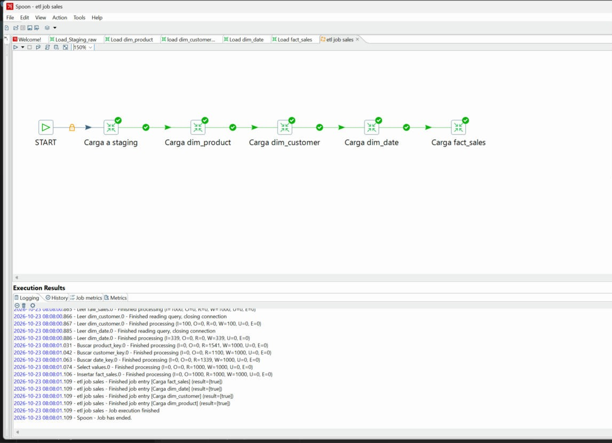](figuras/fig29_ejecucion_job.jpg)

**Figura 29.** Job etl job sales ejecutado completo, con todas las entradas en verde. Archivo: [fig29_ejecucion_job.jpg](figuras/fig29_ejecucion_job.jpg)

[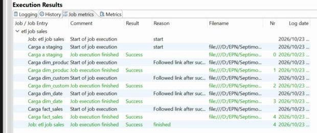](figuras/fig30_metricas_job.jpg)

**Figura 30.** Job metrics: cada transformación termina con resultado Success. Archivo: [fig30_metricas_job.jpg](figuras/fig30_metricas_job.jpg)

Cada Table output tiene Truncate table activado, de modo que el job se puede ejecutar varias veces sin duplicar filas. `TRUNCATE` no reinicia las secuencias de las columnas `SERIAL` [4], así que después de la ejecución del job las claves sustitutas continúan desde donde quedaron en la ejecución individual de cada transformación. Por eso en la sección 8 aparecen claves como 923 o 1001. Esto no afecta al análisis, porque la tabla de hechos se recarga en la misma ejecución con las claves vigentes de las dimensiones.

---

## 8. Comprobación en PostgreSQL

Las consultas de esta sección están en [02_verificacion_resultados.sql](sql/02_verificacion_resultados.sql) y se ejecutaron en el Query Tool de `Datawarehouse2` después del job.

### 8.1. Conteos y calidad de la carga

La Figura 31 muestra el número de filas de cada tabla y la Figura 32 los valores distintos de `raw_sales`, que explican esos números. La Figura 33 muestra las seis filas del producto P186 en `dim_product`, cada una con una combinación distinta de categoría y subcategoría.

[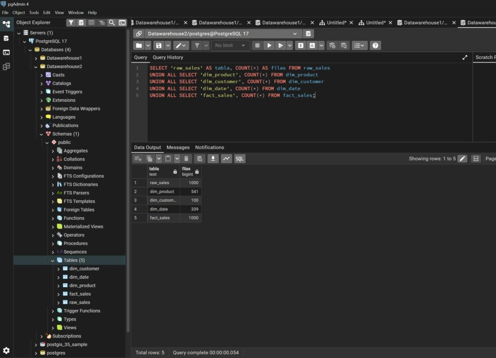](figuras/fig31_conteo_tablas.jpg)

**Figura 31.** Número de filas de raw_sales, de las tres dimensiones y de fact_sales. Archivo: [fig31_conteo_tablas.jpg](figuras/fig31_conteo_tablas.jpg)

[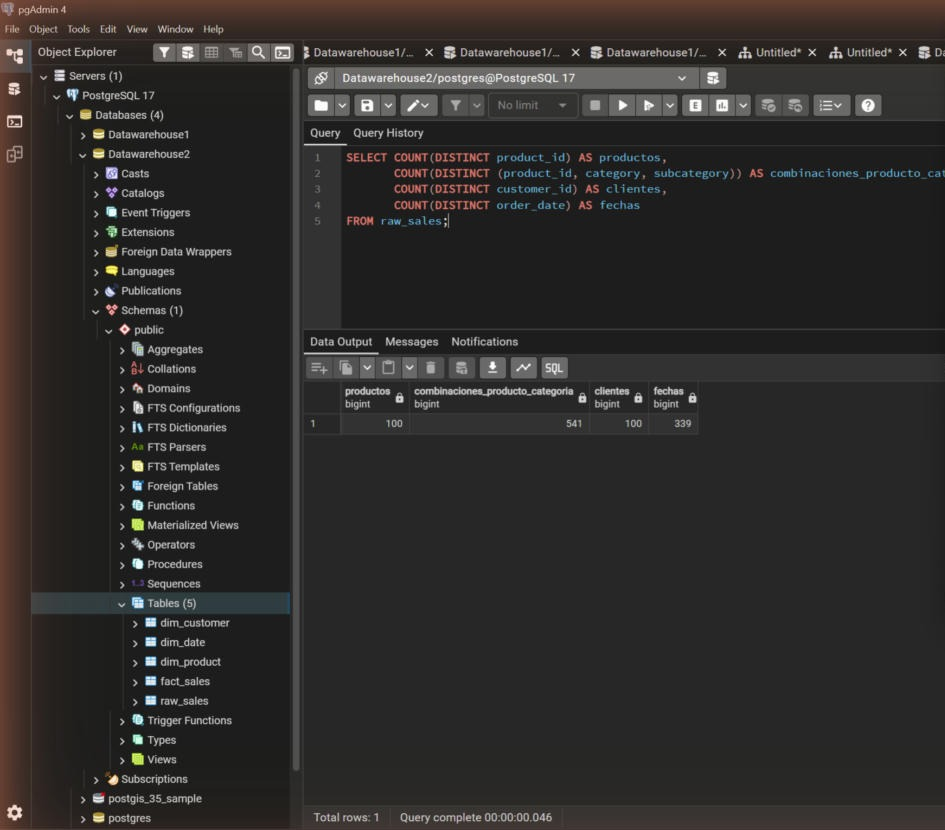](figuras/fig32_perfil_raw_sales.jpg)

**Figura 32.** Valores distintos en raw_sales: 100 productos, 541 combinaciones de producto y categoría, 100 clientes y 339 fechas. Archivo: [fig32_perfil_raw_sales.jpg](figuras/fig32_perfil_raw_sales.jpg)

[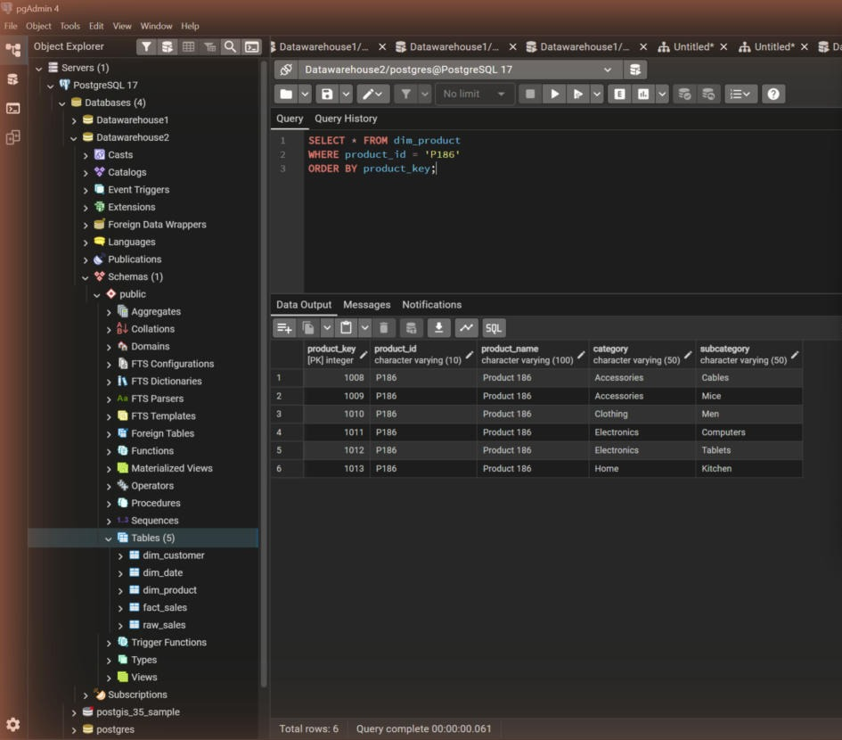](figuras/fig33_producto_P186_en_dim_product.jpg)

**Figura 33.** El producto P186 aparece en seis combinaciones de categoría y subcategoría. Archivo: [fig33_producto_P186_en_dim_product.jpg](figuras/fig33_producto_P186_en_dim_product.jpg)

La Figura 34 comprueba que ningún hecho quedó sin clave y que las ventas y las unidades de `fact_sales` son las mismas que las de `raw_sales`. La Figura 35 hace la misma comparación por categoría. La Tabla 9 resume los dos controles.

[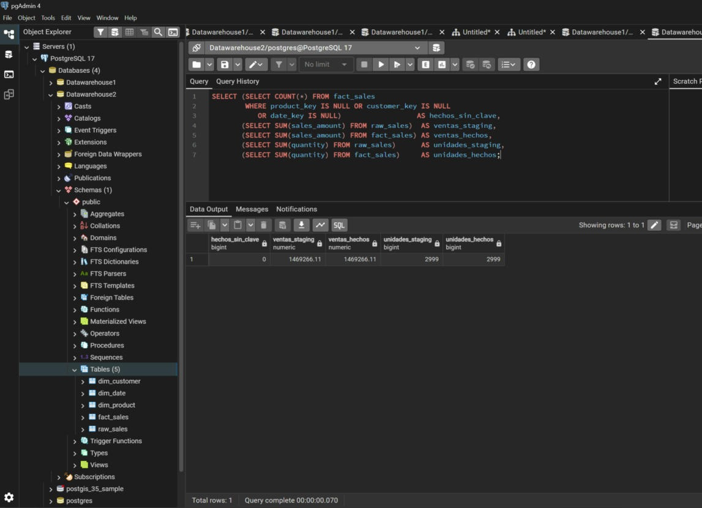](figuras/fig34_conciliacion_staging_hechos.jpg)

**Figura 34.** Ningún hecho sin clave y mismas ventas y unidades en raw_sales y fact_sales. Archivo: [fig34_conciliacion_staging_hechos.jpg](figuras/fig34_conciliacion_staging_hechos.jpg)

[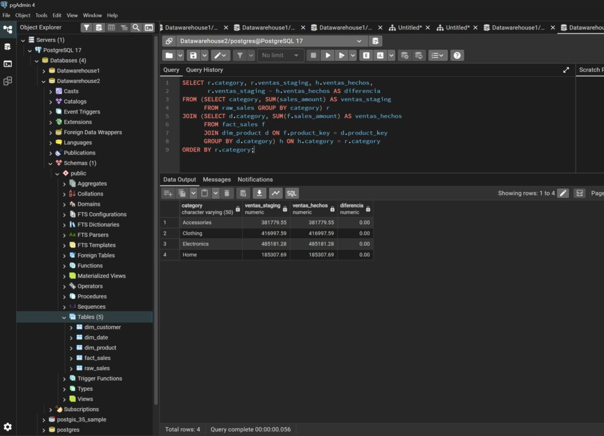](figuras/fig35_conciliacion_por_categoria.jpg)

**Figura 35.** Ventas por categoría en raw_sales y en fact_sales, con diferencia cero. Archivo: [fig35_conciliacion_por_categoria.jpg](figuras/fig35_conciliacion_por_categoria.jpg)

**Tabla 9.** Conciliación entre staging y la tabla de hechos

| Control | `raw_sales` | `fact_sales` | Diferencia |
|---|---|---|---|
| Filas | 1000 | 1000 | 0 |
| Hechos sin clave de producto, cliente o fecha | No aplica | 0 | 0 |
| Unidades | 2999 | 2999 | 0 |
| Ventas totales | 1 469 266.11 | 1 469 266.11 | 0 |
| Ventas de Accessories | 381 779.55 | 381 779.55 | 0 |
| Ventas de Clothing | 416 997.59 | 416 997.59 | 0 |
| Ventas de Electronics | 485 181.28 | 485 181.28 | 0 |
| Ventas de Home | 185 307.69 | 185 307.69 | 0 |

La diferencia cero por categoría es la prueba de que el diseño de la sección 2.3 funciona. Con una sola fila por `product_id` las ventas totales también coincidirían, pero el reparto entre categorías no.

Por último, la Figura 36 muestra el resultado de `SELECT * FROM fact_sales LIMIT 10`, que pide la guía [1]. Cada fila tiene las tres claves y las tres medidas.

[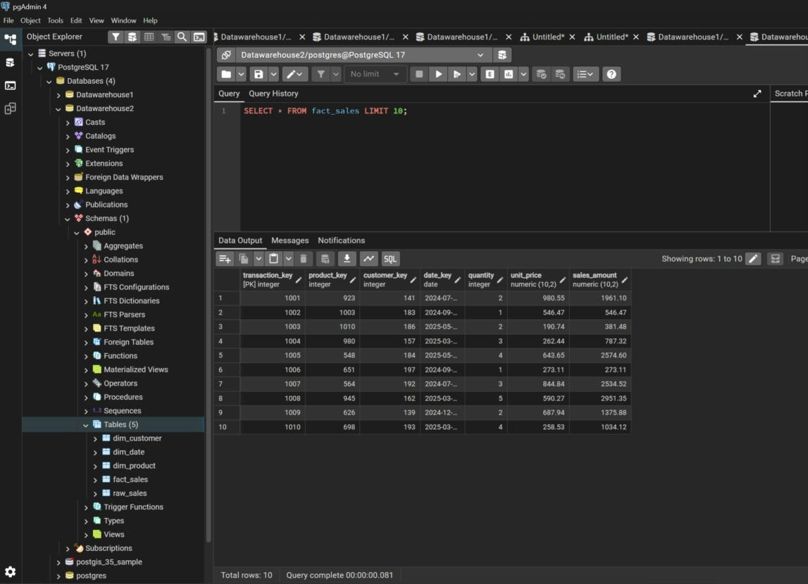](figuras/fig36_muestra_fact_sales.jpg)

**Figura 36.** Resultado de SELECT * FROM fact_sales LIMIT 10. Archivo: [fig36_muestra_fact_sales.jpg](figuras/fig36_muestra_fact_sales.jpg)

### 8.2. Consulta de comprobación de la guía

La Figura 37 muestra la consulta de comprobación de la guía, que suma `sales_amount` por categoría y mes [1]. Devuelve 48 filas, cuatro categorías por doce meses.

[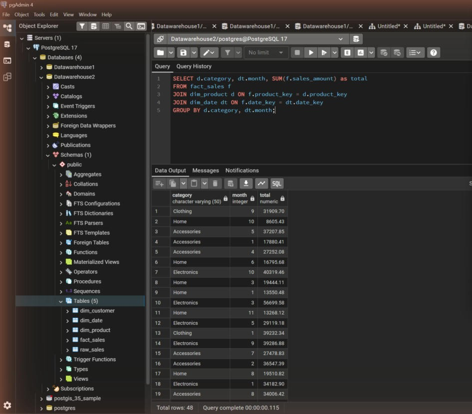](figuras/fig37_consulta_comprobacion_guia.jpg)

**Figura 37.** Consulta de comprobación de la guía: total vendido por categoría y mes, 48 filas. Archivo: [fig37_consulta_comprobacion_guia.jpg](figuras/fig37_consulta_comprobacion_guia.jpg)

Esta consulta agrupa solo por el número de mes, y el archivo cubre desde el 13 de mayo de 2024 hasta el 13 de mayo de 2025. Por eso el mes 5 suma ventas de dos años distintos. Por ejemplo, el total de 37 207.85 de Accessories en el mes 5 se compone de 25 992.56 de mayo de 2024 y 11 215.29 de mayo de 2025. Además, la consulta suma importes pero no cuenta ventas, que es lo que pregunta la pregunta 1. Por estas dos razones la pregunta se responde con la consulta de la sección 8.3.

### 8.3. Ventas por mes y categoría

La consulta de la Figura 38 agrupa por año, mes y categoría, y devuelve el número de ventas y el total vendido. Son 52 filas, cuatro categorías en cada uno de los 13 meses del período. El resultado completo está en [consulta1_ventas_por_anio_mes_y_categoria.csv](datos/salida/consulta1_ventas_por_anio_mes_y_categoria.csv).

[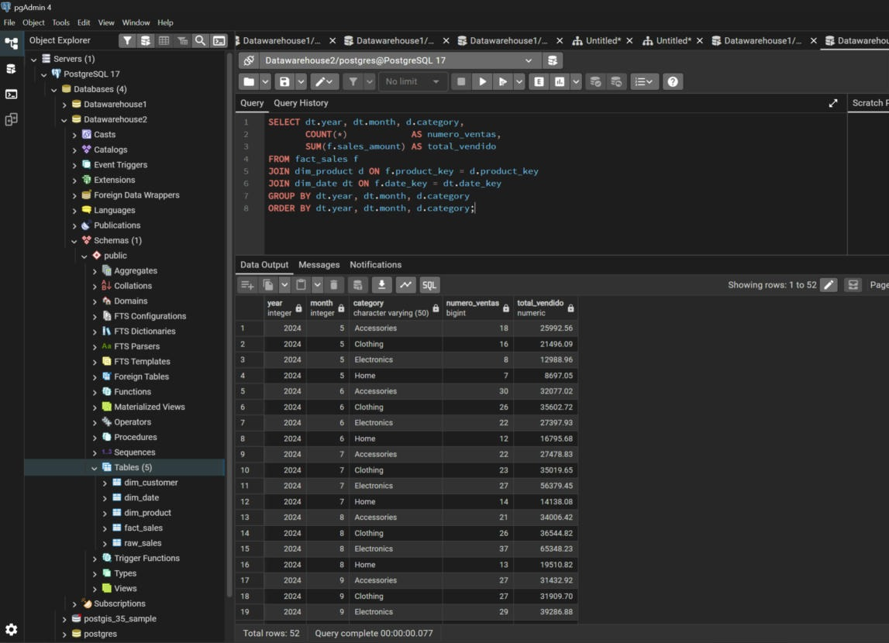](figuras/fig38_ventas_por_mes_y_categoria.jpg)

**Figura 38.** Número de ventas y total vendido por año, mes y categoría, 52 filas. Archivo: [fig38_ventas_por_mes_y_categoria.jpg](figuras/fig38_ventas_por_mes_y_categoria.jpg)

La Tabla 10 resume el resultado por categoría.

**Tabla 10.** Ventas por categoría en todo el período

| Categoría | Número de ventas | Total vendido | Porcentaje de las ventas totales |
|---|---|---|---|
| Electronics | 295 | 485 181.28 | 33.0 % |
| Clothing | 288 | 416 997.59 | 28.4 % |
| Accessories | 279 | 381 779.55 | 26.0 % |
| Home | 138 | 185 307.69 | 12.6 % |
| **Total** | **1000** | **1 469 266.11** | **100 %** |

La Tabla 11 resume el resultado por mes.

**Tabla 11.** Número de ventas y total vendido por mes

| Año | Mes | Número de ventas | Total vendido |
|---|---|---|---|
| 2024 | Mayo, desde el día 13 | 49 | 69 174.66 |
| 2024 | Junio | 90 | 111 873.35 |
| 2024 | Julio | 86 | 133 016.01 |
| 2024 | Agosto | 97 | 155 410.29 |
| 2024 | Septiembre | 91 | 114 353.28 |
| 2024 | Octubre | 74 | 111 333.75 |
| 2024 | Noviembre | 86 | 126 314.36 |
| 2024 | Diciembre | 79 | 127 429.78 |
| 2025 | Enero | 76 | 104 846.13 |
| 2025 | Febrero | 71 | 113 696.82 |
| 2025 | Marzo | 80 | 140 890.44 |
| 2025 | Abril | 82 | 116 482.39 |
| 2025 | Mayo, hasta el día 13 | 39 | 44 444.85 |
| **Total** | | **1000** | **1 469 266.11** |

Electronics es la categoría con más ventas y con mayor ingreso, y Home la de menos, con menos de la mitad de ventas que cualquier otra. Agosto de 2024 es el mes con más ventas, 97, y con el mayor total vendido. Los meses de mayo tienen menos ventas porque solo cubren parte del mes.

### 8.4. Ventas por cliente y género

La consulta de la Figura 39 suma lo vendido a cada cliente y muestra su género. Devuelve los 100 clientes ordenados de mayor a menor, y el resultado completo está en [consulta2_ventas_por_cliente_y_genero.csv](datos/salida/consulta2_ventas_por_cliente_y_genero.csv). La Tabla 12 muestra los cinco clientes con más compras.

[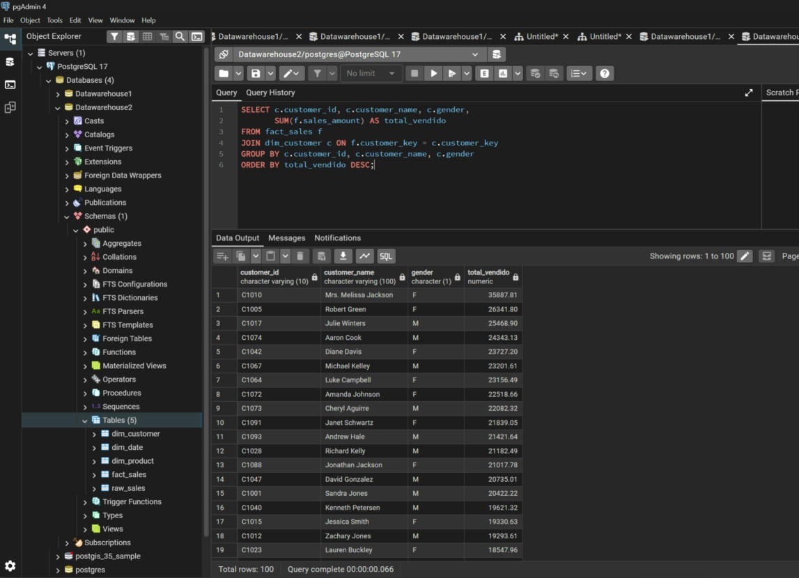](figuras/fig39_ventas_por_cliente_y_genero.jpg)

**Figura 39.** Total vendido a cada cliente con su género, 100 filas ordenadas de mayor a menor. Archivo: [fig39_ventas_por_cliente_y_genero.jpg](figuras/fig39_ventas_por_cliente_y_genero.jpg)

**Tabla 12.** Clientes con mayor total vendido

| Cliente | Nombre | Género | Total vendido |
|---|---|---|---|
| C1010 | Mrs. Melissa Jackson | F | 35 887.81 |
| C1005 | Robert Green | F | 26 341.80 |
| C1017 | Julie Winters | M | 25 468.90 |
| C1074 | Aaron Cook | M | 24 343.13 |
| C1042 | Diane Davis | F | 23 727.20 |

La consulta de la Figura 40 agrega el resultado por género, y la Tabla 13 lo resume.

[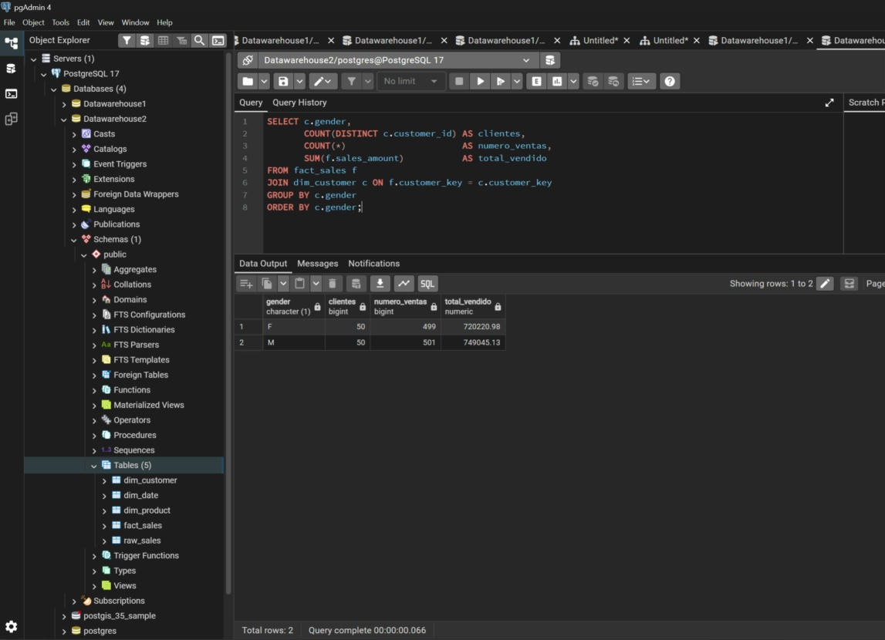](figuras/fig40_ventas_por_genero.jpg)

**Figura 40.** Clientes, número de ventas y total vendido por género. Archivo: [fig40_ventas_por_genero.jpg](figuras/fig40_ventas_por_genero.jpg)

**Tabla 13.** Ventas por género

| Género | Clientes | Número de ventas | Total vendido | Promedio por cliente |
|---|---|---|---|---|
| F | 50 | 499 | 720 220.98 | 14 404.42 |
| M | 50 | 501 | 749 045.13 | 14 980.90 |
| **Total** | **100** | **1000** | **1 469 266.11** | |

Los clientes de género M compran algo más que los de género F: 28 824.15 más en total, un 4.0 % más por cliente en promedio, con prácticamente el mismo número de ventas. La diferencia es pequeña, así que el género no parece un factor decisivo en el ingreso de la tienda.

En el archivo, el género no siempre corresponde con el nombre del cliente. Por ejemplo, Robert Green figura con género F y Julie Winters con M. No se corrigió porque no existe una regla confiable para hacerlo y la guía no pide limpiar ese campo, pero se deja señalado porque afecta la interpretación de la Tabla 13.

---

## 9. Validación independiente

El script [validar_resultados.py](validacion/validar_resultados.py) recalcula en Python, solo con la biblioteca estándar y a partir de `ventas_1000.csv`, todo lo que se obtuvo con Pentaho y PostgreSQL, y lo compara con los CSV de [datos/salida](datos/salida/). La Tabla 14 resume los controles.

**Tabla 14.** Controles del script de validación

| Control | Resultado |
|---|---|
| 1000 ventas y `sales_amount` igual a `quantity` por `unit_price` en todas | Correcto |
| 541 combinaciones de producto, 100 clientes y 339 fechas | Correcto |
| Unique rows sin ordenar deja 989 productos y 990 clientes, como en la guía | Correcto |
| Con una categoría por `product_id`, 562 ventas cambian de categoría | Correcto |
| Consulta de comprobación de la guía, consulta de ventas por mes y categoría, y consultas por cliente y por género | Coinciden con los CSV de salida |
| Conciliación por categoría | Diferencia cero en las cuatro categorías |

Para ejecutarlo, desde la raíz del repositorio:

```bat
python "Practica 5\validacion\validar_resultados.py"
```

El script termina con el mensaje `Validacion correcta` cuando todos los controles pasan.

---

## 10. Conclusiones

El proceso ETL quedó implementado de punta a punta con Pentaho: una transformación lleva el CSV a staging sin cambios, tres transformaciones construyen las dimensiones, una carga la tabla de hechos con las claves sustitutas y un job las ejecuta en orden, deteniéndose si alguna falla. El resultado en `Datawarehouse2` concilia exactamente con el archivo de origen: 1000 ventas, 2999 unidades y 1 469 266.11 en ventas, también por categoría.

Seguir la guía al pie de la letra habría producido un data warehouse con errores. El paso Unique rows necesita datos ordenados, y sin un Sort rows previo deja 989 productos y 990 clientes donde solo hay 100 de cada uno. Además, un mismo producto aparece con varias categorías en las ventas, y una dimensión con una sola fila por producto habría cambiado la categoría de 562 ventas. Guardar una fila por combinación de producto y categoría, y buscar la clave con esos campos, mantiene correcta la respuesta a la pregunta de ventas por categoría.

La consulta de comprobación de la guía agrupa solo por mes y suma en el mes 5 ventas de mayo de 2024 y de mayo de 2025. Para responder la pregunta de negocio fue necesario agrupar también por año y contar las ventas además de sumarlas. Con ese ajuste, Electronics resulta la categoría más vendida y agosto de 2024 el mes con más ventas. Por género, los clientes M y F generan totales parecidos, con una diferencia de 4.0 % en el promedio por cliente.

---

## 11. Referencias

[1] Escuela Politécnica Nacional, Facultad de Ingeniería de Sistemas, "Práctica 5. Creación de un data warehouse," guía de práctica de la asignatura Business Intelligence, Quito, Ecuador, 2026.

[2] R. Kimball y M. Ross, *The Data Warehouse Toolkit: The Definitive Guide to Dimensional Modeling*, 3.ª ed. Indianapolis, IN, EE. UU.: Wiley, 2013.

[3] Hitachi Vantara, "Unique Rows," *Pentaho Data Integration Documentation*. [En línea]. Disponible en: https://docs.pentaho.com/pdia-data-integration/pdi-transformation-steps-reference-overview/unique-rows. [Accedido: 23-oct-2026].

[4] PostgreSQL Global Development Group, "TRUNCATE," *PostgreSQL 17 Documentation*. [En línea]. Disponible en: https://www.postgresql.org/docs/17/sql-truncate.html. [Accedido: 23-oct-2026].

---

## 12. Declaración de uso de inteligencia artificial

En la elaboración de este trabajo se utilizó el asistente de inteligencia artificial Claude como apoyo en el análisis de la guía y del archivo de datos. 
La construcción y la ejecución de las transformaciones y del job en Spoon, la ejecución de las consultas en pgAdmin, la escritura del script de validación, las decisiones de diseño y la revisión final fueron del grupo.

**Porcentaje de uso de inteligencia artificial: 20 %**
